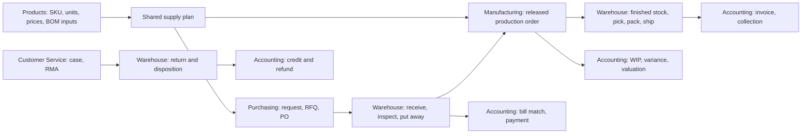

# IronStone BOSS — Core applications crosscut design

Oct 27, 2026 — draft

This is the common business-screen and process design for Products, Warehouse, Manufacturing,
Purchasing, Customer Service and Accounting. It incorporates the existing Commons, Comms and
Projects contracts. Each app stands alone for its audience; shared screens are mounted inside
that app with its context, without requiring access to another app. This phase does not design
the remaining apps, but preserves extension points for them.

**Inputs.** [initial-design.md](initial-design.md), [design-doc-guide.md](design-doc-guide.md),
[style-guide.md](style-guide.md), [research-crosscut.md](research-crosscut.md), the six matching
research files, [design-drawers-commons.md](design-drawers-commons.md),
[design-projects.md](design-projects.md), [ss-inventory.md](ss-inventory.md) and
[usl-inventory.md](usl-inventory.md). Current source takes precedence over research-era claims
that a capability is absent. Proposed additions below are specifications, not implemented APIs.

**Sections.** [1 conventions](#1-conventions-and-authority) · [2 registry](#2-shared-screen-registry) ·
[3 screens](#3-shared-business-screens) · [4 processes](#4-cross-app-process-contracts) ·
[5 access](#5-external-access-and-shared-configuration) · [6 validation](#6-end-to-end-acceptance) ·
[7 needs](#7-framework-and-data-needs) · [8 decided](#8-decided) · [9 open](#9-open)

**Source paths.** Baseline screen paths below are relative to
`mr-moqui/runtime/component/mr-marble/screen/SimpleScreens/`, with `BasicHandheld/` a sibling.
Mantle source paths are relative to `mr-moqui/runtime/component/mr-mantle/`. Third-party paths
start at `~/work/moquiwork/3p_other/`; Odoo's app path is `odoo/odoo/addons/` and ERPNext's
is `frappe/erpnext/erpnext/`. Reference code is evidence for behavior; BOSS keeps its own
Moqui screen/service design.

## 1. Conventions and authority

### 1.1 One definition, contextual mounts

A shared screen is one `screen/Shared/<Name>.xml`, mounted through `subscreens-item location`.
The including root sets `appRoot`; server actions resolve the authenticated organization's
scope, roles, record visibility and permitted actions. Context specifies tabs, fixed filters
and emphasis, never grants authority. A supplied organization, customer, supplier or app name
cannot enlarge access. The same service authorization applies to direct requests and batch actions.

Screen paths, action names and shared model choices in this file are the integration contract.
App authors propose changes here rather than silently varying them. Existing paths of the
Projects and Commons PoCs remain valid. A screen's Context exposes canonical record identity,
selection and filters through the implemented context element; shell providers use that context.

### 1.2 Current capability and proposed work

The six app roots and section placeholders exist but are not complete applications. Their
`BOSS_PRODUCTS`, `BOSS_WAREHOUSE`, `BOSS_MANUFACTURING`, `BOSS_PURCHASING`,
`BOSS_CUSTOMER_SERVICE` and `BOSS_ACCOUNTING` grants remain an implementation concern.
Commons and Projects have working shared screens, intake, record links, calendars and time
services. The shared OrderDetail and InvoiceDetail currently implement Projects billing only;
the general contexts specified here extend them rather than treating them as already complete.

Verify names in active XML, excluding comments. In particular, old cost/configuration and
tax-rate definitions inside XML comments are design references, not runtime entities.
Use `parity` for baseline replacement, `new` for essential first-release additions, and `later`
for advanced functionality. All three receive an explicit design; `later` is not an omission.

### 1.3 Common interaction and transaction behavior

XML widgets first; use current list/board/tree/calendar capabilities before proposing new
widgets. A custom `.qvue` screen specifies its terminal twin and uses the existing `m-*` inputs.
Amounts retain currency and quantity retains UOM; server-side decimal arithmetic determines
totals and conversions. Lists distinguish empty, loading, failed and access-limited results.
Handheld operations show one task, scanned identity, quantity/UOM and an explicit confirmation.
They are online-first; an interrupted request is reconciled by its operation identity before retry.

Every stock or financial posting has a server operation identity, revalidates current status,
availability, permission and period, and atomically records its document links and movements.
Retries return the prior result instead of posting again. Posted movements are corrected by
linked reversals or adjustments, not deletion. Independent imported rows, supplier groups or
batch documents report named failures and continue; an internally dependent posting remains
atomic. A failed posting never displays success or advances its source document.

## 2. Shared-screen registry

These section numbers are stable across the six app designs. Contact, employee, request, task,
calendar, Chatter, files and approvals references keep their existing design owner.

| Screen | Path | Archetype | Impl | Purpose | Main record | Reused | Roles | Scope | Context |
| --- | --- | --- | --- | --- | --- | --- | --- | --- | --- |
| ContactDetail | Commons/Contacts/ContactDetail | detail | xml | Maintain the existing contact record | Party | Commons §6; §3.1 here | party readers | parity | Party partyId |
| Customer360 | Shared/Customer360 | 360 | xml | Customer operations and financial context | Party | own §3.2 | customer readers | parity | Party partyId |
| Supplier360 | Shared/Supplier360 | 360 | xml | Supplier sourcing, receipts and AP context | Party | own §3.3 | supplier readers | parity | Party partyId |
| PersonDetail | Projects/Resources/PersonDetail | detail | xml | Existing person/resource context; full Employee360 deferred | Party | Projects §9; §3.4 here | resource readers | parity | Party partyId |
| Product360 | Shared/Product360 | 360 | xml | One product master with contextual business tabs | Product | own §3.5 | product readers | parity | Product productId |
| OrderDetail | Shared/OrderDetail | detail | xml | Sales/purchase parts and fulfillment/settlement | OrderHeader | own §3.6; preserves Projects §10 | order readers | parity | OrderHeader orderId; part and item selection |
| InventoryAvailability | Shared/InventoryAvailability | list | xml | Explain physical, usable and projected stock | Asset; AssetReservation; projections | own §3.7 | stock readers | parity | product/facility/lot filters; asset selection |
| ShipmentDetail | Shared/ShipmentDetail | detail | xml | Shipment lines, sources, packages and handling | Shipment | own §3.8 | shipment readers | parity | Shipment shipmentId |
| MaterialIssueReceipt | Shared/MaterialIssueReceipt | task | xml | Issue, receive or return production material | AssetIssuance; AssetReceipt | own §3.9 | material operators | parity | work effort, operation and movement source |
| FacilityDetail | Shared/FacilityDetail | detail | xml | Facility, locations and operational policies | Facility | own §3.10 | facility readers | parity | Facility facilityId |
| EquipmentDetail | Shared/EquipmentDetail | detail | xml | Equipment identity, availability and permitted book data | Asset | own §3.10 | equipment readers | parity | Asset assetId |
| RequestDetail | Shared/RequestDetail | detail | xml | Existing request with case/purchase/inventory contexts | Request | Projects §6; extensions §3.11 | request readers | parity | Request requestId |
| WorkItemDetail | Shared/WorkItemDetail | detail | xml | Existing task and follow-up work | WorkEffort | Projects §5; §3.12 here | work-item readers | parity | WorkEffort workEffortId |
| Calendar | Commons/Calendar | calendar | qvue | Existing schedules and resource availability | WorkEffort | Commons §7; §3.13 here | calendar readers | parity | calendar/resource and date range |
| Chatter | Shared/Chatter | panel | qvue | Existing messages, activities and internal notes | Canonical host record | Commons §15; §3.14 here | host readers | parity | host entity and canonical key |
| RecordFiles | Shared/RecordFiles | panel | qvue | Existing authorized record files | Canonical host record | Commons §9; §3.14 here | host readers | parity | host entity and canonical key |
| Notifications | Commons/Notifications | list | xml | Existing approvals/notifications with domain providers | NotificationMessage | Commons §4; §3.15 here | recipient | parity | topic and recipient filters |
| InvoiceDetail | Shared/InvoiceDetail | detail | xml | Invoice/bill lines, sources and settlement | Invoice | own §3.16; preserves Projects §10 | invoice readers | parity | Invoice invoiceId |
| ReturnDetail | Shared/ReturnDetail | detail | xml | Authorization, physical disposition and settlement | ReturnHeader; ReturnItem | own §3.18 | return readers | parity | ReturnHeader returnId |
| QualityInspection | Shared/QualityInspection | task | xml | Capture and verify source-linked inspection | proposed QualityInspection | own §3.19 | inspectors; contextual readers | new | inspection and source identity |
| InspectionTemplates | Shared/InspectionTemplates | settings | xml | Maintain versioned quality checks | proposed InspectionTemplate | own §3.19 | quality administrators | new | template/version |
| SupplyPlanning | Shared/SupplyPlanning | split | xml | Explain and convert common buy/make/transfer suggestions | Requirement; proposed PlanningRun | own §3.20 | planners; contextual readers | new | run, facilities and selected requirements |
| PriceLists | Shared/PriceLists | list | xml | Find scoped rule-based price lists | proposed ProductPriceList | Products §7; §3.21 here | price editors | new | list rows and scope |
| PriceListDetail | Shared/PriceListDetail | detail | xml | Edit effective list scope and rules | proposed ProductPriceList; ProductPriceRule | Products §7; §3.21 here | price editors | new | price list and selected rules |
| PriceExplain | Shared/PriceExplain | report | xml | Explain one resolver result | PriceServices result, extended | Products §7; §3.21 here | authorized price readers | new | product and pricing inputs |
| SupplierPrices | Shared/SupplierPrices | list | xml | Maintain supplier offers and dated quantity tiers | ProductPrice | Products §8; §3.21 here | supplier-price readers/editors | parity | external vendor, internal buyer, optional product |
| InvoiceMatch | Shared/InvoiceMatch | split | xml | Match bills to PO and accepted receipts | InvoiceItem; proposed InvoiceMatch | own §3.22 | match operators; financial release role | new | invoice, source lines and match revision |
| BomDetail | Shared/BomDetail | detail | xml | Edit and release a versioned manufacturing method | proposed ProductBom; ProductBomVersion | Manufacturing §5; §3.23 here | method readers; method approvers | parity | product, organization, BOM and version |
| BomExplosion | Shared/BomExplosion | report | xml | Explain selected version and component requirements | proposed ProductBomVersion; ProductBomItem | Manufacturing §5; §3.23 here | method readers | new | version, quantity/UOM and effective date |
| BomCompare | Shared/BomCompare | report | xml | Compare immutable or draft method versions | proposed ProductBomVersion | Manufacturing §5; §3.23 here | method readers | new | old/new version and comparison quantity |
| WhereUsed | Shared/WhereUsed | report | xml | Trace a component through versioned methods | proposed ProductBomItem | Manufacturing §5; §3.23 here | method readers | parity | component, organization and effectivity |
| RoutingDetail | Shared/RoutingDetail | detail | xml | Maintain versioned operation sequence and resources | proposed RoutingVersion; RoutingVersionOperation | Manufacturing §5; §3.23 here | routing editors; method approvers | new | routing version and selected operation |
| ProductionCostClose | Shared/ProductionCostClose | task | xml | Review and post WIP/output cost allocation and variance | proposed ProductionCostEvent; ProductionCostAllocation | Accounting §10; §3.24 here | financial readers; GL/finance approver | new | organization, run, source revision and accounting date |
| InventoryValuation | Shared/InventoryValuation | report | xml | Reconcile stock value with inventory/WIP/GL | cost/stock/ledger evidence | Accounting §10; §3.25 here | financial readers; revaluation by finance capability | parity | organization/facility/product/as-of |
| Leases | Shared/Leases | detail | xml | Inspect lease terms, schedule and financial posting | proposed AccountingLease | Accounting §9; contexts in §5 | lease readers; finance capability for mutations | later | supplier, asset and organization |
| InvoicePay | Shared/InvoicePay | detail | xml | Customer invoice view and confirmed payment | Invoice | Accounting §4; contexts in §5 | verified customer capability | new | invoice and external customer scope |
| SupplierBillUpload | Shared/SupplierBillUpload | wizard | xml | Accept a supplier's own bill evidence | proposed submission; Invoice | Accounting §5; contexts in §5 | verified supplier capability | new | supplier, internal buyer and eligible source PO |

Dashboard widgets (§3.17) are forms/providers on app landing screens, not another screen.
Shared paths above are canonical definitions; each app table enumerates its own mounted routes.

## 3. Shared business screens

### 3.1 Contact record

Reuse the Commons contact record and contact-mechanism forms. Customer and supplier role
screens add business tabs around it; they do not create a second person, organization or
address book. Editing a business contact requires party-write authority independently of
viewing an order or invoice. Source: design-drawers-commons §6.

### 3.2 Customer360

**Layout.** 360, XML; customer identity, account hierarchy and contact card above counters;
tabs for Overview, Orders, Cases, Returns, Invoices/payments, Agreements, Activities and Files.
Chatter is a side column at wide desktop widths and a tab otherwise. Financial counters and
credit policy are omitted from unauthorized responses, not merely hidden in the browser.

| Form | Kind | Purpose | Highlighted fields | Widgets of note | Services | Derived from |
| --- | --- | --- | --- | --- | --- | --- |
| CustomerIdentity | display; single for party editors | Read/edit the existing contact record | party, legal/display name, organization, roles, contact purposes | Commons contact record | `mantle.party.PartyServices.update#PartyDetail`; existing contact services in Commons §6 | SimpleScreens `Party/EditParty` `EditOrganizationForm`, `EditPersonForm`; Commons ContactRecord |
| BusinessRelationships | list, editable rows | Account hierarchy, account contacts and classifications | from/to party, relationship type, role, dates, classification | party lookup | `mantle.party.PartyServices.set#PartyClassification`, `remove#PartyClassification`; entity services for `PartyRelationship` and `PartyRole` behind role checks | `Party/EditParty` contact/account relationships, classifications and roles forms |
| CustomerOrders | list, read | Customer orders and fulfillment progress | order, date, status, total, promised date | links into same-app OrderDetail | entity reads, with `mantle.order.OrderInfoServices.get#OrderDisplayInfo` for detail | `Party/FinancialInfo` `OrderList`; Odoo customer smart buttons |
| CustomerCasesReturns | list, read | Cases and return progress | request/return, status, owner, due, last activity | status and SLA indicators | entity reads; `mantle.order.ReturnServices.get#ReturnDisplayInfo` | Frappe Helpdesk customer tickets; `Return/FindReturn` `ReturnHeaderList` |
| CustomerMoney | list, read | Unpaid/paid invoices, receipts and credits | invoice/payment, due, currency, unpaid/applied amount | amount drill-down | `mantle.account.InvoiceServices.get#InvoiceDisplayInfo`, `mantle.account.PaymentServices.get#PaymentDisplayInfo` | `Party/FinancialInfo` `UnpaidInvoiceList`, `PaidInvoiceList`, `PaymentList` |
| CustomerCredit | single | Maintain organization-specific credit policy | customer, organization, currency, limit, overdue threshold, hold, reason | money and effective dates | proposed Accounting credit-policy service (design-accounting needs) | ERPNext Customer Credit Limit; Accounting CreditPolicy |
| CustomerActivities | component | Follow-ups, promises and conversation | host party, activity, visibility | shared Chatter and Today activity creation | existing Commons §15 services | `Party/EditParty` note forms; Odoo chatter |
| CustomerFiles | component | Documents with party visibility | host party, type, file | shared RecordFiles | existing Commons §9 services | `Party/EditParty` content forms |

**Actions.** Save contact for party editors; New case, New return and Schedule activity for
their respective domain roles; statements and credit-policy changes for Accounting-authorized
users. Order changes enter the controlled case/change flow rather than bypassing order guards.
Creating a customer uses existing person/organization/account services and role relationships;
it does not create a second Party when the contact already exists.

**Navigation.** Customer list, case, order and invoice all reach the same record in the current
app. Links to another app appear only when that app is available; essential tasks retain a
same-app shared mount. **States.** Record unavailable is indistinguishable from inaccessible;
an empty financial tab does not imply a zero balance if it cannot be loaded.
**Source.** research-crosscut §3; research-customer-service customer context; research-accounting
AR/collections; Commons §6; baseline `Party/FinancialInfo.xml`.
**Needs.** CX-ACCESS, CX-CREDIT, CX-SHELL.

**Per-app context**

| App | Tabs or panes shown | Filters fixed | Action set | Emphasis |
| --- | --- | --- | --- | --- |
| Customer Service | Contact, Orders, Cases, Returns, permitted invoice summary, Activities, Files | current customer and organization; support-visible records | contact update, case, return, controlled order change, follow-up | customer history and next action |
| Accounting | Contact, Orders, Invoices/payments, Credit, Agreements, Activities, Files | current customer and accounting organization | financial actions, credit policy, statement, collection activity | balances and settlement |
| Projects (existing) | Existing client/contact links; optional customer mount for internal financial staff | projects visible to the user | existing project billing actions only | service delivery and client visibility |

### 3.3 Supplier360

**Layout.** 360, XML; shared contact card plus Sourcing, Prices, Purchase orders, Receipts,
Bills/payments, Agreements, Performance, Activities and Files. Dates, quantities and supplier
identifiers remain visible beside price; cost access is independently authorized.

| Form | Kind | Purpose | Highlighted fields | Widgets of note | Services | Derived from |
| --- | --- | --- | --- | --- | --- | --- |
| SupplierIdentity | single | Edit existing supplier party/contact data | party, name, contacts, roles, classifications | Commons contact record | `mantle.party.PartyServices.update#PartyDetail`; Commons contact services | `Supplier/FindSupplier` create forms; `Party/EditParty` contact forms |
| SupplierRelationships | component | Reuse business contact and account relationships | parent/child account, contacts, roles, classifications, dates | BusinessRelationships from §3.2 with supplier scope | same guarded PartyRelationship/PartyRole/classification services as §3.2 | `Party/EditParty` relationship, role and classification forms |
| SupplierProfile | single | Maintain organization-specific sourcing defaults | supplierPartyId, organizationPartyId, buyerPartyId, currencyUomId, settlementTermId, incoterm, block/reason, effectiveFrom/thru, expectedRevision | source/effectivity and approval links | proposed `ironstone.purchasing.SupplierServices.store#SupplierProfile` over proposed `mantle.party.supplier.SupplierProfile` | ERPNext supplier defaults; Purchasing supplier context; complete new profile inputs listed here |
| SupplierPrices | component | Embed supplier offers with this supplier fixed | product, supplier item code, min qty, price/currency, increment, UOM, lead time, preference | canonical SupplierPrices | same guarded ProductPrice services as Products §8 | [Products-owned SupplierPrices](design-products.md#8-suppliers); Catalog EditPrices baseline |
| SupplierOrders | list, read | PO status and outstanding supply | order/part, requested date, outstanding qty, status | current-app OrderDetail links | entity reads and `mantle.order.OrderInfoServices.get#OrderDisplayInfo` | `Party/FinancialInfo` `PurchaseOrderList` |
| SupplierReceipts | list, read | Accepted/rejected/delayed receipts and returns | shipment, product, accepted/rejected qty, promised/actual date | ShipmentDetail, inspection and return links | entity reads and shared §3.8/§3.18 services | Warehouse receipt views; ERPNext supplier delivery score |
| SupplierMoney | list, read | AP invoices, credits and outgoing payments | bill, due, hold, currency, unpaid, payment | shared InvoiceDetail and match links | `mantle.account.InvoiceServices.get#InvoiceDisplayInfo`, `mantle.account.PaymentServices.get#PaymentDisplayInfo` | `Party/FinancialInfo` `UnpaidPayablesList`, `PaidPayablesList`, `OutgoingPaymentList` |
| SupplierAgreements | list, read | Terms and committed/consumed quantities | agreement, period, committed/released qty, settlement terms | agreement detail link | entity reads for `Agreement`, `AgreementItem`, `AgreementTerm` | `Party/FindAgreement` `AgreementList` |
| SupplierPerformance | display | On-time delivery, quality and price variance with evidence | period, due/received qty, rejected qty, price variance | denominator and source drill-down | proposed Purchasing scorecard service | ERPNext Supplier Scorecard; Purchasing Performance |
| SupplierCollaboration | component | Activities and documents on the supplier | party, visibility, files/activity | Chatter and RecordFiles | Commons §9/§15 services | baseline Party notes/content |

**Actions.** New purchase request/RFQ/PO for buyers; maintain supplier prices for authorized
pricing editors; approve/pay bills only for financial roles. Supplier portal contacts and
invitation use shared external-access rules, not ordinary Party user-account administration.
**Source.** research-purchasing supplier records; research-products supplier prices;
research-accounting AP; SimpleScreens `Supplier/FindSupplier.xml`, `Party/FinancialInfo.xml`.
**Needs.** CX-ACCESS, CX-PRICING, CX-MATCH, CX-SOURCING, CX-SHELL.

**Per-app context**

| App | Tabs or panes shown | Filters fixed | Action set | Emphasis |
| --- | --- | --- | --- | --- |
| Purchasing | All supplier business tabs, financial summary subject to role | supplier and buying organization | source, negotiate, order, resolve match exceptions, maintain terms | open supply and performance |
| Products | Contact, Prices, product-related agreements, Files | supplier, internal buyer and optionally product | maintain permitted supplier ProductPrice rows | alternate sources and product codes |
| Warehouse | Contact, Orders, Receipts, Returns, quality evidence | supplier and authorized facilities | receipt/return execution; read price only with permission | delivery and disposition |
| Accounting | Contact, Bills/payments, Agreements, Orders, Receipts, Activities | supplier and accounting organization | approve, hold/release, payment, debit/credit application | liability and settlement |

For purchase prices `vendorPartyId` is the external supplier and `customerPartyId` the internal
buyer. For sales prices `vendorPartyId` is the internal seller. A non-null vendor field alone
does not identify a supplier price; supplier and organization context must both be checked.

### 3.4 Employee/person context

Reuse Projects PersonDetail and Commons directory/contact context for people assignments.
Manufacturing labor uses Projects time services; this pass does not design HR/payroll or expose
employee compensation through operational screens. Full Employee360 remains for People.

### 3.5 Product360

**Layout.** 360, XML, with title/status/action row and tabs Summary, Variants & features,
Categories, Identifiers, Dimensions & units, Documents, Prices, Suppliers, Costs, Associations
and History. Stock mounts InventoryAvailability with product fixed; BOM/where-used mounts
Manufacturing's BOM detail. Access follows capability, not another app's launcher grant.
Product content keeps typed ProductContent rows while preview and collaboration use existing
Commons components. Equipment product templates include meters and maintenance defaults.

| Form | Kind | Purpose | Highlighted fields | Widgets of note | Services | Derived from |
| --- | --- | --- | --- | --- | --- | --- |
| Product | single | Maintain master data | ID/name, type/class, owner, amount/UOM, lifecycle, sales/support dates, inventory/shipping flags | server-search owner/unit; status-bar | entity `mantle.product.Product` through guarded CatalogServices | Catalog EditProduct EditProductForm |
| CloneProduct | dialog | Copy selected master sections | new ID/name, categories/features/dimensions/associations/prices/content/identifiers copy flags | explicit copy checklist | `mantle.product.ProductServices.clone#Product` | Catalog EditProduct CloneProductForm |
| AddIdentification | dialog | Assign a typed code | type, value | barcode validation | entity `mantle.product.ProductIdentification` through identifier guard | Catalog EditProduct AddIdentificationForm |
| Identifications | list, editable rows | Maintain product codes | type, value | collision feedback; label link | entity through identifier guard | Catalog EditProduct IdentificationsForm |
| GenerateOtherIdentification | dialog | Propose scoped slug | product, store, segment, language/name | preview | `mantle.product.StoreServices.generate#UrlSlugFromProductName` | Catalog EditProduct GenerateOtherIdentification |
| AddOtherIdentification | dialog | Add a scoped identity | type, value, store, market segment | scope lookup | entity `mantle.product.ProductOtherIdentification` | Catalog EditProduct AddOtherIdentificationForm |
| OtherIdentifications | list, editable rows | Maintain scoped IDs | type/value, store, segment, dates | effective date | entity | Catalog EditProduct OtherIdentificationsForm |
| NewFeature | dialog | Create and apply a feature | feature type, description, application type, number/UOM, amount | feature type lookup | `mantle.product.ProductServices.create#ProductFeature`; apply#ProductFeatures | Catalog EditProduct NewFeatureForm |
| AddFeature | dialog | Apply an existing value | feature, application type, dates, amount | server-search feature | `mantle.product.ProductServices.apply#ProductFeatures` | Catalog EditProduct AddFeatureForm |
| ProductFeatures | list, editable rows | Maintain applications | feature, type, application, amount, dates | guard distinguishing identity | entity ProductFeatureAppl | Catalog EditProduct FeaturesForm |
| AddDimension | dialog | Add a physical dimension | dimension type, value, UOM | decimal/unit pair | entity `mantle.product.ProductDimension` | Catalog EditProduct AddDimensionForm |
| Dimensions | list, editable rows | Maintain physical dimensions | type, value, unit | unit validation | entity | Catalog EditProduct DimensionsForm |
| AddUomDimension | dialog | Add commercial measurement | unit, dimension, segment, value | unit/segment lookup | entity `mantle.product.ProductUomDimension` | Catalog EditProduct AddUomDimensionForm |
| UomDimensions | list, editable rows | Maintain measurement context | dimension, UOM, segment, value | unit validation | entity | Catalog EditProduct UomDimensionsForm |
| CreateProductLocation | dialog | Set preferred product location | facility, location, minimum/maximum stock if present in baseline | location lookup | entity `mantle.facility.ProductFacilityLocation` | Catalog EditProduct CreateProductLocation |
| ProductLocations | list, editable rows | Maintain location policy | facility/location, baseline stock policy fields | authorized facility filter | entity | Catalog EditProduct ProductLocationList |
| CreateProductMeter | dialog | Add equipment model meter definition | meter type, UOM, default/description from baseline | meter-type/unit lookup | entity `mantle.product.maintenance.ProductMeter` | Catalog EditProduct CreateProductMeter |
| ProductMeters | list, editable rows | Maintain meter templates | meter type, UOM, baseline fields | unit lookup | entity | Catalog EditProduct ProductMeterList |
| CreateProductMaintenance | dialog | Add scheduled maintenance template | maintenance type, interval quantity/UOM, meter reference, repeat policy from baseline | maintenance/meter lookup | entity `mantle.product.maintenance.ProductMaintenance` | Catalog EditProduct CreateProductMaintenance |
| ProductMaintenance | list, editable rows | Maintain equipment-model schedules | maintenance type, interval, meter reference | dated/policy edit | entity | Catalog EditProduct ProductMaintenanceList |
| AddCategory | dialog | Apply a category | category, interval, sequence | category lookup | entity ProductCategoryMember | Catalog EditCategories AddCategoryForm |
| ProductCategories | list, editable rows | Maintain memberships | category, interval, sequence | view branch link | entity | Catalog EditCategories CategoriesForm |
| AddAssociation | dialog | Link another product | association type, target product, dates, quantity, sequence | product lookup | entity ProductAssoc through cycle/domain guards | Catalog EditAssocs AddAssocToForm |
| AssociationsTo | list, editable rows | Maintain outgoing associations | type, product, dates, quantity, instruction | type-specific editing | entity | Catalog EditAssocs AssocToListForm |
| AssociationsFrom | list, read | Show incoming uses | type, source product, dates, quantity | authorized source links | entity | Catalog EditAssocs AssocFromListForm |
| ProductPrices | list, editable rows | Maintain scoped base prices | price type/purpose, parties/agreement/store, amount/currency, quantity basis, dates | explain link, role-filtered columns | entity ProductPrice through proposed guarded price mutation | Catalog EditPrices PricesForm |
| NewProductPrice | dialog | Add a dated price | scope, purpose/type, amount/currency, quantity/UOM, dates | role-aware party lookup | entity ProductPrice through proposed guarded mutation | Catalog EditPrices NewPriceForm |
| SupplierPrices | component | Embed vendor offers with this product fixed | supplier, internal buyer, other-party item ID/name, min qty/increment/UOM, lead time, preference, price/currency, dates | canonical SupplierPrices | same guarded ProductPrice services as Products §8 | [Products-owned SupplierPrices](design-products.md#8-suppliers); Catalog EditPrices baseline |
| ProductContentList | list | Select typed document/text | type, locale, feature/store, interval, resource | existing preview | entity ProductContent | Catalog Product/Content/ContentList ContentList |
| NewProductContent | dialog | Upload a typed file | type, locale, scope, dates, file | upload | `mantle.product.ProductServices.create#ProductContent` | same NewContentForm |
| NewProductLocation | dialog | Link a resource | type, locale, scope, location | authorized resource chooser | same create service | same NewLocationForm |
| NewProductText | dialog | Create text | type, locale, scope, text | existing editor | same create service | same NewTextForm |
| ProductContentMetadata | single | Edit content applicability | content ID, type, locale, scope, dates | date interval | `mantle.product.ProductServices.update#ProductContent` | Catalog Product/Content/ContentDetail UpdateContentForm |
| ProductContentText | single | Edit/replace a content version | content ID, text/file, expected revision | version-aware editor | same update service with proposed revision guard | same UpdateTextForm |
| Variants | component | Preview/generate actual SKUs | virtual product, selected feature sets, identity fields | Products VariantBuilder | `mantle.product.ProductServices.create#VariantProducts`; proposed preview/selection extension | Catalog `EditAssocs` `CreateVariantsForm`, `AllSelectableFeaturesForm`; Products §4 |
| ProductStock | component | Show stock and facility policy | product, facility, quantities | shared InventoryAvailability | `mantle.product.AssetServices.get#AvailableInventory`; projection services §3.7 | §3.7; baseline Facility products |
| ProductBom | component | Show versioned BOM, where-used and routing | product, revision, date, component quantities | Manufacturing BOM detail | proposed `mantle.product.BomServices.get#BomExplosion` using the selected immutable BOM/routing versions | [Manufacturing versioned explosion](design-manufacturing.md#bomexplosion) |
| ProductCosts | component | Explain estimates and actual/valuation history | product, org/facility, version, currency/UOM, source | mounted StandardCosts/CostHistory from Products | proposed Products cost services and Accounting valuation reads | Products §7; Accounting valuation |
| ProductHistory | list, read | Explain master/price changes | time, actor, field, previous/current, source | audit list and permitted value columns | entity audit reads | Dolibarr price history; existing audit log |

**Actions.** Save master, clone, build variants, explain price, print labels/manual and
retire/reactivate each require the relevant grant and state. Product manual output uses
`mantle.product.ProductServices.get#ProductManualDocumentData`. VariantBuilder, PriceExplain,
StandardCosts and CostRollup retain their full definitions in Products; this screen mounts or
links them with product fixed. Saving an estimate never calls
`mantle.product.AssetServices.update#ProductAcquireCost` to rewrite inventory.

**States.** Draft/Active/Discontinued/Obsolete are proposed lifecycle labels/seed work, not
existing seeded Product statuses. Sales/support dates retain their meaning. Retirement prevents
new use while preserving orders, stock and history. Read-only contexts omit write capabilities;
supplier costs are absent for customer-facing users. Changes that would alter an active SKU's
barcode/feature identity are refused with affected-record links.
**Source.** research-products §2–§13; Catalog forms above; Odoo product/supplierinfo; ERPNext
Item and variant controller; current ProductDefinitionEntities.
**Needs.** CX-ACCESS, CX-PRICING, CX-COST, CX-AVAILABILITY, CX-FACILITY-POLICY,
CX-PRODUCTION, CX-LABELS; Products lifecycle, identifiers, variant and content refinements in §7.2.

**Per-app context**

| App | Tabs or panes shown | Filters fixed | Action set | Emphasis |
| --- | --- | --- | --- | --- |
| Products | All master tabs, Stock, BOM/where-used, Costs; equipment templates by type | product, visible owner and organization | master editing plus independently granted price/supplier-price/cost actions | catalog correctness |
| Purchasing | Summary, Identifiers, Suppliers/prices, Stock, Documents, permitted estimates | product, external supplier/internal buyer | supplier prices and sourcing policy; master data by separate grant | supply options |
| Warehouse | Summary, Identifiers, Dimensions/units, Stock/locations, Documents, History | product and authorized facilities | permitted stock/location policy; master read-only by default | physical identity |
| Manufacturing | Summary, BOM/where-used, routing, Costs, Stock and Documents | product and production scope | BOM/routing/estimate actions by their grants | manufacturability |
| Accounting | Summary, Costs/history, source movements and permitted Prices | product and accounting organization | valuation/revaluation in accounting workflows | cost evidence |
| Customer Service | Summary, customer-safe and warranty/coverage documents, identifiers, availability and permitted customer price explanation | customer/order context; no cost or supplier-price data | read only | identification, coverage and promises |

### 3.6 OrderDetail

**Layout.** Detail, XML; identity/status, parties, dates and totals above Items, Fulfillment,
Invoices/payments, Agreements, History, Chatter and Files. Lines use the full width, so Chatter
is a tab. Sales/purchase meaning is resolved per `OrderPart` vendor/customer direction, not
by an invented OrderHeader purchase flag. Mixed parts are filtered by actual organization access.

| Form | Kind | Purpose | Highlighted fields | Widgets of note | Services | Derived from |
| --- | --- | --- | --- | --- | --- | --- |
| HeaderForm | single | Order identity, references and dates | order, name, date, priority, external reference | read-only status-bar; guarded edit | `mantle.order.OrderServices.update#OrderHeader` | `Order/OrderDetail` `HeaderForm` |
| Parts | list; dialog | Parties, addresses, shipping/billing and terms | part, vendor/customer, facility, addresses, currency, settlement | contact and facility lookups | `mantle.order.OrderServices.create#OrderPart`, `update#OrderPart`, `set#OrderBillingShippingInfo`; entity `OrderPartParty` | `Order/OrderDetail` `AddPartForm`, `EditPartForm`, `EditPartNonEdForm`, `CreateOrderPartParty`, `SetOrderInfoForm` |
| OrderItems | list, editable rows | Product and other charge lines with fulfillment/billing totals | product/item type, qty/UOM, unit price, tax, required date, received/shipped/billed | product lookup with availability and price explanation; totals | `mantle.order.OrderServices.create#OrderItem`, `update#OrderItem`, `delete#OrderItem`, `add#OrderProductQuantity` | `Order/OrderDetail`, `Order/OrderItems` product/other-item forms and `OrderItems`; `Order/EditItem` `EditOrderItem` |
| QuickItems | list, first row | Rapid order entry with selectable products | part, product, quantity, price, date | keyboard quick entry | `mantle.order.OrderServices.add#OrderProductQuantity` | `Order/QuickItems` `QuickItemOptions`, `QuickItemList` |
| AvailabilityReservations | list, read; dialog | Show promises and guarded reservation changes | item, facility, reserved/short qty, required date | shared availability; reservation dialog | `mantle.product.AssetServices.reserve#AssetForOrderItem`, `remove#OrderItemReservations` | `Order/ItemReserve` `ReserveItem`; §3.7 |
| Shipments | list, read; dialog | Create/link fulfillment from remaining quantities | part, shipment, type, remaining qty, facility | shared ShipmentDetail | `mantle.shipment.ShipmentServices.create#OrderPartShipment`, `add#OrderPartToShipment` | `Order/OrderDetail` `AddOrderPartToShipmentForm`; Odoo purchase receipts |
| OrderMoney | list; dialog | Order payments, applications and invoices | payment, method, amount, authorization, invoice | financial-role gate and gateway result link | `mantle.order.OrderServices.add#OrderPartPayment`; `mantle.account.PaymentServices.update#Payment`, `authorize#OrderPayments`; invoice reads | `Order/OrderDetail` `AddPaymentForm`, `UpdatePaymentForm`, `GatewayAuthorizeForm`, `GatewayResponseList` |
| Promotions | list; dialog | Explain existing sales-order promotions | promo code, applied adjustment, eligibility | visible separate promotion step | `mantle.product.PromotionServices.apply#OrderPromotions`; entity `OrderPromoCode` | `Order/OrderDetail` `AddPromoCode`, `AddPartyPromoCode`, `OrderPromoCodeList` |
| OrderHistory | list, read | Revisions, related orders and communications | revision, timestamp, actor, child order, message | audit timeline; scoped message detail | entity reads; `mantle.order.OrderInfoServices.send#OrderStoreEmail` for authorized send | `Order/OrderDetail` `AuditLogList`, `ChildOrderList`, `EmailMessageList`, `SystemMessageList`, `SendPlacedEmailForm` |
| Recurrence | dialog | Existing recurring order options | period, next date, end date, remaining count | date-period controls | `mantle.order.OrderServices.update#OrderRecur` | `Order/OrderDetail` `RecurOptions` |
| OrderCollaboration | component | Notes, activities and typed attachments | order identity, note/file, visibility | Chatter and RecordFiles | existing Commons services; `mantle.order.OrderServices.create#OrderContent`, `update#OrderContent` where typed content is needed | baseline Order note/content forms |
| ProjectBilling | component | Retain existing estimate, project shares and billing context | projects, milestone shares, billed qty/amount | existing Projects billing forms | existing `ironstone.projects.BillingServices` calls in Shared/OrderDetail | design-projects §10; implemented Shared/OrderDetail |

**Actions.** Draft edits call guarded order services. Propose/place/approve, close remaining
items, cancel and clone use the corresponding existing OrderServices transitions, with status,
authority and confirmation checked server-side. Approval thresholds add recorded policy decisions
before the approve call. A partial receipt/shipment is not undone by canceling the remainder.
Customer Service requests changes through a linked case; applying an approved change revalidates
the order revision, shipped/billed quantities, reservations and payment consequences atomically.
Frozen lines are corrected through returns/credits or explicit change processing, never silent edits.

**States.** Closed/posted-related parts are read-only except authorized correction actions.
Cross-company and external client views omit restricted parts. Source failures retain the last
known display with a stale marker and block posting from stale quantities.
**Navigation.** All line-level receipt, invoice, production and request links retain their source
keys. Projects' existing estimate and money visibility remain intact.
**Source.** research-crosscut §3; research-purchasing POs; research-customer-service order desk;
SimpleScreens `Order/OrderDetail.xml`; Odoo `odoo/addons/purchase/views/purchase_views.xml`.
**Needs.** CX-ACCESS, CX-POSTING, CX-PRICING, CX-APPROVAL, CX-ORDER-CHANGE, CX-SHELL.

**Per-app context**

| App | Tabs or panes shown | Filters fixed | Action set | Emphasis |
| --- | --- | --- | --- | --- |
| Purchasing | Header, Items, Receipts, Bills/match, Agreements, History, collaboration | buying organization's purchase parts | draft/edit/place, policy approval, cancel remainder, receive by stock role, match exceptions | supplier commitments |
| Warehouse | Header, Items, Fulfillment, History; money only with financial role | parts at authorized facilities | reserve, pick/pack/ship/receive through stock services | locations and quantities |
| Customer Service | Header, Items, Fulfillment/tracking, permitted money, History, Cases | customer-facing sales parts | request change/cancellation; apply approved eligible-remainder cancellation by capability; RMA and communication | promise and resolution |
| Accounting | Header, Items, Invoices/payments, Fulfillment, History | accounting organization | invoice/payment/hold actions; operational facts read-only | postings and applications |
| Projects | Existing Details, Projects, Lines, Milestone shares, Invoices | visible linked projects and money-management authority | existing send/print estimate | project billing, preserved |

### 3.7 InventoryAvailability

**Layout.** XML list with summary strip, find form and expandable facility/location/lot rows;
Projection is a date-bucket tab over the same product scope. Stock is never editable as a total.

| Form | Kind | Purpose | Highlighted fields | Widgets of note | Services | Derived from |
| --- | --- | --- | --- | --- | --- | --- |
| InventoryFind | find | Select stock scope and horizon | product, organization/owner, pool, status/hold, facility/location, lot/serial, as-of horizon | barcode/product lookup; explicit Any/None scope | none | SimpleScreens Asset inventory/report find forms |
| Availability | list, read | Distinguish physical, reserved and usable quantities | product, UOM, facility, on-hand, reserved, available, held, incoming | totals with source drill-down | `mantle.product.AssetServices.get#AvailableInventory`, `get#AvailableInventoryMulti`; `AssetSummaryView`/`AssetLocationSummary` reads | baseline inventory summary; ERPNext stock balance |
| Projection | list, read | Show demand and supply chronology | date, source, demand, supply, projected, freshness | source links; graph over identical dataset | `mantle.product.InventoryReportServices.get#InventoryProjectedInfo` plus proposed fresh planning read | baseline projected inventory; Carbon planning |
| Reservations | list, read | Explain allocations and shortages | order/item, reserved/short, promise, asset | OrderDetail links | entity `AssetReservation`; `mantle.product.AssetServices.get#AvailableForOrder` | `Asset/AssetDetail` `ReservationsListForm` |
| FacilityPolicy | single | Maintain per-product facility defaults | product, facility, minimum stock, reorder qty, replenishment method | default/override source label | entity `mantle.facility.ProductFacility`; proposed policy extension | `Facility/EditFacilityProducts` `AddProductForm`, `ProductList` |

**Actions.** Read/refresh everywhere; replenishment, transfer, count and reservation corrections
only through their authorized workflows. Customer-facing quantity may be masked to availability
bands while internal roles see exact quantities. Promise dates are projections with freshness,
not a guaranteed delivery date unless an order promise has been accepted.

**States.** Current `get#InventoryProjectedInfo` aggregates indexed data and returns a danger
message when search is unavailable. Do not convert missing search results into zero demand.
The proposed planning read validates against transactional records before supply creation;
index age is shown and stale/unavailable data blocks conversion. On-hand reads can still work.
**Source.** research-warehouse inventory; research-crosscut §3; current InventoryReportServices.xml.
**Needs.** CX-AVAILABILITY, CX-PLANNING, CX-FACILITY-POLICY, CX-ACCESS.

**Per-app context**

| App | Tabs or panes shown | Filters fixed | Action set | Emphasis |
| --- | --- | --- | --- | --- |
| Warehouse | Summary, Locations/lots, Reservations, Projection, Policy | authorized facilities/organization | stock workflow links and permitted policy edits | physical stock and exceptions |
| Purchasing | Summary, Projection, Policy | buying org and replenishment facilities | buy/transfer planning and sourcing policy | net shortages and incoming supply |
| Manufacturing | Summary, Projection, lots when issuing | production facility, components/output of current run | planning/material issue links | component readiness |
| Customer Service | Availability, incoming and customer-safe promise projection | customer/order product and shipping facilities | read only | promise and alternatives |
| Products | Summary, Projection, Policy | current product and authorized facilities | permitted product/facility settings | lifecycle and stocking policy |

### 3.8 ShipmentDetail

**Layout.** Detail, XML; origin/destination, parties, dates and status above Items, Packages,
Tracking, Documents, financial links and History. Stock task mounts (receive/pick/pack) link to
the same shipment and source lines. A task screen may narrow the form set but does not own a
second shipment balance. Tracking is phone-capable; scan tasks use Warehouse's handheld layout.

| Form | Kind | Purpose | Highlighted fields | Widgets of note | Services | Derived from |
| --- | --- | --- | --- | --- | --- | --- |
| ShipmentHeader | single | Maintain draft shipment logistics | shipment/type, from/to parties/facilities, route, dates, method | facility/address lookups, status-bar | `mantle.shipment.ShipmentInfoServices.get#ShipmentDisplayInfo`, `get#ShipmentContactInfo`; `mantle.shipment.ShipmentServices.update#ShipmentAndRouteSegment` | `Shipment/ShipmentDetail` `EditShipment` |
| ShipmentParties | list, editable rows | Assign shipping roles | party, role, date | party lookup | entity services for shipment party associations | `Shipment/ShipmentDetail` `AddParty`, `RolesForm` |
| ShipmentItems | list; dialog | Lines and order/return sources, remaining quantities | product, UOM, ordered/handled/rejected, source item | expandable sources and quantity controls | `mantle.shipment.ShipmentServices.create#ShipmentItem`, `update#ShipmentItem`, `ensure#ShipmentItemQuantityRemaining` | `Shipment/ShipmentDetail` `AddItemForm`; `Shipment/ShipmentItems` item and source lists |
| ShipmentReservations | dialog | Select eligible stock before handling | source line, asset, facility, available/reserved, requested | tracked-stock selector | `mantle.product.AssetServices.reserve#AssetsForOrder`, `reserve#AssetForOrderItem`, `reduce#AssetReservation` through stock guard | `Shipment/ItemReserve` `ReserveItem`; `Shipment/UpdateItemAsset` `UpdateForm` |
| ShipmentMovements | list, read | Reconcile issued and received source quantities | source, asset/lot, accepted/rejected, issued, destination/package, time | source/reversal/inspection links | entity `AssetReceipt`, `AssetIssuance` | `Shipment/ShipmentItems` `ItemSourceReceiptList`, `ItemAssetReceiptList`, `ItemSourceIssuanceList`, `ItemAssetIssuanceList` |
| ShipmentReceive | dialog | Receive one source line with physical detail | source, quantity, lot/serial, location, accepted/rejected, reason | scan and explicit quantity confirmation | `mantle.shipment.ShipmentServices.receive#ShipmentProduct`; guarded batch `receive#EntireShipment` | `Shipment/ReceiveItem` `ReceiveForm`; Warehouse receiving tasks |
| ShipmentPickPack | component | Link into operation tasks with same line identity | shipment, product/source, location/container, qty | handheld pick/pack forms | `mantle.shipment.ShipmentServices.get#ShipmentProductByScan`, `pickMove#ShipmentProduct`, `pack#ShipmentProductScan`, `pack#ShipmentItemSource`, `unpack#ShipmentItemIssuance` | `Shipment/ShipmentDetail` `PickScanForm`, `PackScanForm`; `Shipment/ShipmentItems` packing forms |
| ShipmentPackages | list, editable rows | Package contents, dimensions, carrier and labels | package, type, weight/UOM, tracking, label state | package/content expansion | `mantle.shipment.ShipmentServices.create#ShipmentPackage`, `update#ShipmentPackageAndRouteSeg`, `add#ItemToPackage`, `update#ShipmentPackageContent`, `delete#ShipmentPackage`, `print#ShipmentLabels` | `Shipment/ShipmentPackages` package/options/label/content forms |
| ShipmentAssemblies | component | Preserve pick-assembly fulfillment | assembly and component, required/issued/unused qty | material issue/receipt links | `mantle.shipment.ShipmentServices.pack#ShipmentAssemblyComponent`; Manufacturing production services via §3.9 | `Shipment/ShipmentDetail` assembly forms; `Shipment/ShipmentItems` component packing forms |
| ShipmentTracking | list, read | Route/package events and estimated delivery | package, event, time, carrier reference, ETA | carrier link; local event list | entity reads; gateway refresh through configured carrier service | `Shipment/PackageTracking` `EtaPackageList`; Odoo delivery tracking |
| ShipmentMoney | list, read | Related order and invoice settlement | source order/invoice, amount/currency, status | financial-role gate | shared order/invoice reads | `Shipment/ShipmentDetail` `ShipmentOrderPaymentList`, `ShipmentInvoicePaymentList` |
| ShipmentHistoryFiles | component | Audit, messages, typed documents and activity | shipment, event/file, actor, visibility | Chatter, RecordFiles, audit list | `mantle.shipment.ShipmentServices.create#ShipmentContent`, `update#ShipmentContent`, `send#ShipmentStoreEmail`; shared services | baseline shipment audit/content/email forms |

**Actions.** Complete packing, ship, deliver and cancel call existing `complete#ShipmentPack`,
`ship#Shipment`, `deliver#Shipment` and `cancel#Shipment` in ShipmentServices behind §1.3 guards.
Print/label requests are repeatable without a second stock issue; carrier purchase/void uses a
persisted operation identity and ambiguous external responses are reconciled before retry.
Receive, over-receipt, substitution and rejected quantities are explicit decisions. Warehouse
operators cannot release an Accounting hold by changing shipment status.
`mantle.shipment.CarrierServices.get#ShipmentRates` is commented out despite its inventory row.
Warehouse proposes a shipment-rate adapter over configured active rate implementations; an
interface definition alone is not a working rate provider. Do not dispatch a bare interface.
**Source.** research-warehouse shipping/receiving; research-purchasing receipts; research-customer-service
tracking; baseline Shipment screens. **Needs.** CX-ACCESS, CX-POSTING, CX-QUALITY, CX-LABELS, CX-SHELL.

**Per-app context**

| App | Tabs or panes shown | Filters fixed | Action set | Emphasis |
| --- | --- | --- | --- | --- |
| Warehouse | All logistics panes, permitted financial links | authorized facilities and shipment direction | receive, inspect, pick, pack, label, ship, deliver, guarded cancel | physical execution |
| Purchasing | Incoming lines, source POs, dates, receipt/inspection and return links | buying organization/supplier | receipt when stock-authorized; otherwise read/follow-up | delivery commitments |
| Customer Service | Items, safe tracking, documents and return links | customer/order scope | tracking refresh and communication; no stock mutation | delivery resolution |
| Accounting | Items/sources, receipt/issue facts, money and documents | accounting organization | read physical facts, open invoice/matching | posting evidence |

### 3.9 MaterialIssueReceipt

**Layout.** XML task screen with production/work or authorized ad-hoc receipt context, required/handled quantities, Issue,
Receive and Return-unused tabs, and a recent movements list. Mode, source keys and facility are
server-validated. It is phone-capable with scanner/manual lookup and terminal sequential forms.

| Form | Kind | Purpose | Highlighted fields | Widgets of note | Services | Derived from |
| --- | --- | --- | --- | --- | --- | --- |
| MaterialContext | display | Identify the job and remaining work | work effort, operation, product, expected qty, facility | source and revision links | `mantle.work.ManufacturingServices.get#ProductionRunDisplayInfo`, `get#ProductionRunProduceConsumeDetail` | `Manufacturing/RunProducts` consume/produce lists |
| IssueMaterial | dialog | Issue a selected or allocated stock quantity | work effort, operation, asset/product, lot/serial, location, qty/UOM | scan; available quantity beside entry | `mantle.product.AssetServices.issue#AssetToWorkEffort`, `issue#AnyAssetToWorkEffort` behind proposed production guards | `Manufacturing/RunConsumed` `IssueAssetForm`, `ConsumeAssetForm`; `RunProducts` `IssueAssetForm` |
| ReceiveOutput | dialog | Receive good output or a by-product | work effort, product, quantity/UOM, facility/location, lot/serial, cost basis | scan; inspection gate | `mantle.product.AssetServices.receive#Asset` behind proposed completion guards | `Manufacturing/RunProduced` `ReceiveAssetForm`; `ProduceAsset` `ReceiveAssetForm` |
| AdHocReceipt | dialog | Receive authorized stock without a PO or production run | organization, product, quantity/UOM, facility/location, lot/serial, acquisition basis, reason | explicit unreferenced-source confirmation | `mantle.product.AssetServices.receive#Asset` with proposed stock/period/quality guard | Asset inventory `ReceiveAssetForm`; Warehouse ad-hoc receipt |
| ReturnUnused | dialog | Return unconsumed issued material with its original cost | issuance, qty, destination, reason, operation identity | source issuance lookup | proposed guarded material-return service; `mantle.product.AssetServices.cancel#AssetIssuance` only for a valid whole-issuance cancellation | ERPNext material transfer/return; baseline issued-asset list |
| MaterialHistory | list, read | Explain posted movements and reversals | issuance/receipt, qty, lot, time, actor, value when authorized | linked source and reversal | entity reads `AssetIssuance`, `AssetReceipt`, `AssetDetail` | `RunConsumed` `IssuedAssetForm`, `RunProduced` `ReceivedAssetForm` |
| AssemblyReconciliation | component | Reconcile pick-assembly material and packed output | components picked/issued, assemblies produced/packed, unused returns | linked Warehouse Pack context | `mantle.work.ManufacturingServices.produce#AvailableAssemblies`; `mantle.shipment.ShipmentServices.pack#ShipmentAssemblyComponent` behind source guards | `Shipment/ShipmentDetail` `ProduceAssembliesForm`, `AssemblyProduceProducts`, `AssemblyConsumeProducts`; ShipmentItems component packing forms |

**Actions.** Confirm one movement; explicit return/correction references the original. Good
output does not imply all issued input was consumed. Backflush and substitution are controlled
production policies with preview; inspection and closed-period checks apply before posting.
The existing Manufacturing quantity mutators can recalculate consumption and complete a run;
they are not safe direct editing APIs for a released routed order. The proposed production
orchestrator validates the frozen material/operation identity before using stock primitives.
**States.** An unavailable lot, changed order revision or duplicate operation returns a precise
result and reloads remaining quantity. Failed stock posting leaves operation completion unchanged.
Ad-hoc receipt is a distinct authorized mode requiring reason and valuation basis; it does not
invent a production order or silently satisfy a PO/return receipt requirement.
**Source.** research-manufacturing shop floor; research-warehouse internal movements; baseline
Manufacturing forms above. **Needs.** CX-POSTING, CX-PRODUCTION, CX-QUALITY, CX-COST.

**Per-app context**

| App | Tabs or panes shown | Filters fixed | Action set | Emphasis |
| --- | --- | --- | --- | --- |
| Manufacturing | Job, Issue, Receive, Return-unused, History | released run/operation and production facility | authorized issue/output/return, preview backflush | completion and material reconciliation |
| Warehouse | Job, Issue/Receive/Return-unused, History | assigned movement and warehouse facility | physical posting for permitted source work effort | stock location and traceability |

### 3.10 FacilityDetail and EquipmentDetail

These are two XML detail screens, not a generic record with interchangeable identifiers.
FacilityDetail has Overview, Locations, Stock policies, Packages, Schedules and permitted Work
center settings; EquipmentDetail has Identity, Assignment, Meter/history, Schedule and Book.

| Form | Kind | Purpose | Highlighted fields | Widgets of note | Services | Derived from |
| --- | --- | --- | --- | --- | --- | --- |
| FacilityIdentity | single | Maintain facility hierarchy and organization | facility/type, owner, parent, name, time zone | parent lookup, hierarchy link | `mantle.facility.FacilityServices.get#Facility`, `create#Facility`, `update#Facility` | `Facility/EditFacility` `EditFacilityForm`, `ChildListForm`; `FindFacility` `NewFacilityForm` |
| FacilityLocations | list, editable rows | Addressable bins with capacity/type | location, area/aisle/section/level/position, capacity, type | scan/location lookup | `mantle.facility.FacilityServices.create#FacilityLocation`; guarded entity updates | `Facility/EditFacilityLocations` `NewLocationForm`, `LocationsForm` |
| FacilityPolicies | list, editable rows | Product stocking and allowed locations | product, minimum/reorder, location, policy source | shared availability/policy | entity `ProductFacility`, `ProductFacilityLocation`; proposed policy service | `Facility/EditFacilityProducts` `AddProductForm`, `ProductList` |
| FacilityPackaging | list, editable rows | Allowed boxes/location types | box, dimensions/UOM, location type | reusable settings lists | entity `FacilityBoxType`, `FacilityLocationType` | `Facility/EditFacility` box/location type forms |
| FacilityPrinters | list, editable rows | Bind available printers to operational purposes | facility, purpose, printer, format, copies | capability lookup and test output | entity `FacilityPrinter`; proposed print dispatch | active FacilityPrinter; Carbon printer modal |
| WorkCenterAttributes | single | Production throughput/cost configuration | facility, calendar, parallel capacity, efficiency, hourly cost, currency | existing calendar lookup | proposed Manufacturing work-center extension/service | ERPNext Workstation; Carbon work centers |
| EquipmentIdentity | single | Existing asset identity and assignment | asset, product, serial, owner/custodian, facility, status | read-only tracking history | `mantle.product.AssetServices.get#AssetDisplayInfo`, `update#Asset`; assignment services | `Asset/AssetDetail` `EditAsset`; existing equipment fields |
| EquipmentBook | display; authorized Accounting dialogs | Show acquisition, depreciation and disposal links | acquisition cost/currency, in-service date, depreciation, net book, GL links | financial role gate | Accounting asset-book/depreciation services; `mantle.product.AssetServices.update#AssetAcquireCost` only through controlled accounting adjustment | `Asset/AssetDetail` `UpdateAssetAcquireCost`, `AssetDepreciationList` |
| FacilityEquipmentSchedule | component | Show resource availability and bookings | facility/asset, range, calendar | Commons Calendar context | existing Commons §7 services | design-drawers-commons Calendar |
| FacilityEquipmentHistory | component | Audit, meters, activities and documents | host, actor, timestamp, reading/file | Chatter, RecordFiles and list | existing shared services; entity meter reads | baseline Asset audit/history, Facility notes |

**Actions.** Facility configuration for facility administrators; equipment movement and booking
for operational roles; capitalization/disposal/revaluation only for Accounting-authorized roles.
Maintain equipment in these contexts without requiring the not-yet-designed Maintenance app.
Maintenance work-order policies and HR data remain outside this definition.
**Source.** research-crosscut §3; FacilityEntities.xml (`capacity` means people), ProductAssetEntities.xml;
SimpleScreens Facility and Asset. **Needs.** CX-FACILITY-POLICY, CX-WORKCENTER, CX-COST, CX-ACCESS.

**Per-app context**

| App | Tabs or panes shown | Filters fixed | Action set | Emphasis |
| --- | --- | --- | --- | --- |
| Warehouse | Facility, Locations, Stock policies, Packages, asset history | authorized facilities | logistics configuration and permitted stock moves | addressable stock |
| Manufacturing | Facility/equipment, Work center, Schedule, meter/history | production facilities/assets | production settings and assignment | capacity and readiness |
| Accounting | Equipment identity, Book, source/history; facility accounting context | accounting organization | capitalization, depreciation, revaluation/disposal | value and ledger |
| Commons (existing) | Resource identity, calendar and booking | resources the user may view/book | existing booking actions | availability |

### 3.11 RequestDetail

The base is [Projects §6](design-projects.md#6-requests), including `RequestItem`, record links,
email intake, visibility and conversion/linking to work items. Customer Service mounts this as
CaseDetail with case queues, SLA and conversation emphasis; Purchasing fixes `RqtPurchase`;
Warehouse fixes `RqtInventory`. Add domain panels to the existing shared definition rather than
building parallel request records. Purchase RFQs use a new purchase-specific type, not Sales'
customer `RqtQuote`. Customer Service case links use the active `RequestRecord` and existing
request join services. SLA extends the existing working-hours calendars.
Request-type policy also controls linked-work completion: preserve Projects' existing behavior,
but support cases require agent resolution, and purchase/inventory requests derive their progress
from their procurement/material source documents. Closing a linked task alone must not complete
those domain processes. This is an extension of shared request services, not a new request table.

The proposed Customer Service panels below extend the Projects-owned screen. Its existing
header, items, linked work, conversation and files remain the base forms. The proposed
`mantle.request.service.CaseProfile` contains service metadata keyed by requestId; it does not
replace Request. Full service model/policy fields are in
[Customer Service §12](design-customer-service.md#12-framework-and-data-needs).

| Form | Kind | Purpose | Highlighted fields | Widgets of note | Services | Derived from |
| --- | --- | --- | --- | --- | --- | --- |
| CaseServiceFacts | single/read | Classify service work and explain its clocks | category/team, assignee, priority, service workflow/version, SLA policy/version, channel, response/resolution deadlines, pauses, last customer reply | SLA explanation and terminal table | proposed `ironstone.customerservice.CaseServices.update#Case`, `ironstone.customerservice.SlaServices.get#CaseSlaHistory`; existing `mantle.request.RequestServices.update#Request`, `replace#RequestParty` behind the type policy | existing RequestHeader; Frappe TicketSidebar/TicketSLA references in Customer Service |
| CaseSlaAction | dialog | Pause, resume, resolve or reopen | requestId, expectedRevision, target category/state, pause/resolution/reopen reason, customer message, operationKey | transition preview and calendar basis | proposed `ironstone.customerservice.CaseServices.transition#Case`, `ironstone.customerservice.SlaServices.record#CaseEvent` | Projects ResolveRequest; Frappe status/SLA controls |
| CaseReplyAction | component/dialog | Apply a saved response and reviewed actions | reply/version, rendered body, recipients/audience, assignment/field/status preview, expectedRevision | existing Chatter composer, explicit Send, terminal plain text | proposed `ironstone.customerservice.ReplyServices.preview#SavedReply`, `apply#SavedReply`; existing `mantle.party.CommunicationServices.send#EmailDraft`, `create#Message` | Commons Chatter; Frappe SavedRepliesSelectorModal |
| CaseServiceLinks | component | Navigate related cases and business evidence | linked record identity, relationship, permitted summary; merge/split lineage | existing record cards | existing `mantle.request.RequestServices.link#RequestRecord`, `unlink#RequestRecord`; WikiPageRequest; proposed CaseRelation reads | existing RequestDetail LinkedRecords and knowledge links |

**Actions and policy.** Open the Customer Service-owned merge/split, order-change, warranty,
return-intake and case-to-article screens without copying their forms. Service transitions must
also guard the existing `mantle.request.RequestServices.complete#RequestFromWork` automatic
hook; linking development work must neither require a project nor silently resolve a case.
First response is fulfilled by a real outward response and does not reset on reopening.
Resolution has retained episodes; reopening starts a new episode and preserves earlier breaches.
The default pause is customer wait for the resolution clock; internal waiting remains measured.
SLA policy/calendar bindings and corrections retain historical versions. Default CSAT is one
1–5 rating with optional comment/reason per eligible resolution episode, using existing framework
forms and proposed case invitation links. Customer-facing context omits staff assignment, SLA
internals, private notes, costs and unrestricted linked-record traversal.
**Source.** [Customer Service reference files](design-customer-service.md#reference-files),
current Shared RequestDetail and RequestServices, existing Commons Chatter and calendar.
**Needs.** CX-REQUEST/CX-ACCESS plus CS-QUEUE, CS-SLA, CS-REPLIES and CS-FEEDBACK in §7.

The Purchasing context also extends the existing RequestItem form with explicit quantityUomId,
source organization/revision and budget dimensions. Existing productId, quantity, requiredByDate,
maximumAmount, selectedAmount and supplierPartyId retain their meanings. These source extensions
are proposed; the base Request/RequestItem and record links are current.

| Form | Kind | Purpose | Highlighted fields | Widgets of note | Services | Derived from |
| --- | --- | --- | --- | --- | --- | --- |
| PurchaseRequestApproval | display/dialog | Explain and decide source approval | request/revision, policy/version, amount/currency, budget cost-center/project allocation, Warn/Stop result, eligible approver, decision/reason, operationKey | existing Commons approval surface | proposed `ironstone.purchasing.ApprovalServices.preview#PurchaseApproval`, `decide#PurchaseApproval`; Accounting budget commitment guard | existing RequestHeader/Items; Purchasing ApprovalPolicies and Accounting budget controls |
| PurchaseSourcingProgress | list, read | Explain requested, committed and fulfilled quantities | request item, entered/base UOM, approved quantity, RFQ/award/PO/item, received/closed/remaining quantity, requirement/supply links | source links; opens owned RequestSourcing wizard | proposed `ironstone.purchasing.RequestServices.get#PurchaseRequestProgress` over existing RequestItemOrder and canonical RequirementSupply | Request/EditRequestItems; PurchaseSourcing design |

Request states remain the existing Req* family; Reviewed is not approval. A separate revision-bound
PurchaseApprovalDecision and budget commitment authorize sourcing where policy requires it.
RFQ/PO creation means progress, not fulfillment. Canceling a request releases only unsourced
demand and opens an explicit decision for related PO remainders; it never deletes receipts or
bills. Inventory-request progress uses the same source-fact principle for movement/transfer
fulfillment. Projects' work-linked policy remains unchanged for its request types.

### 3.12 WorkItemDetail

Reuse [Projects §5](design-projects.md#5-work-items) for follow-up tasks. A production order
uses production-purpose WorkEffort records and its own execution screens, not a relabeled
Projects task. Labor time, weekly submission/approval and locks share Projects time services;
machine runtime is separate from the one active person timer.

### 3.13 Calendar and schedules

Reuse [Commons §7](design-drawers-commons.md#7-calendar-and-schedules), its working-hours,
holiday and resource-availability conventions. Production scheduling is a Manufacturing
surface over these calendars; SLA business hours use the same sources. Facility capacity
describes people today, so production throughput belongs in proposed work-center attributes.

### 3.14 Chatter and RecordFiles

Reuse [Commons §15](design-drawers-commons.md#15-chatter-and-activities) and
[§9](design-drawers-commons.md#9-files) with the canonical host identity. Domain-specific
attachments retain their typed record links. Internal notes remain internal in customer and
supplier contexts; financial permissions apply before a linked record title or amount is returned.

### 3.15 Approvals waiting

Reuse [Commons §4](design-drawers-commons.md#4-header-and-drawer-screens). Each app may mount
the same approvals provider with its document-type filter. Approval decisions transition the
source document through its own service; no second generic document lifecycle replaces it.
Threshold policies and recorded approver decisions supplement existing status flows.

### 3.16 InvoiceDetail

**Layout.** XML detail; invoice/bill kind, parties, due date, status, unpaid total and hold summary
above Lines/tax, Source orders/receipts, Matching (AP), Payments/applications, Ledger, Time/
milestones (Projects), History and collaboration. Part-paid and overdue are derived conditions,
not new invoice statuses. Currency is shown on every amount and never silently combined.

| Form | Kind | Purpose | Highlighted fields | Widgets of note | Services | Derived from |
| --- | --- | --- | --- | --- | --- | --- |
| InvoiceHeader | single | Edit an eligible draft and show financial status | invoice/type, from/to party, currency, date, terms/due, reference, message | read-only status-bar and explicit state actions | `mantle.account.InvoiceServices.get#InvoiceDisplayInfo`, `update#Invoice`; proposed `ironstone.accounting.InvoiceServices.change#InvoiceState` guard | `Accounting/EditInvoice` `EditInvoice`; existing Projects InvoiceHeader |
| InvoiceLines | list, editable rows | Maintain draft charges, quantities and tax breakdown | item/type, product, quantity/UOM, price, tax, line total | totals; source links | `mantle.account.InvoiceServices.create#InvoiceItem`, `update#InvoiceItem`, `delete#InvoiceItem`, `update#InvoiceItemAdjustment`; extend the currently TODO `mantle.other.TaxServices.calculate#InvoiceSalesTax` | `Accounting/EditInvoiceItems` `CreateInvoiceItem`, `EditInvoiceItems` |
| InvoiceItemDetails | list; dialog | Allocation/detail evidence for asset/facility charges | invoice/item, asset/facility, quantity, amount, description | asset/facility lookup | `mantle.account.InvoiceServices.create#InvoiceItemDetail`, `distribute#InvoiceItemDetail` | `Accounting/EditInvoiceItemDetails` `AddDetailForm`, `AssetItemDetailList`, `FacilityItemDetailList`, `ItemDetailList` |
| InvoiceSources | list; dialog | Link lines to actual order/receipt/shipment sources | invoice/item, order/item, shipment/source, quantity, amount | matched/remaining quantities | `mantle.account.InvoiceServices.apply#InvoiceToOrder`, `apply#InvoiceItemToOrder`, `unapply#InvoiceItemFromOrder`, `apply#InvoiceToShipment`, `apply#InvoiceItemToShipment`, `unapply#InvoiceItemFromShipment` | `Accounting/EditInvoiceItemOrders`, `EditInvoiceItemShipments` apply/list forms |
| InvoiceMatch | component | Preview and resolve supplier bill matching | bill, PO, accepted receipts, exceptions, hold | Shared/InvoiceMatch | proposed `ironstone.accounting.MatchServices.evaluate#InvoiceMatch`, `apply#InvoiceMatch`, `release#InvoiceHold` | §3.22; Odoo purchase bill line match |
| InvoiceSettlement | list; dialog | Apply eligible payments/credits or create payment | invoice, payment, remaining amount, discount/write-off/FX | settlement preview; permission-gated amounts | `mantle.account.PaymentServices.create#InvoicePayment`, `apply#InvoicePayment`, `apply#InvoiceToInvoice`, `unapply#PaymentApplication`; `mantle.account.InvoiceServices.autoApplyTo#Invoice` via proposed `ironstone.accounting.SettlementServices.apply#Settlement` | `Accounting/EditInvoice` `RecordPaymentForm`, `PaymentApplicationList`, `OrderPromisedPaymentList`, `UnappliedPaymentList`, `UnpaidInvoiceList` |
| InvoiceCorrection | dialog | Correct a financial document with an audit trail | source invoice, date, reason, amount/lines, period, reversal | preview of source/credit/reversal | `mantle.account.InvoiceServices.adjust#Invoice`, `create#InvoiceCreditMemo`, `reverse#Invoice`, `cancel#Invoice` through state/period guard | `Accounting/EditInvoice` `AdjustInvoice`, `NewCreditMemoForm` |
| InvoiceLedger | list, read; authorized repair dialog | Show postings and repair an eligible posting explicitly | transaction, account, debit/credit, currency, posted/date, repair reason | ledger drill-down and repair preview | entity reads; `mantle.ledger.InvoiceAutoPostServices.post#Invoice`, `repost#Invoice` only through financial period/reversal guards | `Accounting/EditInvoice` `InvoiceTxList`, `InvoiceGlaList` |
| InvoiceSend | dialog | Send the version visible to the recipient | billing address, template, attachment, message, invoice version | recipient preview | `mantle.account.InvoiceServices.send#InvoiceStoreEmail`, `send#SalesInvoicePastDueEmails`; existing Projects send service for project invoices | `Accounting/EditInvoice` `SendFinalizedEmailForm`, `SendPastDueEmailForm`; existing Projects send dialog |
| InvoiceHistory | list, read; component | Audit, messages, files and internal conversation | actor, time, status/reason, message/file | audit list, Chatter, RecordFiles | `mantle.account.InvoiceServices.create#InvoiceContent`, `update#InvoiceContent`; shared services and entity reads | `Accounting/EditInvoice` audit/content/email/system-message forms |
| ProjectInvoiceEvidence | component | Retain billed time and milestone shares | project, shared work item, day/hours, milestone, line | existing Projects visibility and remove-line behavior | existing `ironstone.projects.BillingServices` detail/write services; `mantle.account.InvoiceServices.get#InvoiceTimeDetail` | design-projects §10; implemented Shared/InvoiceDetail |

**Actions.** Draft edits, approval/finalization, send, cancel, correction, settlement and print
are explicit capabilities. Proposed `ironstone.accounting.InvoiceServices.approve#Payable`
checks source matching, active holds, policy approval and open period. A hold is separate from
Invoice status and blocks payment even when a bill is otherwise approved. Resume changes for
a Projects invoice keeps its existing visible workflow but must obey global posting/period
guards; once posted it requires the permitted linked reversal/reopening procedure. It cannot
silently delete accounting history. Tax recalculation uses the corrected local-rate or configured
external gateway contract from Accounting; the existing local tax stub is not treated as working.

**States.** Failed payment gateway calls retain an unresolved attempt until reconciled.
An inaccessible invoice returns no parties, totals or files. Printed/exported views apply the
same row/field authorization as the screen. Cross-period corrections show both dates explicitly.
**Source.** research-accounting invoicing/settlement; research-purchasing matching; existing
Projects billing; SimpleScreens `Accounting/EditInvoice.xml` and related item screens.
**Needs.** CX-ACCESS, CX-POSTING, CX-MATCH, CX-RETURNS, CX-CREDIT, CX-PORTALS.

**Per-app context**

| App | Tabs or panes shown | Filters fixed | Action set | Emphasis |
| --- | --- | --- | --- | --- |
| Accounting | All authorized financial/source panes | accounting organization | invoice/bill edit/approval, settlement, holds, correction, print/send | financial control |
| Purchasing | Bill header/lines, PO/accepted receipts, Match, hold and permitted payment summary | purchase bills of buying organization | source matching and exception investigation; financial release only with its separate grant | received-versus-invoiced |
| Customer Service | Customer-safe header/lines, payment/credit status, source order/return | customer's invoices linked to visible records | read, send copy where authorized, request credit/refund through ReturnDetail | customer resolution |
| Warehouse | Source/quantity, receipt/shipment links and permitted posting/payment summary | invoices linked to authorized shipment/receipt and organization | read only; no physical receipt creation from a bill | receipt and billing evidence |
| Projects internal | Existing details/projects, lines, milestones, time, payments, Chatter | visible linked project and money-management authority | existing approve/send/edit/resume/cancel and print, under common financial guards | billable work |
| Projects client | Own sent invoice, lines, payments, allowed shared hours and PDF | existing client-project and recipient restrictions | read/print only; no internal notes, worker identity/rates or mutations | invoice due and shared work |
| External Accounting payer | Own published invoice, amount due, payment result and PDF | authenticated recipient or narrow payment capability | pay through hosted/configured gateway; no invoice edit | settlement |

### 3.17 Dashboard widgets

Use implemented dashboard/number/chart elements and saved finds. Landing pages expose
authorized aggregates with drill-down into the same filtered list. A zero, unavailable data
and failed query are different states. Insights will own cross-app dashboard editing; this
pass adds per-app queries/providers, not a competing dashboard entity model.

### 3.18 ReturnDetail

**Layout.** XML detail with authorization status, customer/supplier, source order and dates;
Items, Receipt/shipment, Inspection/disposition, Credit/refund, History and collaboration tabs.
Display authorized, physically handled, accepted, rejected and credited quantities separately.

| Form | Kind | Purpose | Highlighted fields | Widgets of note | Services | Derived from |
| --- | --- | --- | --- | --- | --- | --- |
| ReturnHeader | single | Return identity, parties, destination and policy | return, direction, source order, party, reason, facility, dates | source lookup and status-bar | `mantle.order.ReturnServices.get#ReturnDisplayInfo`, `create#ReturnFromOrder`; guarded entity updates for `ReturnHeader` | `Return/EditReturn` `UpdateReturn`; `Return/FindReturn` create forms |
| ReturnableItems | list, bulk | Select eligible source lines and quantity | order/item, shipped/received, returned, eligible, requested | availability-like quantity ceiling, source links | `mantle.order.ReturnServices.find#ReturnableOrderItems`, `calculate#OrderItemReturnable`, `add#OrderItemToReturn` | `Return/AddOrderItems` `LookBackDaysForm`, `AddOrderItemToReturn`; `Order/ReturnItem` `ReturnItem` |
| ReturnItems | list, editable rows | Set authorized quantities, reasons and responses | return item, product, quantity, reason, response, amount | explicit disposition/response labels | `mantle.order.ReturnServices.update#ReturnItem`, `delete#ReturnItem` | `Return/EditReturnItems` `ReturnItemList` |
| ReturnLogistics | component | Receive a customer return or ship a supplier return | shipment/source, product, lot, qty, destination | same ShipmentDetail and inspection forms | `mantle.order.ReturnServices.create#ReturnShipment`, `add#ReturnToShipment`, `receive#ReturnShipmentItems`, `receive#ReturnWithoutShipment` behind §4.4 guards | baseline return receipt; Warehouse tasks |
| ReturnInspection | component | Reuse inspection and disposition evidence | inspection, accepted/rejected qty, action, lot/location | shared QualityInspection | proposed QualityServices §3.19 | ERPNext quality inspection; Carbon RMA receipt |
| ReturnSettlement | list, read; authorized dialog | Credit, replacement or refund with cumulative limits | return item, eligible/credited amount, invoice/payment, response | shared InvoiceDetail and Accounting payment flow | `mantle.order.ReturnServices.process#ReturnItemResponses`, `complete#ReturnItem`; `mantle.account.InvoiceServices.create#InvoiceCreditMemo`; `mantle.account.PaymentServices.create#RefundPayment` through proposed guarded orchestration | Carbon RMA credit; existing `ReturnItemBilling` and return response services |
| ReturnHistory | list, read; component | Authorization, physical and financial audit | status, actor, reason, source/reversal, timestamp | Chatter and RecordFiles | entity audit/return reads and shared services | `Return/EditReturn` `AuditLogList` |

**Actions.** Request and approve use existing ReturnServices `request#Return`, `approve#Return`;
cancel uses `cancel#Return`/`cancel#ReturnItem`, confirms, and refuses to erase posted receipts or
credits. Retain the existing Created → Requested → Approved → Shipped → Received → Completed
status family; expose remaining physical and financial work independently. A replacement order
is linked to the return rather than hidden in a negative stock entry.

**States.** Missing original sale/receipt is an explicit unreferenced-return policy exception
with approver and valuation requirement. Multiple partial returns must not exceed the remaining
source eligibility. Posted quantity and credits are recomputed under lock before confirmation.
Accounting may allow an authorized credit without receipt with a reason; this creates no stock.
**Devices.** Return receipt and inspection tasks are handheld-capable; authorization/settlement
remain desktop forms. **Source.** research-customer-service RMA, research-warehouse returns,
research-purchasing supplier returns, research-accounting credit notes; ReturnServices.xml.
**Needs.** CX-RETURNS, CX-QUALITY, CX-POSTING, CX-ACCESS.

**Per-app context**

| App | Tabs or panes shown | Filters fixed | Action set | Emphasis |
| --- | --- | --- | --- | --- |
| Customer Service | Authorization, Items, tracking/disposition, permitted settlement, conversation | customer's sales returns | request/authorize, replacement and follow-up; receive/dispose or settle only with the additional stock/quality or finance capabilities | resolution and customer commitment |
| Warehouse | Items, Receipt/shipment, Inspection/disposition, History | authorized facilities, both directions | receive, inspect, move/dispose, ship supplier return | physical custody |
| Purchasing | Authorization, Items, outbound logistics, supplier credit summary | supplier returns of buying organization | authorize supplier return, arrange dispatch, resolve supplier credit | supplier recovery |
| Accounting | Source/Items, physical evidence, Credit/refund, History | accounting organization, both directions | credit/debit/refund, applications and controlled exception | financial settlement |

### 3.19 QualityInspection and InspectionTemplates

Both are XML screens. **QualityInspection** is a task/detail with immutable source and template
version, quantity/sample, readings, result, verification and disposition. **InspectionTemplates**
is a list with an inline template editor and versioned characteristics; its edit dialog has one
form, so it is not a separate screen row. Manufacturing may mount the inspection task inside an
operation view; it writes the same inspection, not an operator-specific copy.

| Form | Kind | Purpose | Highlighted fields | Widgets of note | Services | Derived from |
| --- | --- | --- | --- | --- | --- | --- |
| InspectionTemplateFind | find | Locate applicable templates | name, product/category, context, active version | product lookup | none | ERPNext Quality Inspection Template list |
| InspectionTemplateList | list, read | Select template/version | name, version, context, effective dates, state | version/state links | proposed entity reads `mantle.product.quality.InspectionTemplate` | ERPNext Quality Inspection Template |
| InspectionTemplateEditor | single | Define measured or pass/fail checks | name/version, context, product scope, characteristic, unit, limits, sample policy | editable characteristic rows | proposed `mantle.product.QualityServices.store#InspectionTemplate` | ERPNext Quality Inspection Template and reading rows |
| InspectionHeader | single | Start a source-linked inspection | source type/id/line, product, lot/serial, quantity/UOM, sample, template/version, inspector | source scan, immutable source after submit | proposed `mantle.product.QualityServices.create#Inspection` | ERPNext `quality_inspection.json` header |
| InspectionReadings | list, editable rows | Capture evidence per characteristic/sample | characteristic, sample, value/unit, pass/fail, attachment, comment | numeric bounds or pass/fail, scan | proposed `mantle.product.QualityServices.save#InspectionReading` | ERPNext inspection readings; Carbon inspection execution |
| InspectionDecision | dialog | Submit/verify the result | result, accepted/rejected qty, inspector/verifier, reason | quantity reconciliation and required reason | proposed `mantle.product.QualityServices.submit#Inspection`, `verify#Inspection` | ERPNext inspector/verifier and accepted/rejected result |
| InspectionDisposition | dialog | Execute authorized stock or production consequence | inspection, source, accepted/rejected qty, release/quarantine/rework/return/scrap, destination, reason | preview of movement and financial effect | proposed `mantle.product.QualityServices.dispose#Inspection` | Warehouse returns inspection; ERPNext Stock Entry and Carbon quality gates |
| InspectionHistory | list, read | Trace versions, readings, verification and disposition | time, actor, action, source movement, reason | audit and document links | proposed inspection/readings entity queries | Carbon quality activity; ERPNext amended inspection |

**Model and lifecycle.** Proposed `mantle.product.quality.InspectionTemplate`,
`InspectionTemplateItem`, `QualityInspection` and `InspectionReading` hold versioned checks and
source-linked results. These do not exist today. Draft → Submitted → Verified → Disposed are
proposed lifecycle stages; Accepted/Rejected/Partial is the result, not a competing status flow.
An amendment creates a new result revision; verified evidence is not overwritten. Source links
cover receipt/return item, production run/operation and outgoing shipment. Inspector/verifier
separation is organization policy; a verifier may not silently change readings.

**Actions.** Save readings while draft; submit after required checks; verify by an authorized
quality role; dispose under a stock/production role with current-source revalidation. A partial
acceptance reconciles to inspected quantity. Verification alone releases no stock; disposition
posts once, links the resulting receipt/move/scrap or production release, and records the actor.
Published template versions are immutable, and any version already referenced by an inspection
or released run cannot be edited, even while readings are still in draft. Publish a new version
for future use instead; existing inspections and run snapshots retain their selected version.
**States.** Failed verification retains readings. A disposed inspection cannot be deleted or
reapplied on retry. An unavailable mandatory template blocks release, not receipt into quarantine.
**Devices.** Large pass/fail and numeric controls for handheld/operator use; explicit manual
entry when scanning is unavailable; terminal has the same ordered checks and confirmation.
**Source.** research-crosscut §4; local ERPNext
`frappe/erpnext/erpnext/stock/doctype/quality_inspection/quality_inspection.json` (source types,
sampling, readings, inspector/verifier); Warehouse and Manufacturing research quality areas.
**Needs.** CX-QUALITY, CX-POSTING, CX-ACCESS.

**Per-app context**

| App | Tabs or panes shown | Filters fixed | Action set | Emphasis |
| --- | --- | --- | --- | --- |
| Warehouse | Header, Readings, Result, Disposition, History; Templates for quality admins | receipt/return/outgoing source and facility | inspect, verify if authorized, release/quarantine/return/scrap | acceptable stock |
| Manufacturing | Same records embedded in operation context; Templates for quality admins | run/operation/output and work center | in-process/final inspection, verify/rework/release | process gates and measured characteristics |
| Purchasing | Result/evidence and templates where authorized | supplier/product and organization | review supplier quality; template maintenance only with quality-admin role | supplier score evidence |
| Customer Service | Customer-safe result/disposition via ReturnDetail; operational form for separately authorized staff | customer's return | read by default; inspect/verify/dispose only with the corresponding quality/stock capabilities | reason and resolution |

### 3.20 SupplyPlanning

**Layout.** XML split: run parameters and freshness above an exception/suggestion list, with
demand/supply detail for the selected product. Views group by facility, product or buy/make/
transfer method; date buckets share one result set. Manufacturing scheduling remains separate.

| Form | Kind | Purpose | Highlighted fields | Widgets of note | Services | Derived from |
| --- | --- | --- | --- | --- | --- | --- |
| PlanParameters | single | Run a scoped net-needs calculation | organization, facilities, horizon, product scope, include demand/supply, policy date | date range, multi-facility lookup | proposed `mantle.product.SupplyPlanningServices.run#SupplyPlan`; existing `mantle.product.InventoryReportServices.get#InventoryProjectedInfo` is an input with freshness checks | Carbon PurchasingPlanningTable; ERPNext Production Plan |
| PlanSuggestions | list, bulk | Review proposed buy/make/transfer supply | requirement, product, net qty/UOM, method, required/release dates, supplier/source, exception | grouped list; selection without automatic posting | proposed `mantle.product.SupplyPlanningServices.get#SupplyPlan` | Carbon common MRP worklist; `Requirement` status flow |
| DemandSupply | list, read | Explain the suggestion and previous fulfillment | demand source, dated qty, reservation, open supply, linked requirement/supply | source-document links | proposed planning run/suggestion reads; existing availability service | Carbon planning detail; InventoryReportServices data sources |
| ConvertSuggestions | dialog | Confirm selected remaining suggestions into supply | run/revision, selected requirements, supplier/facility, quantity, dates, operation identity | preview grouped documents and per-group results | proposed `mantle.product.SupplyPlanningServices.convert#PlanningSuggestions` | `mantle.order.OrderServices.create#PurchaseRequestOrder` pattern, extended result collection; Carbon PO/job creation |

**Model.** Proposed `mantle.request.requirement.PlanningRun`, `PlanningSuggestion` and
`RequirementSupply` add run snapshots, demand provenance and supply links around existing
`Requirement`, `RequirementOrderItem` and `RequirementRequestItem`. Do not replace their existing
`RqmtStProposed`/`RqmtStCreated`/`RqmtStApproved`/`RqmtStOrdered`/`RqmtStRejected` status family. A suggestion is not a
second durable demand record. Partial conversion records covered quantity and leaves the balance;
the existing Ordered state is reached only when the required supply has been assigned.

**Actions.** Recalculate, accept/reject and convert require planner/buyer/production permissions
for their target method. Preview selects supplier grouping and dates before posting. Conversion
returns a list of created/existing documents and named failures; one bad supplier group must not
roll back unrelated groups. A group with incomplete supplier data fails with its product and
requirement identifiers. Row locks and operation identity prevent duplicate supply across apps.
**States.** Stale run/suggestion cannot be converted until revalidated or recalculated. Missing
dates, BOM cycles, inactive product, incompatible units or missing supplier are visible exceptions,
not a silent zero requirement. No infinite recursion or guessed procurement method.
**Source.** research-purchasing replenishment, research-manufacturing planning; Carbon's shared
purchasing/production planning behavior; current RequestEntities and InventoryReportServices.
**Needs.** CX-PLANNING, CX-AVAILABILITY, CX-POSTING, CX-PRICING.

**Per-app context**

| App | Tabs or panes shown | Filters fixed | Action set | Emphasis |
| --- | --- | --- | --- | --- |
| Purchasing | Parameters, Suggestions, Demand/supply, conversion preview | buying organization/facilities; default buy/transfer | plan, source and convert authorized buy/transfer suggestions | supplier and required dates |
| Manufacturing | Same run and explanations | production facilities; default make and component shortages | plan and convert authorized make suggestions; follow buy links | BOM demand and production readiness |
| Warehouse | Suggestions and demand/supply, optional transfer conversion | authorized facilities; transfer/internal needs | read or convert transfers with stock-planning authority | replenishment between locations/facilities |

### 3.21 Price lists and explanation

**Supplier offers.** [Products §8](design-products.md#8-suppliers) owns the separate canonical
`Shared/SupplierPrices.xml` over existing ProductPrice rows. Products' Suppliers route and
Purchasing's SupplierPrices route mount it, and Product360/Supplier360 embed it with a fixed
product/supplier. Both require the actual pricing capability and organization/supplier scope,
without the other app's launcher grant. This is the same supplier-offer model consumed by the
resolver, not an RFQ response store.

The full PriceLists, rule editor and PriceExplain form design belongs to
[Products §7](design-products.md#7-pricing-and-costs). Their physical definitions are the
`Shared/PriceLists.xml`, `Shared/PriceListDetail.xml` and `Shared/PriceExplain.xml` screens;
Products and other app routes mount them with context.
Other app contexts reuse it with fixed supplier/customer/organization scope, while Product360
shows the relevant `ProductPrice` rows. §4.1 defines the single resolver and its audit output.

**Per-app context**

| App | Tabs or panes shown | Filters fixed | Action set | Emphasis |
| --- | --- | --- | --- | --- |
| Products | Lists/rules, supplier offers and explanation | authenticated organization; optional product/supplier | maintain authorized lists/offers, import, preview and explain | catalog policy and provenance |
| Purchasing | Supplier offers and purchase explanation; permitted list/rules from their links | external vendor, internal buyer, product, quantity/UOM/date/agreement | maintain permitted supplier offers, import and explain; rules require separate price-policy grant | sourcing basis without retroactive PO repricing |
| Customer Service / order context | Customer-safe explanation and selected sale price | internal seller, customer and source order/item | explain/read only unless an explicit price exception capability is granted | customer promise; omit vendor costs and competitor quotes |

### 3.22 InvoiceMatch

**Layout.** XML split task: bill lines on the left, candidate PO and accepted receipt sources
on the right; totals, exceptions and current holds below. The same screen is included in the
InvoiceDetail Matching tab and Purchasing's exceptions workbench.

| Form | Kind | Purpose | Highlighted fields | Widgets of note | Services | Derived from |
| --- | --- | --- | --- | --- | --- | --- |
| MatchScope | find | Choose eligible bill and source lines | invoice, supplier, order, product, receipt range | fixed organization/supplier; source filters | none | Odoo bill-line match filters |
| BillMatchLines | list, read | Show unmatched/previously matched bill quantities | line, product, qty/UOM, price/currency, tax, allocated qty | selection and variance badges | proposed `ironstone.accounting.MatchServices.evaluate#InvoiceMatch` | Odoo `purchase_bill_line_match_views.xml`; Accounting bill lines |
| MatchSources | list, editable rows | Allocate to PO and accepted receipt quantities | PO/item, receipt/source, accepted, prior matched, remaining, selected qty | side-by-side source comparison | proposed `ironstone.accounting.MatchServices.apply#InvoiceMatch` | existing `OrderItemBilling`/shipment receipt links; Odoo matching |
| MatchExceptions | list, read | Explain tolerance or evidence failures | quantity/price/tax variance, tolerance, rule version, source freshness, hold | source-document links; no generic ignore button | proposed `ironstone.accounting.MatchServices.find#BillExceptions` | research-purchasing three-way match; ERPNext invoice controls |
| ReleaseInvoiceHold | dialog | Place/release a permitted exception with evidence | hold, invoice revision, reason, authorizer, release/effective date, evidence | confirmation and separation-of-duty check | proposed `ironstone.accounting.MatchServices.hold#Invoice`, `release#InvoiceHold` | Accounting approval/hold design; Odoo bill exceptions |

**Model.** Proposed `mantle.account.invoice.InvoiceMatch` and `InvoiceMatchLine` retain the
snapshot, rule version and allocations; `InvoiceHold` records reason, decision and release
separately from invoice state. Source references preserve existing order/item, shipment/source
and AssetReceipt identities. Match checks subtract prior matched quantities under lock. A
changed bill/PO/receipt invalidates affected results; rejected/quarantined receipt quantities
are excluded until authorized acceptance. Non-stock/service purchases use an explicit two-way
or acceptance-based policy, never an invented warehouse receipt.
Match lines preserve entered and normalized quantity/UOM, currency/rate, prior billed/credited
quantity and tolerance rule version. A material source revision invalidates the release decision;
payment-run proposal changes independently invalidate that run's payment approval.

**Actions.** Evaluate is read-only; Apply match persists validated allocation; Release hold is
financial authority with reason and invoice/source revision. Purchasing users can correct their
PO or request a release but cannot approve their own exception through a second route. Partial
matches are visible; one bill's failure does not stop independent bills in a batch.
**Source.** research-accounting AP; research-purchasing §10; Odoo local purchase/account matching
view; existing InvoiceServices order/shipment application services.
**Needs.** CX-MATCH, CX-APPROVAL, CX-POSTING, CX-ACCESS.

**Per-app context**

| App | Tabs or panes shown | Filters fixed | Action set | Emphasis |
| --- | --- | --- | --- | --- |
| Accounting | Complete match/hold task | accounting organization and bill | evaluate/apply, authorized release, approve/pay after guards | liability control |
| Purchasing | Same task with PO/receipt emphasis | buying organization/supplier | evaluate/apply with match role, correct PO, request financial release | supplier discrepancy resolution |

### 3.23 BOM and routing records

**Context passed.** The full forms are defined once in
[Manufacturing §5](design-manufacturing.md#5-boms-and-routings), with physical definitions in
`screen/Shared/`. Manufacturing mounts all five screens; Products mounts them within Product360's
BOM context, fixing product and organization while allowing authorized version/date selection.
Use the proposed `mantle.product.BomServices` and `mantle.work.RoutingServices` contracts from
that design, including the single version-aware `get#BomExplosion` used by planning and cost
roll-up. The current `ManufacturingServices.get#ProductBomDetail` remains a legacy migration
comparison source; it is not a second calculator for released methods. Method editing,
publishing and access to cost/rate fields have separate capabilities. A Manufacturing launcher
grant is unnecessary for an authorized Products mount. Generic association editing cannot
mutate published method versions or production snapshots.

**Per-app context**

| App | Tabs or panes shown | Filters fixed | Action set | Emphasis |
| --- | --- | --- | --- | --- |
| Manufacturing | BOM version/items, routing operations/resources, explosion, compare and where-used | organization and selected method/version | draft/edit/validate; publish by method approver; inspect release impact | executable immutable method |
| Products | Same BOM/routing forms within Product360; costs only when granted | current product and organization | read/explode/compare; edit/publish only with method capabilities | product structure and standard estimate inputs |

### 3.24 Production cost close

**Context passed.** Reuse the task fully defined in
[Accounting §10](design-accounting.md#productioncostclose). Accounting mounts it from inventory
valuation and close exceptions; Manufacturing fixes the selected run/organization from
ProductionCosts. Operational users can request review and see permitted status, while financial
capabilities authorize actual value, preview, approval and posting. The Manufacturing mount
requires those capabilities, not the Accounting launcher grant. Both use the source event and
allocation contract in §4.1; no second production ledger or cost-close form is introduced.

**Per-app context**

| App | Tabs or panes shown | Filters fixed | Action set | Emphasis |
| --- | --- | --- | --- | --- |
| Accounting | Evidence, output allocations, WIP/variance and ledger proposal | accounting organization and selected run | preview, approve/post and linked adjustment by finance capability | financial reconciliation and period controls |
| Manufacturing | Same task from ProductionCosts, with operational status visible | run and authenticated organization | request review; financial actions only with the same finance capabilities | complete run-to-ledger evidence |

### 3.25 Inventory valuation

**Context passed.** Reuse [Accounting's full report](design-accounting.md#inventoryvaluation)
in Accounting and Warehouse. Warehouse fixes authorized facility/product/date context;
financial-read controls values and ledger links, while revaluation is a separate financial
mutation capability. A user can read this mount without Accounting launcher access.
Quantity-only operational reports remain separate choices for users without financial-read.

**Per-app context**

| App | Tabs or panes shown | Filters fixed | Action set | Emphasis |
| --- | --- | --- | --- | --- |
| Accounting | Source cost, valuation, WIP/variance and GL reconciliation | accounting organization | report/export; reviewed revaluation by finance capability | book reconciliation |
| Warehouse | Same authorized report with facility/product drill-down | operational facility/product/as-of within financial visibility | report/export with financial-read; mutation only with separate finance capability | physical-to-value evidence |

## 4. Cross-app process contracts

### 4.1 Product identity, units, pricing and cost

Keep `Product` variants linked by `PatVariant`; stock transactions identify an actual SKU.
Packaging uses pack products and `PatPackagingFor` with an explicit conversion to stock UOM.
Propose `ProductAssoc.quantityUomId` for the packaging quantity; it is not an existing field.
Legacy packaging rows without it use the target/base stock UOM only after validation. Persist
the applied conversion on transactions and refuse base-UOM changes that reinterpret posted stock;
do not overload manufacturing phantoms with the pick-assembly product type. Validate compatible
unit conversions server-side and preserve both entered and stock quantities on transaction history.
Supplier product codes, quantity breaks, lead times and prices stay on `ProductPrice`.

Keep `mantle.product.PriceServices.get#ProductPrice` as the one resolver. Proposed price-list
and rule records feed its modification pipeline; extend agreement matching and return a
deterministic explanation of considered/selected rows, scope, dates, quantity, currency and
adjustments. Customer-specific agreement prices remain agreement-scoped rows; segment pricing
uses scoped rules. Order promotions stay a separate, visible step. Rules do not expand into
unbounded generated price rows.

Refine the commented-out cost/configuration concepts against requirements instead of enabling
their old definitions unchanged. Products owns standard estimates and BOM roll-up inputs;
Manufacturing reports actual consumption, labor, overhead and output; Warehouse records physical
movements; Accounting controls valuation policy, revaluation, WIP and GL posting. Changing a
standard estimate never silently rewrites historical inventory value. Posted cost links retain
organization, facility, effective date, quantity/UOM, currency and source transaction.
The agreed proposed estimate entities are `mantle.product.cost.ProductStandardCost` and
`ProductStandardCostComponent`; they are distinct from existing asset-level `AssetStandardCost`.
Proposed pricing records are `mantle.product.ProductPriceList` and `ProductPriceRule`.

Proposed `mantle.work.production.ProductionCostEvent` records event ID, organization, run and
operation/snapshot line, source entity/ID/line and source revision, component type, quantity/UOM,
currency, exact rate/version, amount, event/accounting dates, original/reversal event and existing
stock/invoice/time/GL references. A unique source-component-revision key prevents duplicate
material, labor, machine, overhead and outside-processing costs. Proposed
`ProductionCostAllocation` records allocation ID, cost event, output snapshot line/receipt,
policy/version, allocated amount/currency, WIP/variance destination, posting identity, ledger
links and reversal link. Values allocated from an event cannot exceed its remaining amount;
approved residual variance is explicit. Evidence is not a second financial ledger.
Manufacturing reads/reviews cost and requests close; Accounting owns
[ProductionCostClose](design-accounting.md#productioncostclose) and proposed
`ironstone.accounting.ProductionCostServices.preview#CostClose` / `post#CostClose` for the
balanced, idempotent financial posting. Estimated overhead and outside-service accruals are
cleared or adjusted by later actual evidence, never added a second time. Closed-period corrections
post linked adjustments in an open period.

### 4.2 One planning model

One proposed planning run reads current order demand, production consume/produce, reservations,
open supply and `ProductFacility` policies through existing availability/projection services.
Persist run identity/as-of time, demand provenance and buy/make/transfer suggestions linked to
`Requirement`. Purchasing and Manufacturing view the same suggestions; Warehouse can view
transfer/internal-stock needs. Conversion locks and revalidates remaining uncovered demand,
creates the appropriate PO/production order/transfer once, and records the supply link.
Manufacturing conversion calls proposed `mantle.work.ProductionServices.create#ProductionOrder`
to create a draft `WepProductionRun` in `WeInPlanning`; it does not release the run. Explicit
`release#ProductionOrder` is a separate authority and freezes the approved BOM/routing and
material/operation snapshots. A canceled supply document releases its remaining covered demand
through the same linkage, leaving its history and prior postings intact.
Stale suggestions require recalculation; running another planner does not create new demand.
Manufacturing owns operation scheduling; finite optimization and forecasting are later.

### 4.3 Stock, quality and production

Show on-hand, reserved, available, incoming and projected quantities separately. Quarantined,
rejected or expired stock is not allocatable; a display filter alone cannot enforce that rule.
Inspection is one proposed template/version, inspection header and readings model with source
receipt/return/operation, product, lot/serial, sample, inspector, verifier, result and disposition.
Accepted quantity becomes usable only after the release transaction; failed/partial results
remain visible and traceable. NCR/CAPA and gauge management are later extensions of the same model.

Production supports a simple run without routing and an operation-based order. Release freezes
the BOM/routing revision used for that order. Good output, scrap, process loss, material issued
and unused returns are separate quantities, reconciled rather than silently overwritten.
Stock postings use existing asset issue/receipt services behind domain validation. A count
captures a snapshot, accepts blind entries, reviews movements since the snapshot, then posts
approved differences through a new count-post service; the existing immediate adjustment service
keeps its semantics. Uncounted lines never imply zero.
Proposed `mantle.product.bom.ProductBom`, `ProductBomVersion` and `ProductBomItem` provide stable
version/line identity beyond existing `ProductAssoc`. Proposed `mantle.work.production`
`ProductionRunSnapshot`, `ProductionMaterialSnapshot` and `ProductionOperationSnapshot` bind
the released run to those versions, repeated material lines, operation dependencies, work center,
instructions and quality-template version. Generic Product360 association edits cannot bypass
BOM revision rules or rewrite these snapshots. Existing associations remain a validated baseline
import/compatibility source; Manufacturing owns the detailed BOM/routing forms and services.
Routing uses proposed `mantle.work.production.RoutingVersion` and `RoutingVersionOperation`;
method release records their immutable version IDs. The shared explosion returns selected
versions, stable line identities, paths, unit conversions and missing-input findings for both
production planning and estimated cost roll-up. Missing method evidence blocks conversion or
release rather than being interpreted as an empty BOM.

Outside processing preserves the company as stock owner while a supplier is the custodian.
The service PO line links to the run/operation and outside-process agreement; component dispatch,
vendor location, actual consumption, output receipt and unused-material return remain separate
stock facts. An accepted operation/output references quality evidence and the service-acceptance
record used by bill matching. Receiving the service PO must not receive the finished goods a
second time. AP records the purchased processing charge once; Accounting allocates that charge
to WIP/output by source line, with a later bill variance becoming a linked adjustment. Customer-owned
inward processing is the explicitly later scope in Manufacturing, not company-owned inventory.

### 4.4 Procure-to-pay and returns

Purchase solicitations use proposed `RqtPurchaseRfq` on existing Request/RequestItem.
Proposed `mantle.order.purchase.PurchaseRfqInvitation`, `SupplierQuote`, `SupplierQuoteItem`,
`SupplierQuotePriceBreak` and `PurchaseAward` store frozen invitation/offer revisions, supplier
response and selected allocation. Neither an RFQ nor a quote counts as supply. Award locks
uncovered source demand, records the canonical RequirementSupply allocation and creates a
linked draft PO once. Re-sending or canceling invitations preserves prior responses and revokes
obsolete supplier capabilities. Proposed `PurchaseApprovalPolicy`/`PurchaseApprovalDecision`
bind to source revision; material changes invalidate approval and refresh the existing Commons
notification. Request→PO→actual budget commitments convert/release without double counting,
using Accounting AC-14. ProductPrice remains the accepted supplier-offer catalog and does not
replace quotation history.

Purchasing sources and approves the PO; Warehouse receives and disposes; Accounting approves
and pays the bill and owns GL controls. One match result compares PO quantity/price, accepted
receipt quantity and invoiced quantity, including partials, prior applications, tolerances,
currency/UOM and tax treatment. Exceptions hold payment/approval until an authorized recorded
release or corrected source document. Matching never creates a fictional physical receipt.

Customer Service authorizes RMA on `ReturnHeader`/`ReturnItem`; Warehouse receives, inspects and
disposes; Accounting issues credit/refund using `ReturnItemBilling`. Supplier returns use the
same return record family with reverse party roles and outbound shipment. Cumulative returns,
credits and refunds are checked under lock against eligible source quantities/amounts. Physical
receipt and financial settlement are separate statuses/facts, not competing definitions of done.
Each standalone app includes the shared forms needed by its audience, gated by actual roles.
The proposed common settlement orchestrator is
`ironstone.accounting.ReturnSettlementServices.settle#Return`; its authorization checks the
financial capability and source record, not the Accounting launcher grant. Credit policy uses
proposed `mantle.account.billing.CustomerCreditPolicy` and `CreditHoldDecision`; existing
`BillingAccount.accountLimit` retains its narrower account semantics.

## 5. External access and shared configuration

Customer and supplier pages reuse existing public-token/authenticated-client conventions.
Capabilities are record-scoped, expire/revoke, and never expose internal notes, costs, supplier
quotes from competitors or unrelated organizations. Signed links do not bypass write authorization.
Customer Service owns case/return pages, Purchasing quote response/acknowledgement pages,
Accounting invoice view/pay and bill submission. They share identity and navigation contracts;
a complete storefront and general portal shell redesign are outside this phase.

**Additional domain-owned shared contexts.** Full forms stay in the linked owner file.

| Screen / owner | Consumer and panes | Fixed filters | Actions and authority |
| --- | --- | --- | --- |
| [InvoicePay — Accounting](design-accounting.md#invoicepay) | Accounting external route; customer account/Commerce can reuse later | verified customer and invoice | safe document/payment status, start/resume one gateway attempt; no internal navigation or financial administration |
| [SupplierBillUpload — Accounting](design-accounting.md#supplierbillupload) | Accounting and Purchasing supplier routes | verified external supplier, internal buyer and published eligible PO | upload evidence, inspect own submission receipt; never approve/pay a bill |
| [Leases — Accounting](design-accounting.md#leases) | Accounting later Leases and Purchasing later LeaseOverview | organization plus supplier/asset context | read schedule and source; financial measurement/posting only with lease-finance capability, without requiring another launcher grant |

Supplier subcontract context reuses Purchasing's supplier pages with supplier/run/service-line
scope. It exposes approved custody/due-date/evidence and supplier acknowledgements; it cannot
post company stock, verify inspection or change production snapshots. The manufacturing
context is described in [SubcontractDetail](design-manufacturing.md#subcontractdetail).

Configuration records are shared. Authorized users edit them through any applicable app mount:
Products master data/prices; Warehouse facility/stock policies; Manufacturing production policy;
Purchasing sourcing; Accounting tax/credit/posting; Admin deployment credentials; Commerce
store bindings. A settings mount must work without another app's launcher grant. Gateway secrets
remain Admin-restricted. Facility defaults support stock-only businesses without a ProductStore;
an explicit store policy overrides a facility default for store orders and is shown as the source.

### 5.1 IronStoa PASS public application boundary

[IronStoa PASS — Forum design](../../mr-pass/plan/design-forum.md) owns the public suite foundation: `mr-pass`,
multiple sites, local/remote Mantle authority, public accounts, explicit publication, and scoped
site/category roles. It has no dependency on BOSS. Existing public mailboxes do not become
internet-visible merely by installing PASS. Forum and Comms share CommunicationEvent threads,
access/moderation rules and internal per-message versus public per-thread tracking.

Future PASS Commerce owns the storefront/account flows; BOSS Commerce owns staff store/channel
management. Future PASS Blog/Publishing uses WikiBlog over versioned WikiPage with shared
Commons/Marketing authoring and review. Article discussions use Forum with the source article's
access gate; paid forum/publication access uses Mantle subscription resource handlers. Case
escalation and deliberate public replies preserve private case notes. Full contracts are in
[Forum §13](../../mr-pass/plan/design-forum.md#13-pass-applications-and-boss-integration); the needs index is §7.4.
This addition does not expand the six-core-app historical coverage counts in §6.3.

## 6. End-to-end acceptance

These are design walkthroughs now and acceptance scenarios for implementation. At each arrow
the reviewer follows the same source keys, quantities, units, currency, organization and permitted
actions in the participating app files. No step may require an unavailable app merely to reach
a shared screen.

| Scenario | Required evidence and boundary checks |
| --- | --- |
| Product to procure-to-pay | Create a real variant and pack conversion; select supplier price with both party directions; request/RFQ/award/PO; receive a partial lot, reject part, backorder balance; inspect/release; match a split bill with a price variance; hold/release; pay. PO, receipt and invoice links reconcile without duplicate supplier-product records. |
| Shortage to finished stock and GL | A single demand creates one run with buy/make/transfer suggestions. Both Purchasing and Manufacturing see the same uncovered balance. Freeze BOM/routing on release, issue a substitute with authorization, return unused input, record labor and good/scrap output, inspect finished goods, close WIP and post variance. Subsequent BOM edits do not change the released run. |
| Sales order fulfillment | Reserve stock, encounter a short pick, select an authorized substitute or leave a backorder, pack multiple packages, request carrier labels, ship and invoice. A label timeout/retry cannot buy a second label silently or issue stock twice. Canceling the balance retains shipped/invoiced history. |
| Customer and supplier returns | A linked case authorizes partial return; receive a known lot, inspect and restock/quarantine/scrap; create a limited credit/refund or replacement. Retry and concurrent returns cannot exceed source eligibility. Supplier return dispatch and debit/credit recovery use the same source links with reverse parties. |
| Count with moving stock | Blind count from a snapshot; move stock before submission; detect/resolve that conflict; review variance; post approved lines. Uncounted lines remain unchanged, a failed line is named, and retry does not repeat successful adjustments. |
| Case lifecycle | Receive email/public intake without duplicate requester or case; assign queue/owner, apply business-hours SLA, pause with a mapped reason, reopen correctly, escalate to work, resolve and send one CSAT request. External users see only their own shared conversation and files. |
| Period and authorization boundaries | Refuse posting into a hard-closed period; only a soft operational lock may permit the separately authorized, recorded exception defined in Accounting. Correct hard-closed facts through a linked open-period adjustment or the explicit period-reopening governance, never a posting bypass. An app-root or URL change cannot grant access to another organization's record, supplier cost, customer invoice or stock transaction. Financial corrections create linked reversals. |
| Batch failure and stale evidence | A bad import row or supplier group returns a named failure while independent valid items succeed. A broken projection/index, missing exchange rate or failed source lookup is not zero demand/value. Posting validates live facts and retains the user's unresolved work. |
| Standalone operation | Run each app with its own role plus the deliberately granted operational/financial capabilities. Shared mounts provide needed records and actions without another app-root grant; unrelated capabilities remain denied. |

### 6.1 Documents and outputs

| Output | Kind | From screen | Derived from |
| --- | --- | --- | --- |
| PO/estimate/order confirmation | `html-print`, PDF when configured, email | OrderDetail and owning app send action | baseline order print; existing Projects estimate |
| Receipt, packing slip, shipment/return documents | `html-print`, label/gateway output | ShipmentDetail and ReturnDetail | baseline shipping/return documents; Warehouse output table |
| Invoice/credit and remittance | `html-print`, PDF/email, supported payment exports | InvoiceDetail and Accounting | baseline invoice/payment prints; existing Projects InvoicePrint |
| Inspection result and material movement record | `html-print`, CSV export | QualityInspection and MaterialIssueReceipt | ERPNext inspection certificate; existing movement history |
| Planning explanation, exceptions and batch results | CSV export | SupplyPlanning and owning app import/posting queues | Carbon planning and existing Moqui exports |

App output tables select templates and audience. The rendered document uses the same
authorization and snapshot as the screen; exports must not reintroduce hidden financial columns
or client-private records. All sends record recipient, source version and outcome in the existing
communication history. Independent recipients/documents fail independently.

### 6.2 Baseline coverage

The two inventories carry the per-form and per-service mappings, including both canonical
`Shared/…` definitions and the app mounts that use them. Existing Commons/Projects cells are
preserved. The shared-form mapping covers the following baseline groups; app-specific list,
wizard, task and report mappings remain in the respective app design's coverage section.

| Shared definition | Baseline forms represented |
| --- | --- |
| Customer360 / Supplier360 | Party/EditParty contact, role, classification and business relationship forms; all Party/FinancialInfo AR/AP lists |
| Product360 | Catalog/EditProduct, EditPrices, EditCategories, EditAssocs and Product/Content forms, with VariantBuilder and content components explicitly delegated |
| OrderDetail | OrderDetail, EditItem, ItemReserve, OrderItems and QuickItems; Order/ReturnItem goes to ReturnDetail |
| ShipmentDetail | ShipmentDetail, ItemReserve, ReceiveItem, UpdateItemAsset, ShipmentItems and ShipmentPackages; Warehouse task screens supply the operational presentations |
| MaterialIssueReceipt | Manufacturing RunConsumed, RunProduced, ConsumeAsset, ConsumeProduct, ProduceAsset and RunProducts issue/receipt forms |
| FacilityDetail | EditFacility, EditFacilityLocations and EditFacilityProducts |
| InvoiceDetail | Accounting EditInvoice, EditInvoiceItems, EditInvoiceItemDetails, EditInvoiceItemOrders and EditInvoiceItemShipments |
| ReturnDetail | AddOrderItems, EditReturn and EditReturnItems |

User-account/security administration and unrelated app functions are not dropped; their
inventory cells remain for Admin/People and the other design passes. Only active, directly
used existing Mantle services gain service mappings. Proposed services, indirect helper calls
and obsolete commented definitions do not become active inventory entries. This remains a
draft design review, not implementation coverage or runtime-test certification.

### 6.3 Completed design review

The Oct 27 review used six app authors in two waves, followed by boundary reviews and central
reconciliation. These are documentation/source-review results; the acceptance scenarios above
remain implementation tests, not claims of executed application workflows.

| Boundary reviewed | Reconciled result |
| --- | --- |
| Products / Manufacturing | One version-aware BOM explosion; immutable released methods and quantity conversions; estimates distinct from actual valuation; one person timer and separate machine events. |
| Purchasing / Warehouse / Accounting | Revision-bound approval, one covered-demand link, accepted receipt quantities and match holds; default recount after movement conflict; supplier returns and subcontract stock/service acceptance remain distinct. |
| Customer Service / Warehouse / Accounting / Projects | Agent-controlled support resolution, retained SLA episodes, controlled cancellation proposals, customer-safe product context, one RMA eligibility/settlement contract and separate physical/financial outcomes. |
| Production / Accounting | Explicit ProductionCostClose and unique cost/allocation lineage; subcontract accrual cleared/adjusted once; coupled stock/financial posting atomic in this phase; hard-close corrections use open-period adjustments. |
| Shared access / quality | Same-app mounts use actual capabilities, including valuation and cost close; published or referenced inspection template versions are immutable before readings/production facts can depend on them. |

Validation checked registered screen paths/archetypes/scope, form-table structure, local document
and source links/anchors, active XML service/status names with comments excluded, and exact
inventory mapping keys. The inventories add coverage to 602 screen/form rows and 332 service
rows while preserving earlier Designed in entries and every Implemented in cell. The needs
roll-up accounts for 99 local IDs in 80 shared/domain work items, with the existing Commons and
Projects contract register retained separately. Only Markdown design/coverage files change;
application builds and runtime tests are unnecessary for this pass.

## 7. Framework and data needs

### 7.1 Consolidated core needs

One row below represents one shared or domain-specific work item. The CX identifiers are
common contracts from this file; the app identifiers retain their local names unless explicitly
folded into a CX row. **Used by** and the refinement links identify every contributing design.
A proposed name is not an implemented API. Mantle owns business persistence and reusable
business services; BOSS owns app/context orchestration; mr-moqui owns common widgets/protocols.
Existing capabilities are consumed rather than proposed a second time.

| Need | Kind | Proposed as | Used by | Stub spec |
| --- | --- | --- | --- | --- |
| CX-ACCESS — shared record access and context | service type, seed data | Guarded shared reads/writes and per-app capability maps over existing authz | All six; existing Commons/Projects contexts; products PRD-ACCESS ([design-products §14](design-products.md#14-framework-and-data-needs)); manufacturing M1 ([design-manufacturing §12](design-manufacturing.md#12-framework-and-data-needs)); purchasing PUR-ACCESS ([design-purchasing §16](design-purchasing.md#16-framework-and-data-needs)) | Resolve organization, party/facility visibility and financial field access on server; preserve same-app mounts and existing client restrictions; contexts only narrow. Refinement PRD-ACCESS: see [design-products §14](design-products.md#14-framework-and-data-needs). Refinement M1: see [design-manufacturing §12](design-manufacturing.md#12-framework-and-data-needs). Refinement PUR-ACCESS: see [design-purchasing §16](design-purchasing.md#16-framework-and-data-needs). |
| CX-POSTING — posting and retry boundaries | service type, data model | Operation/result identity and source-lock extensions to existing stock/financial orchestration | Warehouse, Manufacturing, Purchasing, Accounting, Customer Service; warehouse WH-POST ([design-warehouse §17](design-warehouse.md#17-framework-and-data-needs)); manufacturing M2 ([design-manufacturing §12](design-manufacturing.md#12-framework-and-data-needs)) | One atomic source posting with document links; return prior result on retry; linked corrections; named per-item results for independent batches. Refinement WH-POST: see [design-warehouse §17](design-warehouse.md#17-framework-and-data-needs). Refinement M2: see [design-manufacturing §12](design-manufacturing.md#12-framework-and-data-needs). |
| CX-SHELL — app providers | XML Screen element, seed data | Additional palette, Today, quick-create, notification and dashboard providers using existing contracts | All six; products PRD-SHELL ([design-products §14](design-products.md#14-framework-and-data-needs)); warehouse WH-SHELL ([design-warehouse §17](design-warehouse.md#17-framework-and-data-needs)); purchasing PUR-SHELL ([design-purchasing §16](design-purchasing.md#16-framework-and-data-needs)); customer-service CS-PROVIDERS ([design-customer-service §12](design-customer-service.md#12-framework-and-data-needs)) | Same context identity/filter/selection; authorized counts and links; no new shell, Chatter, files or generic record-link subsystem. Refinement PRD-SHELL: see [design-products §14](design-products.md#14-framework-and-data-needs). Refinement WH-SHELL: see [design-warehouse §17](design-warehouse.md#17-framework-and-data-needs). Refinement PUR-SHELL: see [design-purchasing §16](design-purchasing.md#16-framework-and-data-needs). Refinement CS-PROVIDERS: see [design-customer-service §12](design-customer-service.md#12-framework-and-data-needs). |
| CX-PRICING — price lists and explanation | data model, service type | New `mantle.product.ProductPriceList`, `ProductPriceRule`; extend `PriceServices.get#ProductPrice`, proposed list/rule store services | Products, Purchasing; order contexts; products PRD-PRICE ([design-products §14](design-products.md#14-framework-and-data-needs)) | Rule pipeline, agreement matching, effective date/party/currency/UOM scope and deterministic explanation; preserve legacy ProductPrice behavior and separate promotions. Refinement PRD-PRICE: see [design-products §14](design-products.md#14-framework-and-data-needs). |
| CX-COST — estimates and valuation handoff | data model, service type | New `mantle.product.cost.ProductStandardCost`, `ProductStandardCostComponent`; controlled actual-cost/revaluation services | Products, Manufacturing, Warehouse, Accounting; products PRD-COST ([design-products §14](design-products.md#14-framework-and-data-needs)); manufacturing M8 ([design-manufacturing §12](design-manufacturing.md#12-framework-and-data-needs)) | Versioned estimates, frozen production cost basis, actual issue/output and variance/WIP links; Accounting-approved revaluation instead of overwriting history. Refinement PRD-COST: see [design-products §14](design-products.md#14-framework-and-data-needs). Refinement M8: see [design-manufacturing §12](design-manufacturing.md#12-framework-and-data-needs). |
| CX-AVAILABILITY — operational quantities and freshness | service type | Extend existing AssetServices and projection reads | Products, Warehouse, Manufacturing, Purchasing, Customer Service; warehouse WH-EXPIRY ([design-warehouse §17](design-warehouse.md#17-framework-and-data-needs)) | Separate on-hand/reserved/held/usable/incoming/projected; exclude quarantine/expired stock at posting; index freshness and live revalidation. Refinement WH-EXPIRY: see [design-warehouse §17](design-warehouse.md#17-framework-and-data-needs). |
| CX-PLANNING — shared supply plan | data model, service type | New `mantle.request.requirement.PlanningRun`, `PlanningSuggestion`, `RequirementSupply`; proposed `mantle.product.SupplyPlanningServices` | Purchasing, Manufacturing, Warehouse; warehouse WH-PLAN ([design-warehouse §17](design-warehouse.md#17-framework-and-data-needs)); manufacturing M10 ([design-manufacturing §12](design-manufacturing.md#12-framework-and-data-needs)); purchasing PUR-REORDER ([design-purchasing §16](design-purchasing.md#16-framework-and-data-needs)) | Scoped snapshot/provenance, remaining demand, buy/make/transfer conversion, deduplicated supply links and per-group outcomes. Refinement WH-PLAN: see [design-warehouse §17](design-warehouse.md#17-framework-and-data-needs). Refinement M10: see [design-manufacturing §12](design-manufacturing.md#12-framework-and-data-needs). Refinement PUR-REORDER: see [design-purchasing §16](design-purchasing.md#16-framework-and-data-needs). |
| CX-QUALITY — inspection and disposition | data model, service type, seed data | New `mantle.product.quality.InspectionTemplate`, `InspectionTemplateItem`, `QualityInspection`, `InspectionReading`; proposed `mantle.product.QualityServices` | Warehouse, Manufacturing, Purchasing, Customer Service returns; warehouse WH-QUALITY ([design-warehouse §17](design-warehouse.md#17-framework-and-data-needs)); manufacturing M6 ([design-manufacturing §12](design-manufacturing.md#12-framework-and-data-needs)) | Versioned template/readings, separate result/lifecycle, source/lot/quantity linkage, controlled verification and idempotent disposition; later NCR/CAPA/gauges extend these records. Refinement WH-QUALITY: see [design-warehouse §17](design-warehouse.md#17-framework-and-data-needs). Refinement M6: see [design-manufacturing §12](design-manufacturing.md#12-framework-and-data-needs). |
| CX-FACILITY-POLICY — standalone stock settings | data model, service type | Facility policy extension plus existing ProductFacility/ProductStore configuration | Warehouse, Products, Purchasing, Manufacturing; warehouse WH-POLICY ([design-warehouse §17](design-warehouse.md#17-framework-and-data-needs)) | Facility defaults without a store; explicit store override with visible provenance; replenishment, reservation, expiry and putaway validation. Refinement WH-POLICY: see [design-warehouse §17](design-warehouse.md#17-framework-and-data-needs). |
| CX-WORKCENTER — production resources | data model, service type | Work-center extension on existing Facility identity, not its people-capacity field | Manufacturing, Warehouse and Accounting resource context; manufacturing M5 ([design-manufacturing §12](design-manufacturing.md#12-framework-and-data-needs)) | Throughput/parallel capacity, efficiency, calendar and effective hourly costs; shared resource calendars and equipment links. Refinement M5: see [design-manufacturing §12](design-manufacturing.md#12-framework-and-data-needs). |
| CX-METHOD — versioned BOMs and routings | data model, service type | Proposed ProductBom/Version/Item, RoutingVersion/Operation and canonical BomServices/RoutingServices | Manufacturing, Products, supply planning and cost estimates; manufacturing M3 ([design-manufacturing §12](design-manufacturing.md#12-framework-and-data-needs)) | Stable method/version/line identities, quantity/UOM, effectivity, operation dependencies, substitution and phantom rules; immutable release and one provenance-bearing explosion. Existing associations/templates are validated migration inputs. Refinement M3: see [design-manufacturing §12](design-manufacturing.md#12-framework-and-data-needs). |
| CX-PRODUCTION — released production execution | data model, service type, seed data | BOM/routing revision snapshot, operations, material return, scrap/loss/downtime and completion orchestration | Manufacturing, Warehouse; manufacturing M4 ([design-manufacturing §12](design-manufacturing.md#12-framework-and-data-needs)) | Both simple and routed production; distinct good/scrap/material quantities; reuse person time/Timesheet and separate machine runtime; stock and WIP gates. Refinement M4: see [design-manufacturing §12](design-manufacturing.md#12-framework-and-data-needs). |
| CX-MATCH — bill matching and holds | data model, service type | Invoice/PO/receipt match results and hold/release audit around existing billing links | Purchasing, Accounting, Warehouse evidence; accounting AC-03 ([design-accounting §18](design-accounting.md#18-framework-and-data-needs)); purchasing PUR-MATCH ([design-purchasing §16](design-purchasing.md#16-framework-and-data-needs)) | Quantity/price/tax/UOM/currency tolerances; prior matches and partials; no synthetic receipts; payment blocked until authorized resolution. Refinement AC-03: see [design-accounting §18](design-accounting.md#18-framework-and-data-needs). Refinement PUR-MATCH: see [design-purchasing §16](design-purchasing.md#16-framework-and-data-needs). |
| CX-CREDIT — customer credit control | data model, service type | Accounting customer+organization credit policy and recorded hold decisions | Accounting, Customer Service, shared OrderDetail; accounting AC-11 ([design-accounting §18](design-accounting.md#18-framework-and-data-needs)) | Effective currency/limit/overdue policy, order exposure checks, reasoned releases, no operational bypass. Refinement AC-11: see [design-accounting §18](design-accounting.md#18-framework-and-data-needs). |
| CX-SOURCING — RFQ and supplier evaluation | data model, service type, seed data | Purchase-specific RFQ context and quote/award links; supplier score evidence | Purchasing, Products, Accounting; purchasing PUR-RFQ ([design-purchasing §16](design-purchasing.md#16-framework-and-data-needs)) | Separate customer RFQs from purchase solicitations; multiple supplier responses, partial awards and source links; supplier price direction respected. Refinement PUR-RFQ: see [design-purchasing §16](design-purchasing.md#16-framework-and-data-needs). |
| CX-REQUEST — shared request type policies | service type, seed data, data model | Extend existing RequestServices completion/visibility/context policies | Customer Service, Purchasing, Warehouse, existing Projects/Commons; warehouse WH-REQUEST ([design-warehouse §17](design-warehouse.md#17-framework-and-data-needs)); purchasing PUR-REQUEST ([design-purchasing §16](design-purchasing.md#16-framework-and-data-needs)) | Preserve Projects linked-work behavior; support needs explicit resolution, procurement/inventory progress follows its actual source documents; existing RequestRecord/intake remain shared. Refinement WH-REQUEST: see [design-warehouse §17](design-warehouse.md#17-framework-and-data-needs). Refinement PUR-REQUEST: see [design-purchasing §16](design-purchasing.md#16-framework-and-data-needs). |
| CX-APPROVAL — business approvals | service type, seed data, data model | Domain policies/decisions and existing notification-topic approval hooks | Purchasing, Accounting, Customer Service exceptions; purchasing PUR-APPROVAL ([design-purchasing §16](design-purchasing.md#16-framework-and-data-needs)) | Approvals are source-record transitions with threshold/role checks, revision binding and reapproval on material change; same per-app and Commons inbox. Refinement PUR-APPROVAL: see [design-purchasing §16](design-purchasing.md#16-framework-and-data-needs). |
| CX-ORDER-CHANGE — controlled customer changes | data model, service type | Linked Request change proposal and guarded application to order revision | Customer Service, Warehouse, Accounting; customer-service CS-ORDER-CHANGE ([design-customer-service §12](design-customer-service.md#12-framework-and-data-needs)) | Requested vs approved vs applied values; recheck shipped/billed/reserved/payment effects; no direct rewrite of posted facts. Refinement CS-ORDER-CHANGE: see [design-customer-service §12](design-customer-service.md#12-framework-and-data-needs). |
| CX-RETURNS — coordinated return settlement | service type, data model | Extend existing ReturnServices/ReturnItemBilling with policy and cumulative guards | Customer Service, Warehouse, Purchasing, Accounting; warehouse WH-RETURN ([design-warehouse §17](design-warehouse.md#17-framework-and-data-needs)); purchasing PUR-RETURN ([design-purchasing §16](design-purchasing.md#16-framework-and-data-needs)); customer-service CS-RETURN-POLICY ([design-customer-service §12](design-customer-service.md#12-framework-and-data-needs)) | Shared physical/financial facts, eligibility under lock, partial/repeat handling, receiptless-credit exception, replacement links and reversal audit. Refinement WH-RETURN: see [design-warehouse §17](design-warehouse.md#17-framework-and-data-needs). Refinement PUR-RETURN: see [design-purchasing §16](design-purchasing.md#16-framework-and-data-needs). Refinement CS-RETURN-POLICY: see [design-customer-service §12](design-customer-service.md#12-framework-and-data-needs). |
| CX-LABELS — scan and carrier operations | tool, service type, data model, XML Form element | Reuse scan services and printing; extend carrier operation/result handling | Warehouse, Products, Manufacturing; products PRD-IDENTIFIERS ([design-products §14](design-products.md#14-framework-and-data-needs)); products PRD-LABELS ([design-products §14](design-products.md#14-framework-and-data-needs)); warehouse WH-SCAN ([design-warehouse §17](design-warehouse.md#17-framework-and-data-needs)); warehouse WH-LABEL ([design-warehouse §17](design-warehouse.md#17-framework-and-data-needs)) | Keyboard scan/manual entry; barcode/GS1 and unit resolution; receipt/label printer setup; reconcile external label timeouts before retry. Refinement PRD-IDENTIFIERS: see [design-products §14](design-products.md#14-framework-and-data-needs). Refinement PRD-LABELS: see [design-products §14](design-products.md#14-framework-and-data-needs). Refinement WH-SCAN: see [design-warehouse §17](design-warehouse.md#17-framework-and-data-needs). Refinement WH-LABEL: see [design-warehouse §17](design-warehouse.md#17-framework-and-data-needs). |
| CX-PORTALS — shared external access conventions | service type, seed data | Existing public-token/client isolation extended to cases, RFQs, acknowledgement and invoice payment | Customer Service, Purchasing, Accounting; existing Projects; purchasing PUR-PORTAL ([design-purchasing §16](design-purchasing.md#16-framework-and-data-needs)); customer-service CS-PORTAL ([design-customer-service §12](design-customer-service.md#12-framework-and-data-needs)) | Record-bound, expiring/revocable capability, organization isolation, restricted fields/files and visible send/payment outcome. Refinement PUR-PORTAL: see [design-purchasing §16](design-purchasing.md#16-framework-and-data-needs). Refinement CS-PORTAL: see [design-customer-service §12](design-customer-service.md#12-framework-and-data-needs). |
| PRD-LIFECYCLE — product lifecycle | seed data | Proposed Product status flow Draft → Active → Discontinued → Obsolete on existing `Product.statusId` | Products, Product360, Home; [design-products §14](design-products.md#14-framework-and-data-needs) | Dates remain sales/support policy; null legacy status derives Active/Discontinued from dates until an explicit migration assigns status. Discontinued can fulfill allowed remaining stock; Obsolete blocks new commercial demand and replenishment. Existing document fulfillment, returns and corrections remain subject to their domain guards. Activation validates required data; retirement never deletes transactions. |
| PRD-BULK — reviewed catalog changes | service type | Proposed catalog preview/apply services; per-item results on existing bulk services | Products, Suppliers, imports; [design-products §14](design-products.md#14-framework-and-data-needs) | Store/revalidate selected IDs and intended differences, check each authority, apply each independent product atomically and continue on named failure; return counts plus IDs/errors. |
| PRD-VARIANTS — selected variant generation | service type | `ProductServices.preview#VariantProducts` (new), `create#VariantProducts` extended; guarded feature-interaction mutations | VariantBuilder, feature screens, Product360; [design-products §14](design-products.md#14-framework-and-data-needs) | Preview feature combinations, existing IDs, conflicts and copy policy; optional selectedFeatureSets preserves legacy all-combination callers. Unique canonical feature set per virtual product, idempotent retry, per-combination result. Validate `ProductFeatureIactn` rules; never repurpose lot/serial attributes as SKU features. |
| PRD-VARIANT-UI — variant matrix | Vue component | VariantBuilder qvue plus XML terminal twin | VariantBuilder; [design-products §14](design-products.md#14-framework-and-data-needs) | Paged two-axis matrix and additional filters; full combination key, keyboard selection and list view; same services for terminal and phone. No new global matrix widget until another screen requires it. |
| PRD-TAXONOMY — multi-parent category edits | service type | BOSS guarded category-rollup service; existing XML tree occurrence mapping; new tag category enum | Categories, CategoryDetail; [design-products §14](design-products.md#14-framework-and-data-needs) | Use rollup occurrence identity for drag/move, preserve other parents, prevent effective-date cycles, deduplicate descendant membership, add tag type without a separate tag entity. |
| PRD-IMPORT — durable catalog import | data model | Proposed BOSS catalog import run/row results and `ImportServices` | ProductImport; [design-products §14](design-products.md#14-framework-and-data-needs) | Staged file/hash, mapping/version, validation result, selected rows, operation keys, target IDs and named errors; per-row atomic writes, resumable retries, permission revalidation and downloadable results. |
| PRD-CONTENT — catalog content review/version guards | service type | Extend existing product/category content services; proposed translation wrapper | Documents, CategoryContent, Translations, Product360; [design-products §14](design-products.md#14-framework-and-data-needs) | Preserve typed locale/feature/store/date scopes; optimistic revision checks and source-version translation review; use existing resource versions/storage and file authorization. |
| PRD-UOM — validated quantity conversions | service type | Guarded framework UOM maintenance and shared conversion validation | Units, Packaging, prices/imports; [design-products §14](design-products.md#14-framework-and-data-needs) | Existing `moqui.basic.Uom`/`UomConversion`; no parallel unit system. Validate dimensions/types, intervals, nonzero factor and stock-specific zero offset; historical operations retain normalized quantity and applied conversion. |
| PRD-PACKAGING — pack identity and contained quantity | data model | Proposed `ProductAssoc.quantityUomId` and `ProductServices.store#ProductPackaging` over associations/identifiers | Packaging, Product360, downstream scans; [design-products §14](design-products.md#14-framework-and-data-needs) | Pack product + `PatPackagingFor` + explicit contained quantity/UOM, dated versions, cycle checks and identifier uniqueness; validate conversion to base stock UOM. Warehouse alone performs physical unpack/repack. |
| PRD-SETTINGS — organization catalog defaults | data model | Proposed Products settings records/services | Settings, VariantSettings, PricingSettings; [design-products §14](design-products.md#14-framework-and-data-needs) | Versioned defaults and field-copy allowlist; UI feature flags never grant permissions or make used records inaccessible; finance owns valuation/posting defaults. |
| PRD-VALIDATION — catalog readiness | service type | Proposed `CatalogServices.validate#Catalog` | CatalogChecks, activation, imports; [design-products §14](design-products.md#14-framework-and-data-needs) | Return per-record issues and source evidence for selected checks; continue independent checks, enforce strict identity/data guards when writing. |
| PRD-CONFIGURATION — typed versioned configurations | data model | Refined `mantle.product.config` definition/version/question/option/constraint/saved-answer records and `ConfigurationServices` (later) | Configurations/Detail; [design-products §14](design-products.md#14-framework-and-data-needs) | Refine commented ProductConfig concepts and reuse active ProductParameter semantics; immutable published versions, typed declarative constraints, canonical answer fingerprint, explicit creation of `PatConfigInstance` product and frozen order linkage. |
| PRD-CHANGE — catalog engineering changes | data model | Proposed `mantle.product.change` notice/affected-record/review records and `ChangeServices` (later) | ChangeNotices/Detail; [design-products §14](design-products.md#14-framework-and-data-needs) | Draft → review → approved → released/withdrawn with reason and source versions; impacted BOM/routing/order references, conflict detection; released manufacturing snapshots are never rewritten. |
| WH-COUNT — Count snapshots and review/post | data model; service type | Extend active PhysicalInventory/PhysicalInventoryCount; proposed `mantle.product.InventoryCountServices`; Proposed `create#Count`, `update#Count`, `start#Count`, `record#CountLine`, `submit#Count`, `review#Count`, `resolve#CountConflict`, `recount#Count`, `post#Count` in InventoryCountServices | Counts, CountDetail, CountEntry, CountReview, CountVariance; [design-warehouse §17](design-warehouse.md#17-framework-and-data-needs); warehouse WH-COUNT ([design-warehouse §17](design-warehouse.md#17-framework-and-data-needs)) | Header adds mode, scope, blind flag, assignees, started/reviewed timestamps and scope version. Line adds exact owner/pool/status/container/asset-or-serial identity where applicable, stock UOM, snapshot quantity/time/version, observed quantity/time, entry state, review reason/reviewer, approved delta and posting operation/result/AssetDetail links. Existing quantityOnHand carries the observation. Preserve PI status IDs. Start freezes scope; record only saves observation; server enforces blind read restrictions; review reconciles post-snapshot movements; post locks disjoint stock buckets, revalidates reviewed versions, records per-line outcomes and calls immediate variance services only for approved deltas. Import uses the same line validation and named partial errors. |
| WH-PUTAWAY — Storage destinations and capacity | data model | Proposed `mantle.facility.PutawayRule` and storage-type applicability; `mantle.facility.PutawayServices` | Putaway, Move, PutawayRules, Capacity, ContainerDetail; [design-warehouse §17](design-warehouse.md#17-framework-and-data-needs) | Existing ProductFacilityLocation remains product default. Rule fields: ruleId, owner organization, facility, input location/type, product/category/storage type, target location/type, priority, from/thru, active and capacity constraints. `store#PutawayRule`, `resolve#Destination`, `get#Capacity` explain chosen/rejected destinations and use compatible units with incoming reservations; never repurpose Facility people capacity. |
| WH-PICK — Load and short-pick workflow | service type | Extend ShipmentWorkServices plus proposed WarehouseTaskServices `record#ShortPick`, `finish#Pick`, `reverse#Pick` and bulk preview | Picklists, PicklistDetail, CreatePicklists, Pick; [design-warehouse §17](design-warehouse.md#17-framework-and-data-needs) | Retain WepShipmentShip, Shipment.shipWorkEffortId, binLocationNumber and ShipmentItemSource.quantityPicked/quantityNotHandled. Add audited reason/resolution and operation IDs; expose line states derived from quantities. A short pick creates an exception/recount, never an automatic stock decrement. |
| WH-WAVE — Automatic batching | service type | Later wave-policy fields in operation policy and preview/scheduled generation over ShipmentWorkServices | CreatePicklists, StockPolicies; [design-warehouse §17](design-warehouse.md#17-framework-and-data-needs) | Group by facility/carrier/destination/date with limits, assignees and pick path. Preview exclusions and reserve before release; one independent load result per group. Manual load/bulk creation remains first release. |
| WH-TRACE — Traceability queries | service type | Proposed `mantle.product.TraceabilityServices.get#Traceability` | Traceability, AssetDetail, Lots, Movements; [design-warehouse §17](design-warehouse.md#17-framework-and-data-needs) | Bounded cycle-safe traversal of AssetReceipt/Issuance/Detail and production source/output links; paginated nodes/edges, quantity/UOM, event time, source URL, provenance gaps and permission-filtered fields. No new stock balance or ledger table. |
| WH-GRAPH — Lineage visualization | Vue component | Later TraceabilityGraph.qvue and terminal twin | TraceabilityGraph; [design-warehouse §17](design-warehouse.md#17-framework-and-data-needs) | Graph/selection details over WH-TRACE; terminal renders tree/table and the same node actions; accessible keyboard selection. |
| WH-TRIP — Delivery stops | data model | Later `mantle.shipment.DeliveryStop` linked to existing Delivery and ShipmentRouteSegment; proposed DeliveryServices | DeliveryTrips, DeliveryTripDetail; [design-warehouse §17](design-warehouse.md#17-framework-and-data-needs) | Stop ID/sequence, shipment/route, address, planned/actual arrival, result, recipient/evidence, return-to-depot link; create/update/complete trip methods, driver assignment through existing party/work links. Stops complete independently, each source shipment atomically. |
| WH-REPORT — Operational aggregates | service type | Authorized operational queries over current entities; later pivot/graph list view dependency | Reports, Movements, CountVariance, OperationsHistory; [design-warehouse §17](design-warehouse.md#17-framework-and-data-needs) | Same filters and organization/owner permissions as detail; explicit date basis and compatible-UOM totals; no materialized truth tables. Reuse existing views; proposed framework pivot/graph support follows style-guide §8 if needed. |
| WH-SYNC — External stock snapshots | data model | Later `mantle.product.asset.ExternalStockBatch`/ExternalStockRow and ExternalStockServices | ExternalStockSync; [design-warehouse §17](design-warehouse.md#17-framework-and-data-needs) | Provider/batch/row idempotency, source as-of, mapping, owner/facility/UOM, raw quantity, reviewed delta, conflict/error, operation/result link; import/map/review/apply methods. Admin owns credentials/protocol jobs, Warehouse owns review; independent failures continue and issued-stock ownership is explicit per feed. |
| M7 — Operator execution and person/machine time | Vue component / service type / data model | ShopFloor.qvue with `tui` twin; `MachineRuntimeEvent`, instruction step acknowledgments; existing TimesheetServices | ShopFloor, OperationExecution, Instructions, AssemblyViewer, WallDisplay; [design-manufacturing §12](design-manufacturing.md#12-framework-and-data-needs) | Explicit station scope/identity, scan parser, 48px controls, 18px input, keyboard path, retained entry, operation-key outcome reconciliation. Person timers/TimeEntry and weekly locks remain Projects-owned; machine runtime key is equipment/operation interval and cannot masquerade as labor. Every custom canvas/board has text/table/command equivalents and standard `m-*` input controls. |
| M9 — Production batches | data model / service type | ProductionBatch, ProductionBatchMember, ProductionBatchAllocation | Batches, BatchDetail, finite schedule; [design-manufacturing §12](design-manufacturing.md#12-framework-and-data-needs) | Batch groups compatible operation IDs and setup basis; no new production-order identity or merged genealogy. Membership/version checks and group schedule are atomic; each member posts stock/cost atomically and returns independent outcome. Dissolution cannot erase started/posted work. |
| AC-01 Organization scope and activation | service type | `ironstone.accounting.AccessServices`, `SetupServices`; proposed `mantle.ledger.config.AccountingSetupRun`; seeded capability groups | Every screen; Setup; settings; [design-accounting §18](design-accounting.md#18-framework-and-data-needs) | Resolve allowed organizations and finance capabilities; readiness over chart/defaults/periods/tax/bank; versioned preview of opening GL/subledgers and one activation identity. `clone#Preferences` previews conflicts. |
| AC-02 Financial document and settlement controls | service type | `InvoiceServices`, `SettlementServices`, `ReturnSettlementServices`, `PortalServices` in `ironstone.accounting`; extend relevant Mantle mutators with shared checks | Invoice/bill/payment/return/shared mounts; [design-accounting §18](design-accounting.md#18-framework-and-data-needs) | Guard state transitions, mutable fields, source eligibility, duplicate supplier reference, balance locks, period and idempotency. `apply#Settlement` previews/application records include authorized discount/write-off/FX with accounts. `settle#Return` guards cumulative received/credited/refunded quantities and existing ReturnItemBilling. Preserve Projects access and billing links. |
| AC-04 Payment runs | data model | Proposed `mantle.account.payment.PaymentRun`, `PaymentRunItem`; `PaymentRunServices` | PaymentRuns / PaymentRunDetail; [design-accounting §18](design-accounting.md#18-framework-and-data-needs) | Header organization/bank/currency/date/instrument/status/version; item invoice/remaining/selected/payment/file/result. Approval freezes proposal; execution rechecks hold/bank/version and creates one payment instruction identity. Existing check/NACHA/Positive Pay outputs consume those payments; no duplicate sends. |
| AC-05 Bank statement sessions and matching rules | data model | Proposed `mantle.account.method.BankReconciliation`, `BankReconciliationLine`, `BankMatchRule`, `StatementImport`; `BankServices` | Banking; [design-accounting §18](design-accounting.md#18-framework-and-data-needs) | Session owns statement period/opening/closing/snapshot and links existing PaymentMethodTrans; no replacement bank ledger. Match rules suggest first; finalization requires zero difference and resolved import failures. Record exclusions/reopen reasons. FIT/source-row keys deduplicate imports. |
| AC-06 Posting locks and close controls | data model | Proposed `mantle.ledger.config.AccountingLock`, `AccountingLockException`, `AccountingCloseRun`; `CloseServices`; shared posting guard | All postings; PeriodClose; [design-accounting §18](design-accounting.md#18-framework-and-data-needs) | Typed organization lock-through dates, approved expiring soft exceptions, immutable hard close. Guard direct and source-triggered posting, adjustments, refunds, reversals. Close snapshots checks/balances and atomically commits with existing period close; reversal retains original. |
| AC-07 Asset books, valuation and reviewed depreciation | data model / service type | Proposed `mantle.product.asset.FixedAssetClass`, shared `mantle.ledger.transaction.AccountingPeriodRun`/result; `AssetBookServices`; `ProductionCostServices` over canonical ProductionCostEvent/ProductionCostAllocation | Assets; close; Products/Manufacturing/Warehouse; [design-accounting §18](design-accounting.md#18-framework-and-data-needs) | Preserve Asset/AssetDepreciation; class defaults versioned. Preview per asset-period then post each once. Capitalization/disposal/revaluation use linked ledger entries. Consume proposed `mantle.product.cost.ProductStandardCost` / `ProductStandardCostComponent` from Products as estimates; Accounting alone posts revaluation/landed-cost allocations. ProductionCostClose previews and posts WIP/output allocation and variance once; crosscut CX-COST owns the evidence model, with subcontract accrual clearing and linked late adjustments. |
| AC-08 Working local tax and statements | data model | Corrected active `mantle.other.tax.TaxAuthorityRate`; extend `mantle.other.TaxServices.calculate#SalesTaxLocal` and `calculate#InvoiceSalesTax`; `ironstone.accounting.TaxServices` | Tax; all invoices/orders; [design-accounting §18](design-accounting.md#18-framework-and-data-needs) | Effective rules by authority/category/code/jurisdiction, inclusion/compound basis, priority and rate; retain calculation version and line results. Existing gateway interface continues; organization fallback supports non-store invoices. Fix old commented relationships. Tax error blocks affected finalization; tax exemption/zero is explicit, not fallback on failure. |
| AC-09 Recurring billing | data model | Proposed `mantle.account.invoice.InvoiceSchedule`, `InvoiceScheduleOccurrence`; `RecurringServices` and ServiceJob | RecurringInvoices; [design-accounting §18](design-accounting.md#18-framework-and-data-needs) | Template or Subscription source, party/direction/currency, cadence/dates, next period, opt-in send policy. Unique schedule-period generation, per-occurrence result; drafts by default, no repeat after job retry. |
| AC-10 Collections and dunning | data model | Proposed `mantle.account.invoice.CollectionPromise`, `DunningLevel`, `DunningRun`, `DunningNotice`; `CollectionServices` | Collections / Dunning / Statements / Customer360; [design-accounting §18](design-accounting.md#18-framework-and-data-needs) | Reuse WorkEffort activities and record links; add amount/currency/date/qualifying invoice/payment links for promises. Exclude disputes; preview recipient/content; deduplicate notices by run/level/document set. Later fee/interest creates reviewed financial documents. |
| AC-12 Finance report adapters and drill-down | service type | `ironstone.accounting.ReportServices`, `HomeServices`; existing LedgerReportServices and authorized form-list views | Home; Reports; shared 360s; [design-accounting §18](design-accounting.md#18-framework-and-data-needs) | Add partner ledger, as-of aging, source tie-out, multi-period columns and drill-down preserving organization/date/currency. Reuse current report result queries for compatibility; return incomplete/error metadata. Per-app aggregates are providers, not a second Insights dashboard model. |
| AC-13 Entry templates and batch validation | data model | Proposed `mantle.ledger.transaction.AcctgTransTemplate`, `AcctgTransTemplateEntry`; `JournalServices` | JournalTemplates / JournalBatches; [design-accounting §18](design-accounting.md#18-framework-and-data-needs) | Versioned accounts/amount parameters; instantiate a balanced draft with source version. `validate#Batch` validates current constituent entries; proposed `post#Batch` uses atomic per-transaction posts and named partial results rather than the current fail-fast post#GlJournal loop. Commented GlJournalTrialBalance is not called. |
| AC-14 Budget revisions and commitments | service type, data model | `ironstone.accounting.BudgetServices`; proposed `BudgetControlPolicy` and source-linked commitment records alongside existing BudgetRevision/Review | Budgets; Purchasing; expenses; [design-accounting §18](design-accounting.md#18-framework-and-data-needs); purchasing PUR-BUDGET ([design-purchasing §16](design-purchasing.md#16-framework-and-data-needs)) | Keep GL-account/period budget; immutable approved revisions. Warn/Stop by request/PO/expense stage, lock remaining amount at approval, convert/release commitments without double counting actuals; record override. Refinement PUR-BUDGET: see [design-purchasing §16](design-purchasing.md#16-framework-and-data-needs). |
| AC-15 Electronic invoice exchange | data model | Proposed `mantle.account.invoice.InvoiceExchange`; `ExchangeServices` over InvoiceSystemMessage and framework protocol adapters | ElectronicInvoices; inbound bills; [design-accounting §18](design-accounting.md#18-framework-and-data-needs) | Versioned payload/format/provider/status and external reference, validation/acknowledgement history, idempotent submit/poll, correction by revision. Jurisdiction/provider adapters are later, separately validated. Missing X12 component not assumed. |
| AC-16 Rates, revaluation and deferral | service type | `CurrencyServices`, `PeriodRunServices`; proposed deferral schedule/result alongside AccountingPeriodRun | Currencies / AdvancedPeriodRun; [design-accounting §18](design-accounting.md#18-framework-and-data-needs) | Use active UomConversion effective dates and persist exact rate/source; reviewed external-rate fetch. Approved FX/deferral preview posts once with source allocation and optional dated reversal. Financial calculation uses decimals; no silent float-rounding drift. |
| AC-17 Advanced finance models | data model | Proposed `AccountingLease`, `RevenueSchedule`, `IntercompanyBatch` and versioned schedule/entry children; `LeaseServices`, `RecognitionServices`, `IntercompanyServices` | Later leases, recognition and intercompany; [design-accounting §18](design-accounting.md#18-framework-and-data-needs) | Lease terms/rate/policy and liability/amortization schedule; obligation-based recognition allocations; paired organization entries with both permissions/periods. Shared AccountingPeriodRun stores posted results. Consolidation/report adjustments leave local books intact. |
| AC-18 Providers, output and import review | shell item | Accounting palette/quick-create/Today/approval providers; `DocumentServices` and import adapters using existing render/delivery primitives | All named shell sources and outputs; [design-accounting §18](design-accounting.md#18-framework-and-data-needs) | Names/record context from §1.3; localized print templates; approved scheduled sends; batch status and row error downloads. Inspect current framework upload/print capabilities before adding widgets. No new general protocol client belongs in BOSS. |
| PUR-SUPPLIER | data model, service type | mantle.party.supplier.SupplierProfile and SupplierRisk; ironstone.purchasing.SupplierServices | Supplier360, Suppliers, Scorecards; [design-purchasing §16](design-purchasing.md#16-framework-and-data-needs) | Profile key supplier+internal organization; buyer, currency/settlement/incoterm defaults, dated sourcing block/risk, reason, evidence. Reuse ProductPrice, Party classifications and Products import/resolver. Do not duplicate supplier banking or catalog masters. |
| PUR-ORDER | data model, service type | mantle.order.purchase.PurchaseOrderRevision/PurchaseAcknowledgement; ironstone.purchasing.OrderServices | OrderDetail, OrderChanges, Acknowledgements; [design-purchasing §16](design-purchasing.md#16-framework-and-data-needs) | Immutable original/requested/confirmed values, lock/reapproval, per-line supplier promise, changes constrained by posted quantities; idempotent revision publish and delivery outcome. Existing orderRevision and supplier ref fields retained. |
| PUR-AGREEMENT | data model, seed data, service type | AgrPurchase; agreement version/release allocation; ironstone.purchasing.AgreementServices | AgreementDetail; [design-purchasing §16](design-purchasing.md#16-framework-and-data-needs) | Explicit blanket/template, quantity/value caps and currency/UOM; atomic source-linked releases; expired/cancelled unused portions do not erase fulfilled history; Products price resolver uses agreement match. |
| PUR-RECEIPT | service type | Purchasing worklist adapters over shared shipment/quality | Receipts, Inspections; [design-purchasing §16](design-purchasing.md#16-framework-and-data-needs) | find#ExpectedReceipts/find#PurchaseInspections authorized projections; accepted/rejected/held/putaway distinction; Warehouse owns stock posting and quality owns inspection stages/disposition. |
| PUR-REPORTS | data model, service type | mantle.party.supplier.SupplierScorecardPolicy/SupplierScorecard/SupplierScorecardMeasure; ironstone.purchasing.ReportServices | Performance; [design-purchasing §16](design-purchasing.md#16-framework-and-data-needs) | Versioned policy, evaluation period, evidence IDs/numerators/denominators, missing-data and effective risk response; authorized spend/commitment/lineage/statements. Optional indexed acceleration exposes freshness; source records remain authority. |
| PUR-SETTINGS | data model, service type | mantle.order.purchase.PurchasePolicy; ironstone.purchasing.SettingsServices | Settings; [design-purchasing §16](design-purchasing.md#16-framework-and-data-needs) | Effective organization policy, typed shared settings and owner links; existing RequestCategory for request purposes/routing; preview impacts before activation. Supplier classifications/terms existing; financial and receiving policies retained at shared owner. |
| PUR-LATER — Later extensions | service type, data model | Accounting OCR/lease model; shared quality NCR/CAPA; external risk/remote-order protocols | Bills, LeaseOverview, Scorecards; [design-purchasing §16](design-purchasing.md#16-framework-and-data-needs) | Later dependencies retain owning app/tool; suggested extraction needs confidence and human source matching; externally supplied risk cannot silently approve/block/post; protocol adapters need explicit idempotent outcome/reconciliation. |
| CS-QUEUE | data model, service type, seed data | RequestCategory service extension and `mantle.request.service.CaseProfile`; `ironstone.customerservice.CaseServices` / ConfigurationServices | Cases, Home, Customer360; [design-customer-service §12](design-customer-service.md#12-framework-and-data-needs) | Profile PK requestId; organization, service workflow/version, queue/category, template/version, accepted intake timestamp and channel reference. Preserve existing Request priority/customer/parties and category responsible team. Filter every read by organization/customer/team; create/transition atomically with policy. |
| CS-SLA | data model, service type, seed data | `mantle.request.service.ServiceLevelPolicy`, PolicyTarget, CaseStatusMapping, CaseSlaEpisode, CaseSlaEvent; SlaServices | CaseDetail, settings, reports; [design-customer-service §12](design-customer-service.md#12-framework-and-data-needs) | Immutable policy/status/calendar binding; per-priority first-response/resolution targets; start/due/actual, pause intervals/reasons, reopen episode, warnings/breaches and corrections. Shared WetAvailable/holiday schedules feed business-time calculation. Event processing keyed by request/event identity; batch timer failures name case IDs and continue. |
| CS-ASSIGNMENT | data model, service type | ServiceAssignmentRule/Condition, ServiceTeamParticipation; AssignmentServices | Queues, AgentTeams, AssignmentRules; [design-customer-service §12](design-customer-service.md#12-framework-and-data-needs) | Existing user/party/team identities plus eligibility/load/calendar; ordered typed rules and atomic distribution cursor; auditable reason/fallback, no SLA reset. |
| CS-TEMPLATES | data model, service type | CaseTemplate/Field/Dependency/Value with immutable versions; TemplateServices | NewCase, CaseTemplates; [design-customer-service §12](design-customer-service.md#12-framework-and-data-needs) | Typed allowlisted fields/operators, no scripts, cycle validation, audience and server validation. Values reference template version and Request; core Request fields remain canonical. |
| CS-REPLIES | data model, service type | SavedReply/Action; ReplyServices | CaseDetail, Cases, SavedReplies; [design-customer-service §12](design-customer-service.md#12-framework-and-data-needs) | Personal/team/global and language scope; safe variable resolution, preview recipients and permitted changes, version check, one transaction per case and durable outbound message key. |
| CS-MERGE | data model, service type | CaseRelation merge/split lineage plus CaseServices operations | MergeCases, SplitCase; [design-customer-service §12](design-customer-service.md#12-framework-and-data-needs) | source/target/request, relation, actor/time/reason, evidence references and retained SLA obligation. Same-customer merge, lock all involved cases, preserve original audience/history and task/return identities. |
| CS-WARRANTY | data model, service type | Request-linked WarrantyClaim/Decision; WarrantyServices | WarrantyAssessment; [design-customer-service §12](design-customer-service.md#12-framework-and-data-needs) | Sale/product/serial/equipment/agreement evidence, entitlement decision/version/approver/consent, linked maintenance work and custody return. No claim-local stock ledger or repair labor engine. |
| CS-KNOWLEDGE | data model, service type | ServiceKnowledgeSource, ArticleFeedback/Review; KnowledgeServices | Knowledge, ArticleFeedback, CaseToArticle; [design-customer-service §12](design-customer-service.md#12-framework-and-data-needs) | Existing WikiSpace/Page and WikiPageRequest; scoped suggestion search, article-version feedback, moderated/redacted draft creation; public nonce/rate limit. |
| CS-FEEDBACK | data model, service type, seed data | CaseSurveyInvitation/ResponseLink/FollowUp and version policy over framework DbForm/FormResponse; FeedbackServices | FeedbackForms, Feedback, reports; [design-customer-service §12](design-customer-service.md#12-framework-and-data-needs) | case/episode/form version, opaque token digest/expiry/revocation, delivery state, response ID, scalar rating index and consent. One durable response per invitation; immutable published version, response authorization inherited from case. |
| CS-CHANNELS | service type, data model | Queue destinations on existing intake services; ChannelServices route extension | ChannelRouting, ChannelSessions; [design-customer-service §12](design-customer-service.md#12-framework-and-data-needs) | existing intake settings/tokens/email joins reused; organization/account/queue/type/template mapping and safe sender resolution. Comms-owned live chat/CTI/script adapter remains later. |
| CS-REPORTING | service type | ReportingServices views/read models | Home, Reports; [design-customer-service §12](design-customer-service.md#12-framework-and-data-needs) | shared authorized filters, event/episode cohort definitions, as-of/currency/timezone, bounded grouping/export; no synchronous unbounded scanning from Home. |
| CS-SETTINGS | data model, service type | organization service policy and versioned publication services | Settings, ServiceDefaults; [design-customer-service §12](design-customer-service.md#12-framework-and-data-needs) | defaults and readiness validation; migrate active cases explicitly, preserve historical versions; reference shared branding/profile/retention rather than copy them. |

### 7.2 Source reconciliation

Every local need has an entry below. Folded aliases add their detailed requirements to the
linked common work item; they do not call for another implementation. All other IDs are retained
as individual rows in §7.1. Existing design contracts are indexed separately in §7.3.

| Source | Folded into shared work | Retained local work items |
| --- | --- | --- |
| [design-products §14](design-products.md#14-framework-and-data-needs) | PRD-ACCESS → CX-ACCESS; PRD-SHELL → CX-SHELL; PRD-PRICE → CX-PRICING; PRD-COST → CX-COST; PRD-IDENTIFIERS → CX-LABELS; PRD-LABELS → CX-LABELS | PRD-LIFECYCLE; PRD-BULK; PRD-VARIANTS; PRD-VARIANT-UI; PRD-TAXONOMY; PRD-IMPORT; PRD-CONTENT; PRD-UOM; PRD-PACKAGING; PRD-SETTINGS; PRD-VALIDATION; PRD-CONFIGURATION; PRD-CHANGE |
| [design-warehouse §17](design-warehouse.md#17-framework-and-data-needs) | WH-SHELL → CX-SHELL; WH-POST → CX-POSTING; WH-SCAN → CX-LABELS; WH-QUALITY → CX-QUALITY; WH-EXPIRY → CX-AVAILABILITY; WH-LABEL → CX-LABELS; WH-POLICY → CX-FACILITY-POLICY; WH-REQUEST → CX-REQUEST; WH-PLAN → CX-PLANNING; WH-RETURN → CX-RETURNS | WH-COUNT; WH-PUTAWAY; WH-PICK; WH-WAVE; WH-TRACE; WH-GRAPH; WH-TRIP; WH-REPORT; WH-SYNC |
| [design-manufacturing §12](design-manufacturing.md#12-framework-and-data-needs) | M1 → CX-ACCESS; M2 → CX-POSTING; M3 → CX-METHOD; M4 → CX-PRODUCTION; M5 → CX-WORKCENTER; M6 → CX-QUALITY; M8 → CX-COST; M10 → CX-PLANNING | M7; M9 |
| [design-accounting §18](design-accounting.md#18-framework-and-data-needs) | AC-03 → CX-MATCH; AC-11 → CX-CREDIT | AC-01; AC-02; AC-04; AC-05; AC-06; AC-07; AC-08; AC-09; AC-10; AC-12; AC-13; AC-14; AC-15; AC-16; AC-17; AC-18 |
| [design-purchasing §16](design-purchasing.md#16-framework-and-data-needs) | PUR-ACCESS → CX-ACCESS; PUR-SHELL → CX-SHELL; PUR-REQUEST → CX-REQUEST; PUR-RFQ → CX-SOURCING; PUR-APPROVAL → CX-APPROVAL; PUR-REORDER → CX-PLANNING; PUR-RETURN → CX-RETURNS; PUR-MATCH → CX-MATCH; PUR-BUDGET → AC-14; PUR-PORTAL → CX-PORTALS | PUR-SUPPLIER; PUR-ORDER; PUR-AGREEMENT; PUR-RECEIPT; PUR-REPORTS; PUR-SETTINGS; PUR-LATER |
| [design-customer-service §12](design-customer-service.md#12-framework-and-data-needs) | CS-ORDER-CHANGE → CX-ORDER-CHANGE; CS-RETURN-POLICY → CX-RETURNS; CS-PORTAL → CX-PORTALS; CS-PROVIDERS → CX-SHELL; Existing references: CX-ACCESS, CX-REQUEST, CX-AVAILABILITY, CX-QUALITY, CX-CREDIT, CX-POSTING, CX-APPROVAL | CS-QUEUE; CS-SLA; CS-ASSIGNMENT; CS-TEMPLATES; CS-REPLIES; CS-MERGE; CS-WARRANTY; CS-KNOWLEDGE; CS-FEEDBACK; CS-CHANNELS; CS-REPORTING; CS-SETTINGS |

### 7.3 Existing Commons and Projects needs

These are inherited contracts, **not a claim that all listed work is still missing**. The
Commons and Projects implementation plans and current code determine what is already built;
this core-app phase consumes that work. The table retains every need from their design needs
sections, combines duplicate print/provider/search/topic entries, and links the source of the
full specification. Domain-specific core additions appear in §7.1/§7.2. No new implementation
claim or backlog reclassification is made by copying an older proposed name here.

| Need | Kind | Proposed as | Used by | Stub spec |
| --- | --- | --- | --- | --- |
| Shell elements (style-guide §8) | shell item | m-qapps-root: launcher, search button, quick create, Today, Chat, Mail and Messages counts, Notifications, Assist toggle; badges from a shellCounts object | all | the elements of §1.2; the account menu gains status and the Preferences and Account links; the counts come from the service named by the theme value STRT_SHELL_COUNTS_SERVICE, empty when it is not set Full contract: [design-drawers-commons §19](design-drawers-commons.md#19-framework-and-data-needs). |
| Tray panel frame (style-guide §2.4) | shell item | A right panel in the canvas; tabs from STRT_TRAY_TODAY, STRT_TRAY_CHAT, STRT_TRAY_NOTIFICATIONS; open state, tab and scroll kept in the root; Esc closes; full width below 600 px; a … | §4 panels | §1.4 Full contract: [design-drawers-commons §19](design-drawers-commons.md#19-framework-and-data-needs). |
| Shell providers | XML Screen element, XML Screen element (exists) + service type | <shell-providers> in an app root: <quick-create label icon screen parameter-map>, <today-source service>, <palette-action label icon screen>, <palette-type doc-type>, <palette-source group service prefix id-pattern sequence> (a palette group: the … | every app; Home, QuickCreate, every screen | §1.2, §1.5 Full contract: [design-drawers-commons §19](design-drawers-commons.md#19-framework-and-data-needs), [design-projects §15](design-projects.md#15-framework-and-data-needs). |
| Screen context | XML Screen element | <context record-entity record-id title selection-form/>; the root exposes screenContext {path, parameters, record, selection, filters, forms}, bound on the client over the screen's actions data since screens are server-static | every detail, 360, list | §1.6 Full contract: [design-drawers-commons §19](design-drawers-commons.md#19-framework-and-data-needs). |
| Assist drawer | shell item | The Phase 13 port of the Java panel into a right q-drawer with the inputs of §1.3: screen context, canvas placement, running tasks, the reach list assistReach, agent … | all | §1.3; until the port the slot is reserved without a toggle, and the screen context and assistReach come first Full contract: [design-drawers-commons §19](design-drawers-commons.md#19-framework-and-data-needs). |
| Palette | shell item | q-dialog with the groups of §1.5, prefixes, Recent, Ctrl+K; the groups beyond Recent, Screens, Saved finds and Actions from the <palette-source> providers | all | §1.5 Full contract: [design-drawers-commons §19](design-drawers-commons.md#19-framework-and-data-needs). |
| Quick create frame | shell item | The + menu from the providers; opens STRT_QUICK_CREATE (Commons/QuickCreate) or a provider's screen in an m-dialog with the context as parameters | all | §1.5 Full contract: [design-drawers-commons §19](design-drawers-commons.md#19-framework-and-data-needs). |
| `shellCounts` topic and `get#ShellCounts` | service type + shell item | mantle.party.PartyServices.get#ShellCounts (today, overdue, chat unread and mentions, email (unread external mail), messages (unread internal messages and Inbox-delivered mailbox posts), notifications (the Notifications inbox plus approvals), approvals, updates (the … | header badges, Home counters | BOSS seeds STRT_SHELL_COUNTS_SERVICE with this service's name, so the framework calls it without depending on Mantle Full contract: [design-drawers-commons §19](design-drawers-commons.md#19-framework-and-data-needs). |
| Shell and notification topics | seed data, shell item | NotificationTopic seed rows ChatterMention, ChatMention, WorkEffortReminder, WikiPageReview, FileShare and NewMail (mail, internal messages and the mailbox posts delivered to the Inbox) with their title and link templates and … | panels, Chatter, Chat, Knowledge, Files, Inbox; the screens above, the tray | §1.4 Full contract: [design-drawers-commons §19](design-drawers-commons.md#19-framework-and-data-needs), [design-projects §15](design-projects.md#15-framework-and-data-needs). |
| Presence and status | shell item + data model | moqui.security.UserStatus {userId, statusEnumId (online, away, dnd, invisible), statusText, emoji, clearAtDate, lastActiveDate, inCall}; topic userStatus; auto-away from client idle; shown by an m-avatar wrapper that draws the dot | account menu, Chat, Chatter, Contacts | §1.8 Full contract: [design-drawers-commons §19](design-drawers-commons.md#19-framework-and-data-needs). |
| Keymap registry | shell item | moqui.keymap: global bindings, registerScope(scope, bindings) from a screen or .qvue, the ? overlay, user overrides from the KEYMAP preference, conflict resolution by scope; the Inbox and Chat sets … | Inbox, Chat, Calendar, Files, Knowledge, all | §1.7 Full contract: [design-drawers-commons §19](design-drawers-commons.md#19-framework-and-data-needs). |
| `number-card` | XML Screen element | as style-guide §8 | Commons Home, Comms Home | style-guide §8 Full contract: [design-drawers-commons §19](design-drawers-commons.md#19-framework-and-data-needs). |
| `container-split` | XML Screen element | as style-guide §8 | Contacts, Knowledge | style-guide §8 Full contract: [design-drawers-commons §19](design-drawers-commons.md#19-framework-and-data-needs). |
| Wizard panel | XML Screen element | style-guide §8 "Wizard and stack panels" | ContactImport, MailAccounts | style-guide §8 Full contract: [design-drawers-commons §19](design-drawers-commons.md#19-framework-and-data-needs). |
| List views | XML Form element | as style-guide §8 (view-board, view-calendar) | Tasks, Calendar | style-guide §8 Full contract: [design-drawers-commons §19](design-drawers-commons.md#19-framework-and-data-needs). |
| `status-bar` | XML Screen element | as style-guide §8 | TaskDetail, RequestDetail (crosscut) | style-guide §8 Full contract: [design-drawers-commons §19](design-drawers-commons.md#19-framework-and-data-needs). |
| `chatter` | XML Screen element | style-guide §8, embedding the subscreen of the current app root named by STRT_CHATTER_SCREEN (Chatter, which every BOSS app root mounts from Shared/) with recordEntity and recordId, so the … | every record screen; EventDetail, Files, Knowledge | style-guide §8; §15 Full contract: [design-drawers-commons §19](design-drawers-commons.md#19-framework-and-data-needs). |
| `record-files` | XML Screen element | style-guide §8 "Record files", embedding the subscreen named by STRT_RECORD_FILES_SCREEN (RecordFiles) the same way | every record screen; EventDetail, Knowledge | style-guide §8; §9 Full contract: [design-drawers-commons §19](design-drawers-commons.md#19-framework-and-data-needs). |
| Material Symbols | icon set | as style-guide §8 | every screen | style-guide §8 Full contract: [design-drawers-commons §19](design-drawers-commons.md#19-framework-and-data-needs). |
| Anonymous token routes | shell item | Webroot mounts /s/<token> (public share), /u/<token> (unsubscribe), /call/<token> (guest join) that render a named screen in a public shell (Vue, Quasar, the theme and the m-* components, no … | PublicShare, Unsubscribe, Call | Source: [design-drawers-commons §19](design-drawers-commons.md#19-framework-and-data-needs). Full contract: [design-drawers-commons §19](design-drawers-commons.md#19-framework-and-data-needs). |
| App passwords | data model + tool | moqui.security.UserAppPassword {userId, name, passwordHash, createdDate, lastUsedDate, revokedDate}: a per-user password for DAV and SFTP clients, accepted by the protocol servers and not by the web login | Sync | Source: [design-drawers-commons §19](design-drawers-commons.md#19-framework-and-data-needs). Full contract: [design-drawers-commons §19](design-drawers-commons.md#19-framework-and-data-needs). |
| PWA manifest and push | shell item | A manifest and service worker so Comms installs on a phone; web push for chat and mail notifications | Chat, Inbox, Today | later Full contract: [design-drawers-commons §19](design-drawers-commons.md#19-framework-and-data-needs). |
| `m-rich-text` | Vue component | Tiptap in a wrapper with the m-* model contract: formatting, lists, links, images, mentions (@ over a search URL), code, quotes, a plain-text toggle; a light mode for … | Compose, Chat composer, Chatter, Identities, TextBlocks | text-area editor-type="html" (q-editor) is the fallback Full contract: [design-drawers-commons §19](design-drawers-commons.md#19-framework-and-data-needs). |
| `m-coedit` and the `yrs` server | Vue component + tool | m-rich-text with @tiptap/extension-collaboration over a yrs sync server in mr-moqui on the notification WebSocket; the document store moqui.resource.CollabDocument (CRDT state, rendered snapshot, metadata, compaction), per initial-design | Knowledge, Notes | style-guide §8 "Co-editing editor" Full contract: [design-drawers-commons §19](design-drawers-commons.md#19-framework-and-data-needs). |
| `m-html-view` | Vue component | Sanitized HTML (DOMPurify, the Assist port vendors it) rendered in a sandboxed iframe with a CSP, remote images blocked until allowed, links opened outside, dark-mode aware | Inbox, MessageDetail, Chatter | Source: [design-drawers-commons §19](design-drawers-commons.md#19-framework-and-data-needs). Full contract: [design-drawers-commons §19](design-drawers-commons.md#19-framework-and-data-needs). |
| `m-avatar` | Vue component | A q-avatar from a party's PcntFaceImage or initials, with the presence dot | everywhere | Source: [design-drawers-commons §19](design-drawers-commons.md#19-framework-and-data-needs). Full contract: [design-drawers-commons §19](design-drawers-commons.md#19-framework-and-data-needs). |
| Record cards | Vue component | m-record-card: a compact card for an entity and id (type icon, title, status chip, one or two key fields, the link under the viewer's app) from mantle.GeneralServices.lookup#ById (extended … | Chat, Chatter, Inbox linked-records strip | an id such as SO10023 or a pasted BOSS link in a message renders one Full contract: [design-drawers-commons §19](design-drawers-commons.md#19-framework-and-data-needs). |
| Print documents | render mode | html-print templates for the calendar range, a contact, a message, a wiki page; html-print templates for the project status report, the project estimate, the sprint report, a timesheet, … | §18; §14 | style-guide §8 Full contract: [design-drawers-commons §19](design-drawers-commons.md#19-framework-and-data-needs), [design-projects §15](design-projects.md#15-framework-and-data-needs). |
| Search DataDocuments | seed data | MoquiEmailMessage (subject, bodies, addresses, labels, account, folder), MoquiChatEvent (room, sender, body), MoquiDriveFile (drive, path, name, type, modified by, tags, extracted text later; indexed by FileServices on each write, … | palette, Inbox search, Chat search, Files search; WorkItems search, palette | the universal search's organization and user limits apply Full contract: [design-drawers-commons §19](design-drawers-commons.md#19-framework-and-data-needs), [design-projects §15](design-projects.md#15-framework-and-data-needs). |
| Mail account model | data model | Framework entities moqui.basic.email.EmailAccount {owner user or party, kind internal (automatic, one per user, made on first use, no server: internal messages and mailboxes, §12), hosted, external or shared, … | Inbox, Compose, Comms settings | Source: [design-drawers-commons §19](design-drawers-commons.md#19-framework-and-data-needs). Full contract: [design-drawers-commons §19](design-drawers-commons.md#19-framework-and-data-needs). |
| Email client services | service type | org.moqui.impl.EmailClientServices: find#Messages, get#Thread, set#MessageFlags, move#Messages, apply#Labels, snooze#Messages, trash#Messages, report#Spam, unsubscribe#Message, save#Draft, send#Draft, discover#EmailServer, create#EmailAccount, test#EmailAccount, update#EmailAccount, delete#EmailAccount, sync#EmailAccount, run#EmailRules; Rust where they touch the protocol, XML actions otherwise; … | Inbox, Compose, settings | Source: [design-drawers-commons §19](design-drawers-commons.md#19-framework-and-data-needs). Full contract: [design-drawers-commons §19](design-drawers-commons.md#19-framework-and-data-needs). |
| IMAP and POP poller with incremental sync | protocol client | Per-account sync in Rust: folder list, UIDVALIDITY and CONDSTORE or QRESYNC when offered, flags both ways, MOVE and COPY, APPEND of sent mail, IDLE or a short interval; … | Inbox | initial-design "Protocol layer" Full contract: [design-drawers-commons §19](design-drawers-commons.md#19-framework-and-data-needs). |
| SMTP send through the account | protocol client | send#EmailMessage chooses the account's server, direct or relay, DKIM left to the gateway; delivery status back on the message (ES_SENT, ES_BOUNCED from DSN) | Compose, Chatter, system mail | exists for templates; per-account routing is new Full contract: [design-drawers-commons §19](design-drawers-commons.md#19-framework-and-data-needs). |
| SMTP listener behind the gateway | protocol server | Accept from the gateway's addresses only, trust its Authentication-Results, route by address to hosted and shared accounts, run rules, store EmailMessage and the CommunicationEvent when a party matches | hosted and shared accounts | initial-design "SMTP gateway reference setup"; Remaining-Work "Embedded SMTP server: no code" Full contract: [design-drawers-commons §19](design-drawers-commons.md#19-framework-and-data-needs). |
| OAuth client and token store | tool | Authorization-code flow with PKCE in a popup for Google and Microsoft, refresh tokens encrypted, used by the poller and SMTP (XOAUTH2) and later by calendar and contact sync | MailAccounts, Calendars | Source: [design-drawers-commons §19](design-drawers-commons.md#19-framework-and-data-needs). Full contract: [design-drawers-commons §19](design-drawers-commons.md#19-framework-and-data-needs). |
| Autodiscover | tool | Thunderbird autoconfig, Microsoft autodiscover and DNS SRV lookup by domain | MailAccounts | Source: [design-drawers-commons §19](design-drawers-commons.md#19-framework-and-data-needs). Full contract: [design-drawers-commons §19](design-drawers-commons.md#19-framework-and-data-needs). |
| Snooze and scheduled-send jobs | service type | ServiceJobs that return snoozed messages at snoozedThruDate and send drafts at scheduledSendDate; Undo send is a short hold in the Outbox before send#Draft | Inbox, Compose | Source: [design-drawers-commons §19](design-drawers-commons.md#19-framework-and-data-needs). Full contract: [design-drawers-commons §19](design-drawers-commons.md#19-framework-and-data-needs). |
| iCalendar, vCard and iMIP tool | tool | Parse and write .ics (events, RRULE, VALARM, attendees) and .vcf 3.0 and 4.0; iMIP REQUEST, REPLY and CANCEL mail; used by the Inbox card, EventDetail, Calendar export, Contacts … | Calendar, Contacts, Inbox | Source: [design-drawers-commons §19](design-drawers-commons.md#19-framework-and-data-needs). Full contract: [design-drawers-commons §19](design-drawers-commons.md#19-framework-and-data-needs). |
| `List-Unsubscribe` on list mail | tool | Headers on every ContactList send, the one-click POST endpoint | Unsubscribe, Marketing | RFC 8058 Full contract: [design-drawers-commons §19](design-drawers-commons.md#19-framework-and-data-needs). |
| Chat store | data model | Framework entities moqui.chat.ChatRoom {type, name, topic, avatar, visibility, recordEntityName, recordId, retentionDays}, ChatRoomMember {userId or agent reference, role, joinedDate, lastReadEventId, notificationLevel, pinned}, ChatEvent {room, eventSeq, type, senderUserId, contentJson, replyToEventId, … | Chat, ChatPanel, Chatter | initial-design "Matrix-style persistence" Full contract: [design-drawers-commons §19](design-drawers-commons.md#19-framework-and-data-needs). |
| Chat services | service type + protocol server | org.moqui.impl.ChatServices: find#Rooms, create#Room, update#Room, add#Member, remove#Member, set#MemberRole, set#Notification, get#Timeline, send#Message, edit#Message, redact#Message, react#Message, pin#Message, mark#Read, upload#Attachment, create#Poll, vote#Poll; typing, read markers and new events on WebSocket topics chatRoom:<id> … | Chat | Source: [design-drawers-commons §19](design-drawers-commons.md#19-framework-and-data-needs). Full contract: [design-drawers-commons §19](design-drawers-commons.md#19-framework-and-data-needs). |
| WebRTC | protocol server | Signaling over the notification WebSocket (offer, answer, ICE), STUN and TURN from configuration (coturn documented), mesh for small calls and an SFU later | Calls, Call, LiveCall | initial-design "WebRTC built into mr-moqui" Full contract: [design-drawers-commons §19](design-drawers-commons.md#19-framework-and-data-needs). |
| Call store and services | data model + service type | moqui.chat.CallSession {chatRoomId, startedDate, endedDate, startedBy}, CallParticipant, CallLink {token, name, expiry, policy}; org.moqui.impl.CallServices start#Call, join#Call, leave#Call, admit#Guest, create#CallLink, revoke#CallLink, find#Calls; a finished call writes the Call communication event | Calls, Call, LiveCall | Source: [design-drawers-commons §19](design-drawers-commons.md#19-framework-and-data-needs). Full contract: [design-drawers-commons §19](design-drawers-commons.md#19-framework-and-data-needs). |
| `CommunicationEventType` `Call` | seed data | Call (voice or video call in BOSS) beside Phone (a logged external call) | Chatter, call history | Source: [design-drawers-commons §19](design-drawers-commons.md#19-framework-and-data-needs). Full contract: [design-drawers-commons §19](design-drawers-commons.md#19-framework-and-data-needs). |
| Call recording | tool | Recording a call to a DbResource file with consent shown to every participant | Call | later Full contract: [design-drawers-commons §19](design-drawers-commons.md#19-framework-and-data-needs). |
| Contact books | data model | Mantle mantle.party.contact.ContactBook {ownerPartyId or shared, name, color, visibility}, ContactBookParty {book, party, fromDate, isFavorite}, ContactBookGroup, ContactBookGroupParty, ContactBookShare {book, user or group, permission}; a personal contact is a party in … | Contacts, ContactBooks, QuickContact | §6 Full contract: [design-drawers-commons §19](design-drawers-commons.md#19-framework-and-data-needs). |
| Personal contact visibility | data model + seed data | mantle.party.Party gains privateOwnerUserId, set for a personal contact and cleared when it is linked to the directory; a second EntityFilter on mantle.party.Party in the MANTLE_USER_ORG and MANTLE_ACTIVE_ORG filter … | Contacts, Duplicates, every app's party finds | §6 Full contract: [design-drawers-commons §19](design-drawers-commons.md#19-framework-and-data-needs). |
| Contact book, import and export services | service type | mantle.party.ContactBookServices (create#ContactBook, share#ContactBook, add#ContactBookParties, remove#ContactBookParties, create#ContactBookGroup, …), mantle.party.ContactImportServices (parse#ContactFile, preview#Contacts matching rows by email, phone and name, import#Contacts as a job, export#Contacts vCard and CSV); mantle.party.DuplicateServices.merge#Parties extended to … | Contacts, ContactImport, Duplicates | Source: [design-drawers-commons §19](design-drawers-commons.md#19-framework-and-data-needs). Full contract: [design-drawers-commons §19](design-drawers-commons.md#19-framework-and-data-needs). |
| Calendar collections | data model | Mantle mantle.work.calendar.Calendar {ownerPartyId, name, color, kind personal, shared, resource or subscription, timeZone, isDefault}, CalendarWorkEffort {calendar, workEffort}, CalendarShare {calendar, user, group or party, permission, publishToken, password}, CalendarSubscription {calendar, url … | Calendar, Calendars, EventDetail | §7 Full contract: [design-drawers-commons §19](design-drawers-commons.md#19-framework-and-data-needs). |
| Recurrence | data model + seed data | mantle.work.effort.WorkEffortRecurrence {workEffortId, rrule, exdates, rdates}; instance overrides as WorkEfforts linked by the new WorkEffortAssoc type WeatRecurrenceInstance with the instance date; the existing recurStartCron, recurLimit, recurEndDate stay for jobs | Calendar, EventDetail, Tasks | Source: [design-drawers-commons §19](design-drawers-commons.md#19-framework-and-data-needs). Full contract: [design-drawers-commons §19](design-drawers-commons.md#19-framework-and-data-needs). |
| Reminders | data model + service type | mantle.work.effort.WorkEffortReminder {workEffortId, partyId, offsetMinutes, methodEnumId notification or email}; a job that sends on topic WorkEffortReminder with snooze | EventDetail, Tasks, Today | Source: [design-drawers-commons §19](design-drawers-commons.md#19-framework-and-data-needs). Full contract: [design-drawers-commons §19](design-drawers-commons.md#19-framework-and-data-needs). |
| RSVP and booking statuses | seed data + data model | StatusItem WeptTentative in WorkEffortParty; WorkEffortFacility gains statusId with the WorkEffortAssetAssign flow (WeaaRequested, WeaaAssigned, WeaaRequestDenied) or its own | EventDetail, Schedules | Source: [design-drawers-commons §19](design-drawers-commons.md#19-framework-and-data-needs). Full contract: [design-drawers-commons §19](design-drawers-commons.md#19-framework-and-data-needs). |
| Calendar services | service type | mantle.work.EventServices: get#FullCalendarData extended with calendarIdList, RRULE expansion, all-day handling, the meeting rooms of WorkEffortFacility (it reads WorkEffort.facilityId today), recurLimit, and declined invitations left out unless asked; the WorkEffortPartyAsset … | Calendar, EventDetail, Schedules, Calendars | Source: [design-drawers-commons §19](design-drawers-commons.md#19-framework-and-data-needs). Full contract: [design-drawers-commons §19](design-drawers-commons.md#19-framework-and-data-needs). |
| Today and timeline services | service type | mantle.work.WorkEffortServices.get#UserTodayItems (tasks, activities and events of the user by overdue, today and later, skipping what the user snoozed, plus the <today-source> providers' items); mantle.party.CommunicationServices.get#RecordTimeline (the joins or generic … | TodayPanel, Home, Chatter, Inbox, Compose | §15 Full contract: [design-drawers-commons §19](design-drawers-commons.md#19-framework-and-data-needs). |
| Per-user snooze | data model | mantle.work.effort.WorkEffortParty gains snoozedThruDate: hides the task or activity from that party's Today until then without changing the work effort's dates | TodayPanel, Home | Source: [design-drawers-commons §19](design-drawers-commons.md#19-framework-and-data-needs). Full contract: [design-drawers-commons §19](design-drawers-commons.md#19-framework-and-data-needs). |
| Generic record links | data model | Mantle mantle.party.communication.CommunicationEventRecord {communicationEventId, recordEntityName, recordId}, mantle.work.effort.WorkEffortRecord {workEffortId, recordEntityName, recordId}, mantle.party.communication.RecordFollower {recordEntityName, recordId, userId, kinds}; the per-type joins stay and are read too | Chatter, QuickCreate, Inbox, Chat | answers crosscut §8 Full contract: [design-drawers-commons §19](design-drawers-commons.md#19-framework-and-data-needs). |
| Internal message state | data model | Every internal recipient of a Message (to and cc, and for a mailbox post each member and each participant of the thread) gets a mantle.party.communication.CommunicationEventParty row (its roleTypeId, … | Inbox (Internal account and mailboxes), Comms Home | §12 Full contract: [design-drawers-commons §19](design-drawers-commons.md#19-framework-and-data-needs). |
| Mailboxes | data model + service type | A mailbox is a Mantle mantle.marketing.contact.ContactList of the new type MAILBOX (an Enumeration of ContactListType beside MARKETING, NEWSLETTER and ANNOUNCEMENT), using contactListName, description, isPublic, ownerPartyId (the organization) and … | Inbox, Compose, Comms Home, palette | §12 Full contract: [design-drawers-commons §19](design-drawers-commons.md#19-framework-and-data-needs). |
| Consent | data model + service type | Mantle mantle.party.PartyConsent {partyId, contactMechId, purposeEnumId, statusId granted or withdrawn, consentDate, sourceEnumId, evidenceText, userId}; mantle.party.ConsentServices store#PartyConsent, unsubscribe#ContactListParty | Consent, Unsubscribe, Marketing | Source: [design-drawers-commons §19](design-drawers-commons.md#19-framework-and-data-needs). Full contract: [design-drawers-commons §19](design-drawers-commons.md#19-framework-and-data-needs). |
| Notification fields and approvals | data model | moqui.security.user.NotificationMessage gains reasonEnumId (mention, assignment, approval, dateAlert, reminder, comment, system), recordEntityName, recordId, actorUserId, appName; NotificationTopic gains approveServiceName, refuseServiceName, digestDefault and inboxEnumId (NotificationInbox: Notifications, the default, actionable and in … | NotificationsPanel, Notifications, settings | answers the research open question Full contract: [design-drawers-commons §19](design-drawers-commons.md#19-framework-and-data-needs). |
| Notes space and knowledge review | data model + service type | moqui.resource.wiki.WikiPageReview {wikiPageId, versionName (a version name or a commit id), requestedByUserId, reviewerUserId, statusId, note, requestedDate, decidedDate}; org.moqui.impl.WikiServices.ensure#UserNotesSpace, which creates a user's private notes WikiSpace on database files on … | Knowledge, Review, Notes | Source: [design-drawers-commons §19](design-drawers-commons.md#19-framework-and-data-needs). Full contract: [design-drawers-commons §19](design-drawers-commons.md#19-framework-and-data-needs). |
| Drives | data model | moqui.resource.ResourceDrive {driveId, driveName, description, driveKindEnumId (personal, shared, mirror, records), rootLocation, repositoryId, ownerUserId, quotaBytes, archivedDate}, ResourceDriveMember {driveId, userId or userGroupId, permissionEnumId (view, edit, manage), fromDate, thruDate}; the storage is … | Files, Drives, Shares, RecordFiles | §9 Full contract: [design-drawers-commons §19](design-drawers-commons.md#19-framework-and-data-needs). |
| File metadata model | data model | Keyed by drive and path for every storage, since a file in a version-controlled drive has no row of its own: moqui.resource.ResourceShare {driveId, path, user, group, party or … | Files, Shares, PublicShare, RecordFiles | §9 Full contract: [design-drawers-commons §19](design-drawers-commons.md#19-framework-and-data-needs). |
| File services | service type | org.moqui.impl.FileServices: create#Drive, update#Drive, archive#Drive, add#DriveMember, remove#DriveMember, export#Drive, list#Folder, find#Resources, find#Recent, upload#Resource, create#Folder, rename#Resource, move#Resource, copy#Resource, trash#Resource, restore#Resource, get#Versions, get#VersionDiff, restore#Version, share#Resource, revoke#Share, accept#Share, decline#Share, open#PublicShare, list#PublicShare, upload#PublicShare, download#Zip, … | Files, Drives, RecordFiles, Compose, Home | Source: [design-drawers-commons §19](design-drawers-commons.md#19-framework-and-data-needs). Full contract: [design-drawers-commons §19](design-drawers-commons.md#19-framework-and-data-needs). |
| Change sets | tool | A resource facade change set over one root: several writes, deletes and moves and a message, applied as one commit on a git:// root (the git provider now … | Files upload, move, trash and bulk actions; WebDAV `MOVE` and `DELETE` of a folder | mr-moqui resource/git/mod.rs Full contract: [design-drawers-commons §19](design-drawers-commons.md#19-framework-and-data-needs). |
| Version notes | tool + data model | A note written with a version: the commit message on git (read back from the commit), DbResourceFile.versionNote on the database tree (moved into the DbResourceFileHistory row when the … | Files Upload and Versions, Knowledge Save and History | Source: [design-drawers-commons §19](design-drawers-commons.md#19-framework-and-data-needs). Full contract: [design-drawers-commons §19](design-drawers-commons.md#19-framework-and-data-needs). |
| Git path index | tool | Per path on a branch: the last commit that changed it (the date and user for the Files list, where stat now answers the head commit's time for … | Files list and Activity, Knowledge History after a move | mr-moqui resource/git/ops.rs history Full contract: [design-drawers-commons §19](design-drawers-commons.md#19-framework-and-data-needs). |
| Wiki git storage | service type | org.moqui.impl.WikiServices.create#WikiSpace and clone#WikiSpace take repositoryKind (db or local, or remote with a URL for admins): they create the GitRepository, run GitServices.init#GitRepository and set rootPageDirectory to git://<repositoryId> | Spaces | mr-moqui docs/Revision-Management.md "Wiki spaces on git" Full contract: [design-drawers-commons §19](design-drawers-commons.md#19-framework-and-data-needs). |
| WebDAV server | protocol server | Each drive the user may open, with the drive member rights, locks, and PROPFIND of the share and tag properties; a write to a version-controlled drive is a … | Sync, desktop clients | initial-design "Protocol layer"; later, with Sync Full contract: [design-drawers-commons §19](design-drawers-commons.md#19-framework-and-data-needs). |
| Virtual SFTP server | protocol server | The same drives over the russh host with app passwords | Sync, scripts | the Java virtual SFTP; moqui-host/src/ssh/ has the cluster sender Full contract: [design-drawers-commons §19](design-drawers-commons.md#19-framework-and-data-needs). |
| CalDAV and CardDAV servers | protocol server | Calendars (Calendar and WorkEffort events, WetTask as VTODO) and contact books (ContactBook and parties as vCards, each a CardDAV address book) for phones and desktop clients, with app … | Sync | initial-design "Calendar / contacts" Full contract: [design-drawers-commons §19](design-drawers-commons.md#19-framework-and-data-needs). |
| Extracted text for search | tool | Text extraction from PDF and office files into the MoquiDriveFile document | Files search | later Full contract: [design-drawers-commons §19](design-drawers-commons.md#19-framework-and-data-needs). |
| Project home and Today services | service type | mantle.work.ProjectServices.get#ProjectHomeCounts (the counters of the user's group) and get#ProjectTodayItems (the running timer, reviews waiting, a timesheet to submit, requests to triage); each part failure-tolerant. As built: the counts … | Home, the Today tab | as get#UserTodayItems sources Full contract: [design-projects §15](design-projects.md#15-framework-and-data-needs). |
| Palette and notification links | BOSS service | Commons' palette type mapping (PaletteServices, where MantleProject has no detail link today) and the notification record links (CommonsServices) open a project, work item or request under Projects for … | palette, tray, notification center | Source: [design-projects §15](design-projects.md#15-framework-and-data-needs). Full contract: [design-projects §15](design-projects.md#15-framework-and-data-needs). |
| `m-elapsed` | Vue component | <m-elapsed :from="…" />: the time since a timestamp as h:mm, ticking each minute | Home's timer strip, WorkItemDetail's timer, the Today panel's timer item | used through render-mode in XML screens Full contract: [design-projects §15](design-projects.md#15-framework-and-data-needs). |
| Git access in Commons | BOSS screen | Commons/Settings/Account gains a Git access link to Projects/Code/GitAccess for a user who may open it, and else the AccessTokens and NewAccessToken forms of GitAccess, included from one form … | GitAccess, Commons Account | design-drawers-commons Account Full contract: [design-projects §15](design-projects.md#15-framework-and-data-needs). |
| Client access | data model + seed data + shell item | The BOSS_PROJECT_CLIENT group and an entity filter set of that name on WorkEffort (projects where the user's party or organization holds a client role and client sign-in is … | the client-visible screens (§1.1) | a spec proves a client user never reads another client's project, an internal note, a rate or a cost through a screen, Chatter, record files, search or the palette Full contract: [design-projects §15](design-projects.md#15-framework-and-data-needs). |
| Chatter for client users | service type + Vue component | Shared/Chatter takes the audience from the app context: for a client user mantle.party.CommunicationServices.get#RecordTimeline returns messages and status changes only (no notes, activities, files of notes or other audit … | ProjectOverview, WorkItemDetail, RequestDetail | design-drawers-commons §15 Full contract: [design-projects §15](design-projects.md#15-framework-and-data-needs). |
| Project visibility in finds | service type | mantle.work.ProjectServices.get#VisibleProjectInfo: the projects the user holds a current role on and the organizations whose All users and General projects they see, as a condition every Projects find and … | every list of work efforts, requests and time | a spec proves a Work group project stays out of a non-member's lists, counts, search and palette Full contract: [design-projects §15](design-projects.md#15-framework-and-data-needs). |
| User groups and SSH access | seed data | BOSS_PROJECT_TEAM, BOSS_PROJECT_MANAGER, BOSS_PROJECT_CLIENT with their BOSS_PROJECTS authz; UserGroupPermission SSH_GIT for the team and manager groups | §1.1, GitAccess | SSH_GIT cannot be granted to ALL_USERS Full contract: [design-projects §15](design-projects.md#15-framework-and-data-needs). |
| `view-board` group fields | XML Form element | view-board group-fields (a comma list, the first the default) offered as a Group by choice in the board's toolbar; a move posts the field's name and the new … | WorkItems, Projects, Requests | group-field stays for a board of one grouping Full contract: [design-projects §15](design-projects.md#15-framework-and-data-needs). |
| `view-board` all rows | XML Form element | view-board all-rows="true": while the board shows, it asks the form request for the find without paging, up to max-rows (500 by default), as view-calendar's range-find does | WorkItems (a sprint's board), Requests | impl-drawers-commons §8 "Decided" on range-find Full contract: [design-projects §15](design-projects.md#15-framework-and-data-needs). |
| `view-timeline` | XML Form element | later: view-timeline with start, end, title, group and dependency fields; until then the Timeline .qvue | Timeline | style-guide §8 "List views" Full contract: [design-projects §15](design-projects.md#15-framework-and-data-needs). |
| `code-view` | XML Screen element + Vue component | <code-view text language line-numbers highlight-lines/> rendering m-code: highlight.js (BSD-3-Clause) through libs/refresh.mjs with its manifest and License-Review rows, for Java, Groovy, XML, JavaScript, TypeScript, Rust, Kotlin, Python, SQL, YAML, … | RepositoryFiles | style-guide §8.1 checklist Full contract: [design-projects §15](design-projects.md#15-framework-and-data-needs). |
| `.qvue` TUI texts | render mode | Backlog, Timeline, MyTime, TeamPlanner, MergeRequestChanges and RequestIntake are browser-only first; each gets its tui text later (style-guide §4.8), MyTime first, since people log time from a terminal. As … | those screens | the lint's TUI worklist Full contract: [design-projects §15](design-projects.md#15-framework-and-data-needs). |
| `view-tree` | XML Form element | A form-list view beside view-board and view-calendar: <view-tree parent-field="parentWorkEffortId" children-transition="…" rollup-fields="…" ancestor-transition="…"/>: rows indented under their parents with expand and collapse, children fetched on open through the transition … | WorkItems (`WorkItemTree`), WorkItemDetail (`SubItems`), ProgressReport (`TopLevelStats`), Timeline's grid | style-guide §3.15 (look and behavior) and §8 "List views"; the tree element (m-tree-top) is a single-column tree, not a list Full contract: [design-projects §15](design-projects.md#15-framework-and-data-needs). |
| List grouping | XML Form element | later: form-list group-by with group header rows, counts and sums | WorkItems, TimeEntries | Redmine and OpenProject grouping Full contract: [design-projects §15](design-projects.md#15-framework-and-data-needs). |
| Peek pane | XML Form element + XML Screen element | form-list peek-url (a transition to the row's detail screen with its id): a Peek toggle by the view switch that wraps the list in a container-split with the … | WorkItems (ProjectWorkItems), WorkItemDetail | style-guide §3.8; OpenProject split view Full contract: [design-projects §15](design-projects.md#15-framework-and-data-needs). |
| Board WIP limits | XML Form element + data model | later: a per-project limit per status column, shown in the column header and in warning when passed | WorkItems board, SprintDetail | Source: [design-projects §15](design-projects.md#15-framework-and-data-needs). Full contract: [design-projects §15](design-projects.md#15-framework-and-data-needs). |
| Timeline baselines | service type + data model | later: a snapshot of a project's start and due dates, drawn as thin bars under the current ones | Timeline | OpenProject baseline comparison Full contract: [design-projects §15](design-projects.md#15-framework-and-data-needs). |
| Repository list with access | service type | org.moqui.impl.GitServices.find#GitRepositories (the repositories the user may view by the AT_GIT_REPOSITORY check, with kind, branch, last change, paged) and find#GitUpdates (a repository's push log with its refs, for its … | Repositories, RepositoryActivity, ProjectCode, palette | Source: [design-projects §15](design-projects.md#15-framework-and-data-needs). Full contract: [design-projects §15](design-projects.md#15-framework-and-data-needs). |
| Git tree | service type | get#GitTree(repositoryId, revision, path): the entries (name, type, size, object id, LFS pointer) with each one's last commit from the branch's path index | RepositoryFiles | the browse functions have no tree listing Full contract: [design-projects §15](design-projects.md#15-framework-and-data-needs). |
| Git refs | service type | create#GitRef(repositoryId, refName, revision, message) (a branch, or a tag, annotated when a message is given) and delete#GitRef, with the create and delete rights, the branch rules, and the … | RepositoryBranches, RepositoryTags, ReleaseDetail, `create#TaskBranch` | Source: [design-projects §15](design-projects.md#15-framework-and-data-needs). Full contract: [design-projects §15](design-projects.md#15-framework-and-data-needs). |
| Compare | service type | get#GitCompare(repositoryId, base, head, withDiffs): the merge base, the commits in head and not in base, ahead and behind, the files with stats, and each file's diff as the … | Compare, MergeRequestDetail, MergeRequestChanges, RepositoryBranches, WorkItemDetail | the hunks of getVersionDiff Full contract: [design-projects §15](design-projects.md#15-framework-and-data-needs). |
| Merge | service type | gix's merge feature on; merge#GitRefs(repositoryId, source, target, method, message): first a fast-forward or a merge commit by the user, then squash (one commit of the source's changes with … | MergeRequestDetail | merge commit and fast-forward first Full contract: [design-projects §15](design-projects.md#15-framework-and-data-needs). |
| Repository archive | data model + service type | GitRepository.archivedDate and defaultMergeMethodEnumId (GmmMerge, GmmSquash; with GmmFastForward and GmmRebase the values of GitMergeRequest.mergeMethodEnumId); archive#GitRepository and unarchive#GitRepository with the delete right: an archived repository refuses pushes, ref writes and … | Repositories, RepositorySettings, palette | GitHub archive Full contract: [design-projects §15](design-projects.md#15-framework-and-data-needs). |
| Commit statuses | data model + service type | moqui.resource.GitCommitStatus {repositoryId, commitId, context, state (pending, success, failure, error), targetUrl, description, createdByUserId, createdDate}; org.moqui.impl.GitServices.create#GitCommitStatus, get#GitCommitStatuses; REST POST /rest/s1/moqui/git/{repositoryId}/commits/{commitId}/statuses with an access token and the push right, GitHub's status … | CommitDetail, MergeRequestDetail, RepositoryCommits, WorkItemDetail | outside CI posts to it unchanged Full contract: [design-projects §15](design-projects.md#15-framework-and-data-needs). |
| Webhooks | data model + service type | moqui.resource.GitWebhook {webhookId, repositoryId, url, secret (encrypted), events, active}; a delivery is a SystemMessage per event (push, tag, merge request) with an HMAC-SHA256 signature header, retries and a delivery … | RepositorySettings | starts Woodpecker, Jenkins, Drone or a runner relay Full contract: [design-projects §15](design-projects.md#15-framework-and-data-needs). |
| Branch rules | data model + service type | moqui.resource.GitBranchRule {repositoryId, refPattern, allowForcePush, allowDelete, requireMergeRequest, requiredApprovals, dismissStaleApprovals (a new head of the source sets its approvals back to requested), requiredStatusContexts, allowedMergeMethods, pushUserGroupId}, enforced by the git server … | RepositorySettings, MergeRequestDetail | Source: [design-projects §15](design-projects.md#15-framework-and-data-needs). Full contract: [design-projects §15](design-projects.md#15-framework-and-data-needs). |
| Repository settings service | service type | update#GitRepository (description, default branch, default merge method) with the delete right | RepositorySettings | the tools screen edits rows directly Full contract: [design-projects §15](design-projects.md#15-framework-and-data-needs). |
| Code review store | data model + service type | Framework moqui.resource.GitMergeRequest {mergeRequestId, repositoryId, mergeRequestNum (per repository from 1), title, description, sourceRef, targetRef, statusId (GmrDraft, GmrOpen, GmrMerged, GmrClosed, with a flow), authorUserId, createdDate, lastUpdatedDate, headCommitId, baseCommitId, mergeableEnumId, conflictPaths, … | MergeRequests, MergeRequestDetail, MergeRequestChanges, Compare, Home | Mantle-free, as WikiPageReview is Full contract: [design-projects §15](design-projects.md#15-framework-and-data-needs). |
| Merge request links | data model + service type | Mantle mantle.work.effort.WorkEffortGitMergeRequest {workEffortId, mergeRequestId, repositoryId, linkSourceEnumId (WglsMergeRequestBranch, WglsMergeRequestText, WglsExplicit), completeOnMerge, linkedByUserId, linkedDate}; mantle.work.GitServices.link#MergeRequestItems (the source branch's item and the keys in the title and description, by find#TaskReferences; completeOnMerge … | WorkItemDetail, ReleaseDetail, MergeRequestDetail | Source: [design-projects §15](design-projects.md#15-framework-and-data-needs). Full contract: [design-projects §15](design-projects.md#15-framework-and-data-needs). |
| Review anchors | data model + service type | Mantle mantle.party.communication.CommunicationEventGitAnchor {communicationEventId, mergeRequestId, repositoryId, commitId, path, oldLine, newLine, lineText, outdated}, the comment a Comment linked to the merge request by CommunicationEventRecord; mantle.work.GitServices.create#ReviewComment (a line comment or a … | MergeRequestChanges, Chatter on a merge request | Source: [design-projects §15](design-projects.md#15-framework-and-data-needs). Full contract: [design-projects §15](design-projects.md#15-framework-and-data-needs). |
| Code in the palette | service type | mantle.work.GitServices.search#Code(text, limit): repositories and merge requests the user may view, as results (Mantle has no screen links); BOSS's ironstone.projects.CodeServices.search#CodePalette makes them palette rows | palette | Source: [design-projects §15](design-projects.md#15-framework-and-data-needs). Full contract: [design-projects §15](design-projects.md#15-framework-and-data-needs). |
| Repository access by role | service type | check#GitRepositoryAuthz gives the delete right to the project's leads (ProjectManager, Manager, ProgrammerLead, SysArchitect) and only view, when the project shares its repositories, to its client contacts (Customer, CustomerBillTo, … | §7 | was: every active party got view, create and update Full contract: [design-projects §15](design-projects.md#15-framework-and-data-needs). |
| Task branches | service type | mantle.work.GitServices.create#TaskBranch(workEffortId, repositoryId, fromRef, branchName): the name from the project's pattern (get#TaskBranchName: <id>, <KEY>, <key>, <n>, <words>, <type>; <id>-<words> by default), create#GitRef, the link | WorkItemDetail | Source: [design-projects §15](design-projects.md#15-framework-and-data-needs). Full contract: [design-projects §15](design-projects.md#15-framework-and-data-needs). |
| Release tags by version | service type | link#RefByName also links a tag named as a release's version, or v and the version, in the projects linked to the repository | ReleaseDetail | Source: [design-projects §15](design-projects.md#15-framework-and-data-needs). Full contract: [design-projects §15](design-projects.md#15-framework-and-data-needs). |
| Shared work item and request detail | BOSS screens | Shared/WorkItemDetail.xml and Shared/RequestDetail.xml, made from the Commons M6 screens and their ironstone.commons.TaskServices and RequestServices, with the app context (tabs, fields, actions) set by the including app; Commons mounts … | WorkItemDetail, RequestDetail, Commons | design-doc-guide §10 Full contract: [design-projects §15](design-projects.md#15-framework-and-data-needs). |
| Sprints | data model + service type + seed data | WorkEffortType WetSprint and WorkEffortAssocType WeatSprint (sprint to item; a carry-over ends one membership and starts the next); mantle.work.ProjectServices.create#Sprint, update#Sprint, get#SprintDefaults, start#Sprint, complete#Sprint; mantle.work.TaskServices.set#TaskSprint as set#TaskMilestone. As built (P4a): … | Backlog, SprintDetail, WorkItems, QuickCreate | Source: [design-projects §15](design-projects.md#15-framework-and-data-needs). Full contract: [design-projects §15](design-projects.md#15-framework-and-data-needs). |
| Releases and components | service type | create#Release, create#Component as create#Milestone (ids <KEY>-REL-<n>, <KEY>-CMP-<n>, milestones <KEY>-MS-<n>); set#TaskRelease, set#TaskComponent as set#TaskMilestone. As built (P4b): get#PlanItemDefaults and create#PlanItem under the three (an id given is refused when … | Roadmap, ReleaseDetail, ProjectSettings, WorkItemDetail | the types and assoc types exist Full contract: [design-projects §15](design-projects.md#15-framework-and-data-needs). |
| Rank | data model + service type | WorkEffort.sequenceNum (number-integer, gaps of 1000); set#TaskRank(workEffortId, previousSiblingId), renumbering a run when a gap closes; in the tree a rank orders the children of one parent. As built (P4a): … | Backlog, the tree, sub-items, board card order | Source: [design-projects §15](design-projects.md#15-framework-and-data-needs). Full contract: [design-projects §15](design-projects.md#15-framework-and-data-needs). |
| Work item tree | service type | mantle.work.ProjectServices.get#WorkItemTree(find parameters, parentWorkEffortId or top, withAncestors): one level of the tree in rank order with each row's roll-up (its subtree's estimate, remaining, actual, budget, item and done counts, … | WorkItems, WorkItemDetail, Backlog's epic filter, Timeline, ProjectOverview | get#WorkEffortChildStats reads one level of children per call today Full contract: [design-projects §15](design-projects.md#15-framework-and-data-needs). |
| Story points | data model | WorkEffort.estimatedPoints (number-decimal); a sprint's capacity in the project's unit | WorkItemDetail, Backlog, SprintReport | Source: [design-projects §15](design-projects.md#15-framework-and-data-needs). Full contract: [design-projects §15](design-projects.md#15-framework-and-data-needs). |
| Dependency lag | data model + service type | WorkEffortAssoc.lagDays (number-decimal, working days) on WeatDependsOn, whose direction is fixed: workEffortId depends on toWorkEffortId. As built (P4c): mantle.work.TaskServices.add#TaskDependency (a loop, an ancestor or descendant, a negative lag refused; … | Timeline, WorkItemDetail | Source: [design-projects §15](design-projects.md#15-framework-and-data-needs). Full contract: [design-projects §15](design-projects.md#15-framework-and-data-needs). |
| Development status flow | seed data | StatusItems WeInReview (sequence 6) and WeInTesting (7) of type WorkEffort; StatusFlow WorkEffortDevelopment with Approved, In Progress, In Review, In Testing, Complete and Closed and the moves back; complete#TaskFromCommit … | WorkItems, WorkItemDetail, Backlog | Source: [design-projects §15](design-projects.md#15-framework-and-data-needs). Full contract: [design-projects §15](design-projects.md#15-framework-and-data-needs). |
| Labels | data model + seed data | WorkEffortCategory.categoryTypeEnumId (new WorkEffortCategoryType: WcatLabel, WcatHoliday) and colorName (a brand color name); the holiday categories take WcatHoliday | WorkItems, Labels, WorkItemDetail | Source: [design-projects §15](design-projects.md#15-framework-and-data-needs). Full contract: [design-projects §15](design-projects.md#15-framework-and-data-needs). |
| Project health | data model + service type + seed data | WorkEffort.healthEnumId (new WorkEffortHealth: WehOnTrack, WehAtRisk, WehOffTrack); mantle.work.effort.WorkEffortUpdate {workEffortId, communicationEventId, updateDate, healthEnumId, percentComplete, clientVisible}; CommunicationEventType StatusUpdate; post#ProjectUpdate; topic ProjectStatusUpdate | ProjectOverview, Projects, Home, PortfolioReport | Source: [design-projects §15](design-projects.md#15-framework-and-data-needs). Full contract: [design-projects §15](design-projects.md#15-framework-and-data-needs). |
| Project settings | data model + service type | mantle.work.effort.WorkEffortSetting {workEffortId, settingTypeEnumId, settingValue} with WorkEffortSettingType (WstModules, WstEstimateUnit, WstWorkItemTypes, WstSeveralSprints, WstShareNewItems, WstKeywordComplete, WstRequestFromWork, WstIntakeAccount, WstIntakePlusTag, WstIntakeToken, WstTriageParty, WstBranchPattern, WstMergeRequestMoves, WstBillingBasis, WstInvoiceGrouping, WstShareHours, WstClientSignIn, WstShareRepositories, WstDocsWikiSpace, WstApprovalRequired, WstApproverParty); store#ProjectSetting, … | ProjectSettings, NewProject, every screen that reads a module | as PartySetting and ProductStoreSetting Full contract: [design-projects §15](design-projects.md#15-framework-and-data-needs). |
| App settings | seed data | PartySettingTypes ProjWorkItemTypes, ProjTimesheetPolicy, ProjBillingDefaults, ProjRepositoryDefaults, ProjConventions, ProjIntake, ProjPublicForm | the Settings pages | Source: [design-projects §15](design-projects.md#15-framework-and-data-needs). Full contract: [design-projects §15](design-projects.md#15-framework-and-data-needs). |
| Template flag | data model | WorkEffort.isTemplate (text-indicator): left out of every list, count, report and search but Templates and NewProject's choice; clone#Project clears it on the copy unless asked to make a template, … | Templates, NewProject, Projects | Source: [design-projects §15](design-projects.md#15-framework-and-data-needs). Full contract: [design-projects §15](design-projects.md#15-framework-and-data-needs). |
| Work item keys from 1 | service type | create#Project and clone#Project start the project's sequence (Project_<KEY>) at 1 with a bank of 1, so new projects number PROJ-1, PROJ-2 without gaps; existing projects keep theirs | every screen | today the numbers start at 100000 in banks of 10 Full contract: [design-projects §15](design-projects.md#15-framework-and-data-needs). |
| Client project purpose | seed data | Enumeration WepPrClient ("Client Project") under WetProject | NewProject, ProjectSettings | Source: [design-projects §15](design-projects.md#15-framework-and-data-needs). Full contract: [design-projects §15](design-projects.md#15-framework-and-data-needs). |
| Milestone approval | service type + seed data | request#MilestoneApproval, approve#MilestoneApproval, refuse#MilestoneApproval (the requirement and the approver in the milestone's WorkEffortSetting); topic MilestoneApproval naming the two decision services; mantle.work.ProjectServices.send#EstimateForApproval (the estimate's html-print saved as a WorkEffortContent file … | MilestoneDetail, ProjectMoney, the tray's Approvals | Source: [design-projects §15](design-projects.md#15-framework-and-data-needs). Full contract: [design-projects §15](design-projects.md#15-framework-and-data-needs). |
| Recurring work items | data model + service type | WorkEffortRecurrence (built for Calendar) gains recurFromCompletion (text-indicator: count the next dates from the completion day rather than the due date); mantle.work.TaskServices.set#TaskRecurrence(workEffortId, rrule, recurFromCompletion) (an empty rule stops it) … | WorkItemDetail, WorkItems, Commons TaskDetail | Odoo recurring tasks Full contract: [design-projects §15](design-projects.md#15-framework-and-data-needs). |
| Release notes | service type | generate#ReleaseNotes (markdown of the release's items by type with their keys, and its merged merge requests) and publish#ReleaseNotes (a page of the project's docs space, a CHANGELOG.md commit … | ReleaseDetail | Source: [design-projects §15](design-projects.md#15-framework-and-data-needs). Full contract: [design-projects §15](design-projects.md#15-framework-and-data-needs). |
| Project activity | service type | mantle.work.ProjectServices.get#ProjectActivity: the status changes (audit log), comments, commits and merges of the project's items, newest first, paged | ProjectOverview, Home | Source: [design-projects §15](design-projects.md#15-framework-and-data-needs). Full contract: [design-projects §15](design-projects.md#15-framework-and-data-needs). |
| Time in Chatter | service type | get#RecordTimeline gains a time-entry source for a work item (who logged how long, with the comment). As built (P6b): mantle.work.TimeServices.get#TimeEntryTimeline, registered as a RecordTimelineSource ServiceRegister (TimeEntryTimeline, Mantle seed): … | WorkItemDetail | design-drawers-commons §15, Projects' row Full contract: [design-projects §15](design-projects.md#15-framework-and-data-needs). |
| Calendar project filter | service type | mantle.work.EventServices.get#FullCalendarData takes rootWorkEffortId: the project's events (by WorkEffortRecord), milestones, releases and sprints. As built (P4c): only the linked events, all of them for a current party of the … | ProjectCalendar | Source: [design-projects §15](design-projects.md#15-framework-and-data-needs). Full contract: [design-projects §15](design-projects.md#15-framework-and-data-needs). |
| Timeline data | service type | mantle.work.ProjectServices.get#TimelineData: the find's items with start, due, progress, plan items and dependencies, and for each parent its subtree's span and roll-up progress; business days through get#FutureBusinessDay. As built … | Timeline | Source: [design-projects §15](design-projects.md#15-framework-and-data-needs). Full contract: [design-projects §15](design-projects.md#15-framework-and-data-needs). |
| Work item import services | service type | mantle.work.WorkItemImportServices parse#WorkItemFile, preview#WorkItems, import#WorkItems (a job with progress on a topic; the original key in sourceReferenceId; Jira, Redmine and GitHub CSV presets). As built (P4c): also read#WorkItemRows (the … | WorkItemImport | as ContactImportServices Full contract: [design-projects §15](design-projects.md#15-framework-and-data-needs). |
| Wiki space in a repository | service type | create#WikiSpace with rootPageDirectory git://<repositoryId>/docs in a code repository: check that a space rooted in a subdirectory works and that its saves (commits by the user on the default … | ProjectDocs, NewProject | Revision-Management "Wiki spaces on git" Full contract: [design-projects §15](design-projects.md#15-framework-and-data-needs). |
| Timesheet services | service type + seed data | mantle.work.TimesheetServices (built in impl-projects.md P6a): get#TimesheetPolicy and store#TimesheetPolicy, get#WeekRange, get#WeekDays (the policy's working hours less the organization's holidays), get#PartyWeek (the week's rows by item and day, totals, working … | MyTime, Timesheets, TimesheetDetail, TimeEntries | People uses the same Full contract: [design-projects §15](design-projects.md#15-framework-and-data-needs). |
| Time import | service type | mantle.work.TimeServices.import#TimeEntryCsv(file, preview): the Time entries CSV of §8 (date, person, work item or project key, hours or start and end, work type, billable, comment), people by email or … | TimeEntries | Toggl, Harvest and Clockify presets after the first release Full contract: [design-projects §15](design-projects.md#15-framework-and-data-needs). |
| Work types | seed data | Enumerations of WorkType for services work: WktpDevelopment, WktpDesign, WktpTesting, WktpMeeting, WktpSupport, WktpProjectMgmt, WktpConsulting, WktpTravel. As built (P6b): the organization's choice in PartySetting ProjWorkTypes (§12 TimeSettings) | the time forms, rates | the seeded types are labor and office Full contract: [design-projects §15](design-projects.md#15-framework-and-data-needs). |
| Capacity | service type | mantle.work.ResourceServices.get#PartyCapacity(partyId, fromDate, thruDate): weekly working hours from WetAvailable (else the organization's default week) less WetTimeOff and WepHoliday, by week. As built (P7): partyIdList, days with their base, holiday, … | TeamPlanner, PersonDetail, MyTime, UtilizationReport | People's schedule record replaces the source later Full contract: [design-projects §15](design-projects.md#15-framework-and-data-needs). |
| Allocations | data model + service type + seed data | mantle.work.effort.WorkEffortAllocation {workEffortAllocationId, workEffortId, partyId (empty for a placeholder), emplPositionClassId, skillTypeEnumId, fromDate, thruDate, hoursPerWeek, statusId (WealRequested, WealAllocated, WealRejected, WealCancelled, with a flow), requestedByUserId, reviewedByUserId, comments}; create#Allocation, update#Allocation, staff#Allocation, approve#Allocation, … | TeamPlanner, Allocations, ProjectTeam, NewProject | answers the research's question (§16) Full contract: [design-projects §15](design-projects.md#15-framework-and-data-needs). |
| Milestone billing share | data model + service type | OrderItemWorkEffort.invoicePercent (number-decimal); mantle.account.InvoiceServices.create#MilestoneInvoiceItems(workEffortId, invoiceId): an item per linked order line for its share once the milestone is complete, recorded in WorkEffortBilling with the percentage. As built (P8b): also … | MilestoneDetail, ProjectMoney, Unbilled | Source: [design-projects §15](design-projects.md#15-framework-and-data-needs). Full contract: [design-projects §15](design-projects.md#15-framework-and-data-needs). |
| Billing services | service type | mantle.work.ProjectServices.get#UnbilledSummary (by project, and with RaprVendor by worker: unbilled hours and amounts, expenses, reached milestones, open drafts); the time detail appended to a client invoice's print. As built … | Unbilled, ProjectMoney, Home | Source: [design-projects §15](design-projects.md#15-framework-and-data-needs). Full contract: [design-projects §15](design-projects.md#15-framework-and-data-needs). |
| Reports services | service type | mantle.work.ProjectReportServices: get#TimeReport, get#WorkItemSummary, get#SprintBurndown (from the WeatSprint dates and the audit log of remainingWorkTime, estimatedWorkTime, estimatedPoints and statusId; built in P4a with the committed, added, removed, completed, carried-over … | Reports, SprintDetail, Home | Source: [design-projects §15](design-projects.md#15-framework-and-data-needs). Full contract: [design-projects §15](design-projects.md#15-framework-and-data-needs). |
| Request conversion and status from work | service type | mantle.request.RequestServices.convert#RequestToProject (sets rootWorkEffortId, In Progress) and complete#RequestFromWork (a SECA on update#Task: the first linked item started moves the request to In Progress, the last completed to Completed with … | RequestDetail | Source: [design-projects §15](design-projects.md#15-framework-and-data-needs). Full contract: [design-projects §15](design-projects.md#15-framework-and-data-needs). |
| Email intake | framework hook + Mantle service + seed data | the Comms rule actions createRequest and createWorkItem (Remaining-Work: "the createTask and createRequest rule actions are for an app"), through a framework hook run#EmailRules does not have yet: an … | IntakeSettings, ProjectSettings | Odoo alias, Redmine mail handler Full contract: [design-projects §15](design-projects.md#15-framework-and-data-needs). |
| Public request form | BOSS screen + service type | the r token route in MoquiConf.xml; mantle.request.RequestServices.check#IntakeToken (the route's token service), create#IntakeToken, create#IntakeRequest (through create#ContactRequestReCaptcha with a CAPTCHA configured, else create#ContactRequest; files as RequestContent; the confirmation) | RequestIntake, ProjectSettings | the public shell (design-drawers-commons R16) Full contract: [design-projects §15](design-projects.md#15-framework-and-data-needs). |
| Intake settings | seed data | the organization's intake PartySettings and the request types Projects triages | Requests, IntakeSettings | Source: [design-projects §15](design-projects.md#15-framework-and-data-needs). Full contract: [design-projects §15](design-projects.md#15-framework-and-data-needs). |
| Request visibility | Mantle service | As built (P5): get#RecordLinkInfo sees a request of a project the user sees (get#VisibleProjectInfo), and one with no project of a type the user's organization triages (its ProjIntake), … | Requests, RequestDetail | Source: [design-projects §15](design-projects.md#15-framework-and-data-needs). Full contract: [design-projects §15](design-projects.md#15-framework-and-data-needs). |

### 7.4 IronStoa PASS needs

The public suite is a separate design/workstream. These are proposed extensions to shared
framework/Mantle capabilities, not a claim that existing facilities are unimplemented. The
canonical specifications, consumers and acceptance scenarios remain in
[Forum §§16–19](../../mr-pass/plan/design-forum.md#16-framework-and-data-needs); do not duplicate their definitions
in BOSS. The prior six-core-app roll-up counts remain historical to that review.

| Need | Shared owner and purpose |
| --- | --- |
| PASS-SITE | Mantle site/host/mount/role/profile data; PASS public shell and explicit publication |
| PASS-AUTH | Framework verified registration and revocable delegated public sessions |
| PASS-API | Framework authenticated transport and Mantle restricted site-scoped API |
| PASS-ACCESS | Mantle category/topic/participant/source-content authorization shared with Comms |
| PASS-TOPIC | Mantle forum metadata, drafts, revisions, taxonomy, reactions, polls and bookmarks |
| PASS-READ | Mantle public markers, internal CEP allocation and safe mode conversion |
| PASS-PRIVATE | Mantle explicit conversation participants and audited report access |
| PASS-MOD | Mantle review/audit/sanction/trust/rule/timer services and Comms integration |
| PASS-MEDIA | Framework media primitives plus Mantle post-scoped staging/download authority |
| PASS-DELIVERY | Framework mail plus Mantle preferences/outbox/routes/delivery/reply handling |
| PASS-RENDER | Framework/PASS public host routing, HTML/qvue projections and cache boundaries |
| PASS-SEARCH | Framework search and Mantle site/app projections with current-access filtering |
| PASS-PUBLISH | Framework wiki release/version primitives; Mantle public-site/publication binding |
| PASS-INTEGRATE | Mantle product/case/article discussion links and subscription access handlers |
| PASS-OPS | Framework jobs plus Mantle checkpointed export/retention/repair/health operations |
| PASS-IMPORT | Mantle staged Discourse migration, identity/privacy mapping and reconciliation |

## 8. Decided

| Decision | Notes |
| --- | --- |
| Six complete app designs with phased build scope | Every research candidate is designed, merged with a named screen, or explicitly deferred with rationale. |
| Shared-screen definition and contextual mounts | §2 is canonical; app files contain context, not independent copies of the forms. |
| Current implementation is the capability baseline | Reuse Commons/Projects additions and distinguish stubs/commented entities from working services. |
| Documentation only | This pass changes no screen, service, entity, seed data or implementation coverage. |
| Reused screen granularity | One contextual shared screen; complex records use tabs/panes and task links, not per-app copies. OrderDetail and Customer360 follow §3.6/§3.2. |
| Shared settings | Authorized edits through relevant mounts; independent app use; Admin alone handles deployment secrets. Facility defaults cover stock-only operations (§5). |
| Survey/CSAT | Reuse framework DbForm/FormResponse and the survey-builder vocabulary; Customer Service seeds a minimal CSAT form and adds case linkage. A general Commons survey-builder placement waits for Marketing/People design. |
| Quality | First-class template, inspection and readings shared across receipt, return and production; execution presentation may differ. NCR/CAPA/gauge management are later. |
| Price policy | Rule records behind one resolver, agreement-scoped negotiated prices and explicit explanation (§4.1); promotions remain separate. Cross-store promotion programs wait for Marketing/Commerce. |
| Generic links | Reuse active RequestRecord, WorkEffortRecord and existing per-record message/file joins; add only missing domain links. No duplicate universal-record subsystem. |
| Approvals | Commons inbox plus per-app filtered surfaces, both invoking the same source-policy action. Domain status is authoritative; approval decisions bind to source revision. |
| Portals | Common access/identity conventions with scoped customer/supplier pages. Public careers/storefront and a general Commerce portal redesign are outside this pass. |
| Warranty and repair | Customer Service case records the claim/customer communication and links return/equipment/repair work. Physical repair is a linked maintenance-purpose WorkEffort, not a case status pretending to execute stock work. Full Maintenance scheduling waits for that app. |
| Commented-out models | Refine cost/configuration and tax-rate shapes against active fields/relationships; do not enable obsolete commented XML unchanged. |
| Stock requests and planning | Existing Request types remain distinct from Requirement; one planning run/supply-link contract spans buy/make/transfer (§4.2). |
| Downtime | Manufacturing records both equipment and non-equipment reasons (material, staffing, QC); only an equipment fault needs a linked Maintenance request. |
| Time, rate cards and calendars | Share Projects weekly time/locking and RateAmount conventions; retain Commons working hours and resource availability. Personal Me/HR/payroll design remains in People/Commons. |
| External fulfillment | Warehouse handles operator review of stock-sync batches; Admin handles credentials, trust and transport. No second external-stock ledger. |
| Content outside this phase | PASS Blog/Publishing and Commerce own future public publication/storefront designs under [Forum §13](../../mr-pass/plan/design-forum.md#13-pass-applications-and-boss-integration); BOSS Marketing/Commerce retain staff contexts over shared services. Careers, campaign promotion and general Insights authoring remain later. Existing Commons knowledge/file ownership is unchanged. |

## 9. Open

Review choices specific to an app live in its Open section with a recommendation. Cross-app
contradictions must be resolved here before the design set is handed off. Unrelated Sales,
Marketing, Commerce, People, Maintenance, Insights and Admin design choices remain for those
passes; their shared record compatibility is retained here.
