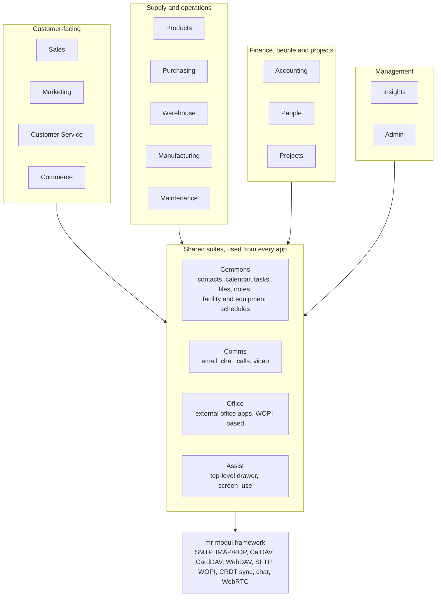

# IronStone BOSS — Design Notes

Oct 14, 2026

## Overview

IronStone BOSS (Business OS Suite) is a new application suite for the Rust-based mr-moqui framework, replacing MarbleERP and SimpleScreens rather than porting them. It is a business-in-a-box: MarbleERP's existing functionality, plus the areas that were never finished — chiefly a full groupware suite grown from the old "My Account" app, and explicit CRM instead of functionality buried in Party screens.

- **One component, many apps.** Each IronStone app is focused on a role or department and gated by authz at its root screen; screens are shared across apps wherever the same data appears (tasks, requests, contacts, communication timelines).
- **Self-hosting first.** Many target businesses, especially open-source ERP users, distrust external hosting. Running mail, files, calendar and office on their own hardware is an enabling feature, not an afterthought.
- **Framework does protocols, BOSS does UI and data mapping.** mr-moqui is becoming a web-standards processing suite (client and server for mail, file transfer, sync protocols, plus an embedded browser), so BOSS consumes those capabilities rather than implementing them.

**Public companion suite (Oct 27, 2026).** **IronStoa PASS — Public Application Software Suite**
lives in the separate `mr-pass` repository/component: Forum first, with Commerce and
Blog/Publishing as future apps. PASS supports multiple sites and local or remote Mantle access,
without a dependency on BOSS. BOSS Commerce remains the staff store/channel surface; Marketing
and Commons share publishing content and authoring services with PASS. The full Forum and shared
foundation design is [design-forum.md](../../mr-pass/plan/design-forum.md) in the `mr-pass` component.

## App map

Each app is named IronStone [Name] and gated by authz at its root screen.

Business functionality ships as role and department apps. Each is named **IronStone \<Name>** so it sits cleanly beside other apps a user has access to, and each is gated by authz at its root screen using standard Moqui patterns. The flow map from the [MarbleERP dashboard](https://github.com/moqui/MarbleERP/blob/master/screen/marble/dashboard.xml) is kept as clickable documentation of how the business flows, linking into these apps (in IronStone Insights).

| App | Primary users | Main sections |
| --- | --- | --- |
| IronStone Sales | Reps, account managers | Pipeline (leads, opportunities) · Accounts & contacts · Quotes · Orders · Agreements & price lists · Sales reports |
| IronStone Marketing | Marketing staff | Campaigns · Segments & lists · Email & newsletters · Promotions & coupons · Content (blogs, landing pages) · Surveys · Campaign analytics |
| IronStone Customer Service | Support, order desk | Cases (Requests) · Order lookup & changes · Returns / RMA · Availability lookup · Customer 360 · Knowledge base links |
| IronStone Commerce | E-commerce and channel managers | Stores & channels · Merchandising (categories, product content, SEO) · Online orders & carts · Channel and marketplace integrations · Shipping, payment & tax settings |
| IronStone Products | Product and catalog managers | Products & variants · Categories · Features & attributes · Pricing & costs · Product suppliers · Product documents |
| IronStone Purchasing | Buyers | Suppliers · Purchase requests · RFQs & supplier quotes · Purchase orders · Replenishment · Supplier returns · Supplier performance |
| IronStone Warehouse | Warehouse staff, fulfillment | Receiving (inbound, put-away, inspection) · Shipping (pick, pack, ship, carriers) · Inventory (stock by location, counts, adjustments, transfers) · Returns receiving · Locations & facility setup |
| IronStone Manufacturing | Production planners, shop floor | Work orders and production runs · BOMs & routings · Planning (MRP) · Shop floor (material issue, time) |
| IronStone Maintenance | Facilities and equipment managers | Facilities · Equipment & assets · Maintenance work orders · Facility and equipment scheduling admin |
| IronStone Accounting | Finance, bookkeepers | Receivables & collections · Payables & payment runs · Banking & reconciliation · General ledger & period close · Tax · Budgets · Financial reports |
| IronStone People | HR, managers | Employees & org structure · Positions & recruiting · Time & leave · Payroll · Skills & training · Reviews |
| IronStone Projects | Project managers, services staff | Projects & milestones · Tasks · Timesheets · Resource scheduling · Time and materials billing · Request intake |
| IronStone Insights | Owners, management | Dashboards & KPIs · Report builder · Saved reports · Business flow map (clickable documentation) |
| IronStone Admin | System admins | Users, groups & permissions · Organizations & settings · Integrations & system messages · Data import and export |

### Shared business screens

The same underlying screens appear in several apps, configured by context (app, role, allowed actions), so most apps are mainly navigation, landing dashboards and a few task-specific screens.

- **Inventory:** full counts, adjustments and moves in Warehouse; read-only availability, incoming stock and promise dates in Customer Service; shortfall and reorder views in Purchasing; inline availability on quotes and orders in Sales.
- **Shipments:** Warehouse Receiving and Shipping share the shipment, item, lot and location forms, each with its own task screens (put-away vs pick and pack); Customer Service sees tracking.
- **Customer 360:** one screen with role emphasis: pipeline (Sales), cases (Customer Service), engagement (Marketing), balance and credit (Accounting).
- **Product 360:** full editor in Products; merchandising views in Commerce; supplier and cost views in Purchasing; BOM views in Manufacturing.
- **Order detail:** one screen with role-based action sets for Sales, Customer Service, Warehouse and Accounting.
- **Facilities and assets:** full management in Maintenance; locations in Warehouse; production equipment in Manufacturing; facility and equipment schedules in Commons.

Apps map to user groups, so the app launcher shows each person only their apps; in a small business one person may hold many, so every app's landing page should stand on its own.

## UI patterns to borrow

The strongest ideas come from Odoo; the rest fill specific gaps.

| Source | Pattern | Use in BOSS |
| --- | --- | --- |
| Odoo | Chatter: message, activity and attachment timeline beside every record | Maps onto CommunicationEvent + content; an email about an order shows on the order. Shared with Comms. |
| Odoo | Activities: scheduled next actions (call, email, to-do) on any record | Rolls up into the header Today panel; covers much of what users expect from CRM |
| Odoo | Switchable views: list, kanban, calendar, pivot, graph over one dataset | Generalize in mr-moqui forms/lists so every find screen can switch views |
| Odoo | App launcher grid; status bar on forms | Module home and record lifecycle display |
| ERPNext / Frappe | Configurable workspace pages per module | Module landing pages: shortcuts, badge counts, charts, user-arrangeable |
| Twenty | Modern CRM record and pipeline UI | Reference for the Sell / CRM module |
| Nextcloud, La Suite numérique | Groupware layout: files, talk, calendar, contacts, docs | Reference for Commons & Comms |

## Commons & Comms

The expanded "My Account" becomes two adjacent modules under one suite name: **Commons** holds the shared things people work on, **Comms** holds the channels they talk through. Both sit on the same Mantle data, so a chat links to a task and an email becomes a request without crossing a boundary.

| Area | Module | Mantle basis | Notes |
| --- | --- | --- | --- |
| Contacts | Commons | Party, ContactMech, relationships | CardDAV sync |
| Calendar | Commons | WorkEffort (events) | Internal calendars plus calendars imported from upstream sources; CalDAV server for local or remote events |
| Facility & equipment schedules | Commons | Facility, Asset, WorkEffort | Schedules available to everyone; scheduling admin in IronStone Maintenance |
| Tasks / projects assigned | Commons | WorkEffort | Shared screens with IronStone Projects |
| Requests assigned | Commons | Request | Shared screens with IronStone Customer Service and Projects |
| Files | Commons | Content / resource layer | WebDAV, virtual SFTP; secure sharing |
| Notes / knowledge | Commons | Wiki, content | Wiki, notes, knowledge management; native real-time co-editing |
| Email | Comms | CommunicationEvent | SMTP send in direct or relay mode; receive per account via SMTP listener (behind a gateway) or IMAP/POP poller |
| Chat | Comms | CommunicationEvent | Matrix-style messaging with internal persistence that runs independently; also used by AI agents |
| Calls / video | Comms | CommunicationEvent, WorkEffort | WebRTC built into mr-moqui |
| Internal comm events | Comms | CommunicationEvent | Same inbox UI as email |

## Header tray and Assist

Rule for what lives in the header: **synchronous or time-bound things get a panel; async things get a count** that links into the owning module.

| Item | Kind | Contents |
| --- | --- | --- |
| Search / command palette | Panel | Extends QuickSearch: jump to any record, run any action |
| Quick create | Menu | One "+" for task, event, note, contact, request |
| Today | Panel | Extends the existing groupware summary widget: tasks due, today's events, activities, overdue items |
| Chat and presence | Panel | Synchronous messages only |
| Email and async comm events | Count | Badge linking into Comms |
| Notifications | Panel | Mentions, assignments, approvals waiting |
| Live call | Mini-window | Appears only during a call; persists across navigation |
| Assist | Panel | Always-available top-level drawer, outside the canvas (below) |

**Layout.** Assist is an always-available top-level drawer. Every other panel and dialog opened from the header (Today, chat, notifications, quick create) opens alongside it, rendered in the canvas area that Assist can see and drive with `screen_use`. The header bar itself stays outside that part of the DOM and out of Assist's reach.

**Header ownership.** Header pieces come in two kinds: elements built into the header and owned by the system, and widgets plugged in by apps (the current My Account message / calendar / task widget, per-app search). Which of them Assist can reach is deferred; this split is the starting point for that decision.

**Assist today.** Assist began as its own screen and is now an outer panel in the header, with a `screen_use` tool that works like browser-use: it can read and navigate screens but cannot click buttons that change data. That restriction is hard-coded for now and expected to become configurable.

**Write policy.** Covered by Moqui's existing, well-defined model; not an open design question for BOSS.

**Shared context plumbing.** If every screen exposes its context (current record, filters, selection) the same way, Assist, Chatter and the tray panels all use it. Because header panels render in the canvas, Assist reads and acts on them through that same context.

## Protocol layer

mr-moqui owns protocols on both sides, normalizing traffic into SystemMessage and CommunicationEvent; IronStone BOSS is a consumer of that functionality and owns only the UI and data mapping. Moqui Java already had IMAP/POP clients, SMTP sending, a lightly built embedded SMTP receiver, and SSH/SFTP as client and (virtual) server.

| Area | Client side | Server side |
| --- | --- | --- |
| Mail | IMAP/POP poller per account; SMTP send through a relay | Direct SMTP send; SMTP listener per account behind a gateway; IMAP/JMAP only if users point mail clients at BOSS |
| Calendar / contacts | Import calendars from upstream sources (e.g. Google, M365) | CalDAV / CardDAV server for internal and imported calendars, local or remote events |
| Files | Remote WebDAV / SFTP | WebDAV; virtual SFTP via SystemMessage |
| Chat | — | Matrix-style messaging with internal persistence that runs independently; usable by AI agents |
| Office | — | WOPI host |
| Real-time editing | — | CRDT sync (yrs) over websocket |
| Calls / video | — | WebRTC built into mr-moqui, available for other uses too |

### SMTP gateway reference setup

The mail equivalent of running Moqui behind a WAF is an edge gateway, similar to the current SubEtha-based setup. The gateway can be co-deployed or a remote service.

- **Reference config:** Postfix (postscreen) + Rspamd (+ ClamAV) at the edge, delivering over LMTP/SMTP to mr-moqui.
- **Supported alternatives:** Stalwart (Rust; AGPL-3.0 or commercial license; run as a separate service), Proxmox Mail Gateway (appliance with web UI), Haraka (can deliver straight to mr-moqui over HTTP).
- **On-prem placement:** for sites with blocked port 25, dynamic IPs or no PTR record, run the gateway on a small VPS and forward over WireGuard/TLS. Data stays on the business's hardware; the edge only queues mail in transit. Outbound goes through the same relay or a smarthost.
- **mr-moqui receiver contract:** accept only from configured gateway IPs; trust the gateway's Authentication-Results and spam headers; route by address (orders@, support@, personal) into SystemMessage / CommunicationEvent; leave DKIM signing to the gateway.

## Office and real-time collaboration

Office holds only external editor apps, initially WOPI-based. Native real-time co-editing for wiki, notes and Markdown belongs to Commons knowledge management, and is specified here beside the office engine.

### Native co-editing for Commons (wiki, notes, Markdown)

- **Sync:** a CRDT server inside mr-moqui. `yrs` (the Rust port of Yjs) is the chosen library (comparison below).
- **Editor:** a ProseMirror-based editor such as Tiptap or BlockNote, with Yjs bindings.
- **Storage:** use the planned multi-entry JSON document type, known to all producers and consumers. One collaborative document holds the CRDT state (source of truth while editing), a rendered Markdown or HTML snapshot written on idle or close, and metadata.
- **Consumers:** wiki search, history, diffs and anything that doesn't speak the CRDT read the snapshot; only the editor and sync server touch CRDT state. Plan periodic compaction of the update log.
- **Caveat:** rich block editors don't round-trip cleanly to plain Markdown, so the snapshot is an export, not a second editable source.

### CRDT library: yrs recommended, Loro runner-up

**Recommendation: yrs.** It is the Rust port of Yjs with the same algorithm and binary update format, so a sync server in mr-moqui talks directly to JavaScript Yjs editors in the browser. Yjs has the deepest editor ecosystem (ProseMirror, Tiptap, BlockNote, CodeMirror, Lexical bindings), and the editor is what wiki and notes depend on most.

| Criterion | yrs (Yjs) | Loro |
| --- | --- | --- |
| Rust server side | Native crate; wire-compatible with JS Yjs | Native Rust core; JS via WASM |
| Editor bindings | Mature: y-prosemirror, Tiptap, BlockNote, CodeMirror, Lexical | Early: loro-prosemirror |
| Maturity | De facto standard for collaborative editors | 1.0 in 2024; newer, smaller community |
| Strengths | Ecosystem; proven in production | Faster; 2–5x smaller encoding; rich-text marks and movable-tree CRDTs |
| Best fit | Wiki, notes and Markdown co-editing now | Hierarchies with concurrent moves (outlines, folders) |

**Why not Automerge.** It aims at general JSON-document sync, and its ProseMirror binding is still alpha.

**Revisit trigger.** Re-evaluate Loro if concurrent tree moves or rich version browsing become central. The dual-format storage keeps a later switch contained to the editor and sync server.

Sources: [Yjs vs Automerge vs Loro (pkgpulse, 2026)](https://www.pkgpulse.com/guides/yjs-vs-automerge-vs-loro-crdt-libraries-2026), [yrs on docs.rs](https://docs.rs/crate/yrs/^0.2)

### Office suite via WOPI

Implement a WOPI host in BOSS once and keep the engine swappable.

| Engine | License | Notes |
| --- | --- | --- |
| Collabora Online (default) | MPL-2.0 | LibreOffice-based; strong ODF; 26.04 added Markdown support and a browser AI assistant |
| OnlyOffice | AGPL-3.0, open core + commercial | Best Microsoft-format fidelity; 9.4 removed the 20-connection cap; licensing disputes in 2026 |
| Euro-Office | Fork of OnlyOffice | March 2026 fork by a European consortium; watch for maturity |

### Moonshot: embedded ArtCraft WASM apps

An alternative to WOPI that is not yet fully viable, and does not change the WOPI decision. Instead of an external editor server, BOSS would embed the WASM distributions of the ArtCraft applications and run them in the browser, with files read and written through BOSS storage.

- Typical office apps: WordCraft, GridCraft, DeckCraft.
- Apps that would be very useful to typical Moqui users: PdfCraft, CADCraft, PhotoCraft.
- Other ArtCraft apps, or other browser-WASM-compatible apps, may turn out well too.
- Benefits to evaluate: no editor server to run, client-side editing, one embedding pattern for many app types.
- To verify before committing: maturity, licensing, file-format fidelity, and how embedded apps would load and save through BOSS storage (a WOPI-like or direct file API).

## Decisions and open questions

### Decided

| Decision | Notes |
| --- | --- |
| Single component, multiple apps, shared screens | Inventory, shipments, Customer 360, Product 360, orders, tasks, requests and Chatter as reusable sub-screens with context parameters |
| Business apps are role and department based | 14 apps, each named IronStone \<Name> and gated by authz at its root screen (standard Moqui patterns) |
| Marble's flow map becomes clickable documentation | Lives in IronStone Insights, linking into the apps |
| IronStone Maintenance for facilities and equipment | Includes facility and equipment scheduling admin; facility and asset functions also appear in other apps in role-specific forms |
| Groupware becomes Commons & Comms | Things vs conversations, shared data |
| Notes and knowledge live in Commons | Office is external editor apps only, initially WOPI-based |
| Facility and equipment schedules live in Commons | Admin of those schedules in IronStone Maintenance |
| Protocols live in mr-moqui; IronStone BOSS is a consumer | Client and server sides, normalized to SystemMessage / CommunicationEvent |
| Email supports both modes | SMTP send direct or via relay; receive per account via SMTP listener or IMAP/POP poller |
| Calendar supports both directions | Internal and imported upstream calendars; CalDAV server for local or remote events |
| Chat uses Matrix-style persistence | Runs independently; also serves AI agent messaging |
| WebRTC is built into mr-moqui | Powers calls and video; available for other uses |
| SMTP receive goes through an edge gateway | Postfix + Rspamd reference; co-deployed or remote |
| WOPI for docs, sheets, slides | Collabora default, engine swappable |
| Collaborative docs store CRDT state and a rendered snapshot | Multi-entry JSON document type |
| CRDT library: yrs | Yjs-compatible; Loro is the runner-up |
| Assist is an always-available top-level drawer | Header panels and dialogs open beside it in the canvas Assist controls; the header bar stays outside Assist's reach |
| Assist `screen_use` is read-only for now | Writes governed by Moqui's existing policy model |

### Open

- [ ] Is the ArtCraft WASM embedding viable as an alternative or complement to WOPI?
- [ ] Which header elements can Assist reach? Start from the split between system-owned header elements and app plugin widgets (My Account widget, per-app search).
